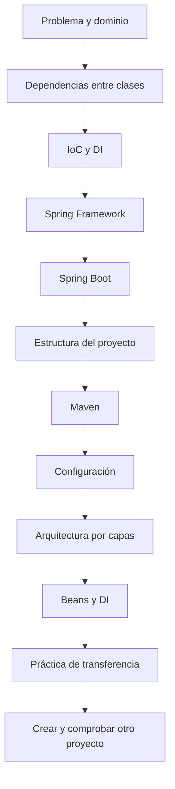

# Bloque 01 — Fundamentos

Este bloque responde dos preguntas esenciales:

> **¿Por qué existe Spring y cómo se organiza una aplicación Spring Boot?**

> **¿Cómo puedo reproducir esa base en un proyecto distinto de PetMatch?**

No empezamos memorizando anotaciones. Primero entendemos el problema, después observamos cómo Spring lo resuelve y finalmente reproducimos una versión pequeña en otro dominio.

---

## Qué aprenderás en este bloque

Al terminar Fundamentos deberías poder:

- describir un dominio antes de pensar en el framework;
- distinguir actores, conceptos, reglas y estados;
- explicar dependencia, acoplamiento, IoC y Dependency Injection;
- diferenciar Spring Framework de Spring Boot;
- crear un proyecto Maven + Java desde Spring Initializr;
- reconocer la clase con `@SpringBootApplication`;
- comprobar el JDK con `java -version`;
- ejecutar el proyecto con Maven Wrapper;
- explicar qué hacen `test`, `clean`, `package` y `spring-boot:run`;
- reconocer qué genera Initializr y qué estructura agrega el desarrollador;
- leer un `pom.xml` sin reducir Maven a “descargar librerías”;
- diferenciar dependency, plugin, starter, scope y dependencia transitiva;
- leer `application.yaml` y utilizar variables de entorno;
- configurar un puerto distinto y comprobar el resultado;
- separar Controller, Service y Repository por responsabilidad;
- distinguir Entity, DTO y View;
- aplicar constructor injection;
- explicar cómo component scanning encuentra componentes;
- explicar cómo un Repository interface llega a ser inyectable;
- registrar y consumir un Bean creado con `@Bean`;
- reproducir Controller → Service mediante DI en una aplicación distinta.

---

## Prerrequisitos

Basta con comprender en Java:

- clase;
- objeto;
- constructor;
- método;
- atributo;
- interfaz a nivel básico.

También debes tener un JDK compatible con el proyecto que vayas a ejecutar.

No necesitas conocer Spring previamente.

Si todavía no has leído la guía general:

**[Cómo usar este libro](../00-como-usar-este-libro.md)**

---

## Capítulos

1. [PetMatch y el problema](01-petmatch-y-el-problema.md)
2. [Antes de Spring](02-antes-de-spring.md)
3. [Spring y Spring Boot](03-spring-y-spring-boot.md)
4. [Estructura del proyecto](04-estructura-del-proyecto.md)
5. [Maven y dependencias](05-maven-y-dependencias.md)
6. [Configuración y `application.yaml`](06-configuracion-y-application-yaml.md)
7. [Arquitectura por capas](07-arquitectura-por-capas.md)
8. [Inyección de dependencias en PetMatch](08-inyeccion-de-dependencias.md)

Después de los capítulos 01–08 completa:

**[Práctica de transferencia — crea una aplicación Spring Boot desde cero](practica-transferencia-fundamentos.md)**

Los capítulos 01–08 explican los conceptos con profundidad usando PetMatch. La práctica no los reemplaza: los convierte en un procedimiento para demostrar que puedes trasladarlos a otra aplicación.

---

## Dos recorridos simultáneos

Durante este bloque estudiarás dos proyectos conceptualmente:

```text
PetMatch
→ aplicación real del repositorio
```

Y:

```text
proyecto propio de práctica
→ aplicación pequeña donde reproduces los mecanismos
```

Ejemplo usado en la práctica de transferencia:

```text
BookShelf
BookController
BookService
```

Ese ejemplo no pretende convertirse en otro proyecto completo del curso. Solo sirve para demostrar que puedes trasladar una idea fuera de PetMatch.

---

## Recorrido mental



---

## Comandos que deberías comprender al terminar

### Comprobar Java

```bash
java -version
```

### Ejecutar tests

Linux/macOS/WSL:

```bash
./mvnw test
```

Windows:

```powershell
.\mvnw.cmd test
```

### Arrancar Spring Boot

```bash
./mvnw spring-boot:run
```

Windows:

```powershell
.\mvnw.cmd spring-boot:run
```

### Limpiar y empaquetar

```bash
./mvnw clean package
```

Debes poder explicar **qué hace cada comando**, no solamente copiarlo.

---

## Archivos que deberías reconocer

En PetMatch:

```text
pom.xml
.mvn/wrapper/maven-wrapper.properties
src/main/resources/application.yaml
src/main/java/com/petmatch/community/PetMatchCommunityApplication.java
src/main/java/com/petmatch/community/config/SecurityConfig.java
src/main/java/com/petmatch/community/controller/PetController.java
src/main/java/com/petmatch/community/controller/api/PetRestController.java
src/main/java/com/petmatch/community/service/PetService.java
src/main/java/com/petmatch/community/service/UserService.java
src/main/java/com/petmatch/community/repository/PetRepository.java
src/main/java/com/petmatch/community/model/Pet.java
```

En un proyecto recién generado deberías reconocer al menos:

```text
pom.xml
mvnw
mvnw.cmd
src/main/java/...Application.java
src/main/resources/application.properties o application.yaml
src/test/java/
```

---

## Regla de estudio

Cuando encuentres:

```java
@Controller
@Service
@Bean
@SpringBootApplication
```

no preguntes primero:

> “¿Qué debo copiar?”

Pregunta:

> **¿Qué responsabilidad representa, quién crea ese objeto y cómo se conecta con el resto?**

---

## Actividad de cierre A — Explica PetMatch

Abre:

```text
PetMatchCommunityApplication.java
PetController.java
PetRestController.java
PetService.java
PetRepository.java
UserService.java
SecurityConfig.java
application.yaml
pom.xml
```

Explica:

1. cómo arranca PetMatch;
2. qué papel tiene Maven;
3. dónde obtiene configuración de DB;
4. quién recibe `/pets`;
5. quién recibe `/api/v1/pets`;
6. qué Service comparten;
7. qué dependencias tiene `PetService`;
8. cómo llega `PasswordEncoder` a `UserService`;
9. por qué `PetRepository` puede inyectarse aunque sea interfaz;
10. qué piezas pertenecen a presentación, negocio y persistencia.

---

## Actividad de cierre B — Demuestra transferencia

Sigue completa la:

**[Práctica de transferencia — crea una aplicación Spring Boot desde cero →](practica-transferencia-fundamentos.md)**

Allí deberás:

1. generar otro proyecto con Spring Initializr;
2. comprobar Java;
3. ejecutar tests y build;
4. reconocer lo que generó Initializr;
5. configurar un puerto;
6. crear un Service;
7. crear un Controller con constructor injection;
8. comprobar el endpoint;
9. provocar un fallo de Bean de forma controlada;
10. explicar qué hizo Spring y qué construiste tú.

Si puedes hacerlo sin copiar `PetService`, el bloque ya está cumpliendo su objetivo de transferencia.

---

## Resultado esperado

Al finalizar deberías poder construir mentalmente y operacionalmente esta secuencia:

```text
problema
↓
proyecto Spring Boot
↓
Maven / dependencias
↓
configuración
↓
Controller
↓
Service
↓
Repository cuando exista persistencia
↓
Beans conectados por Spring
```

Y, especialmente, deberías poder reconocer el mismo esquema usando nombres de **otro dominio**.

---

## Continúa con

Empieza por:

**[Capítulo 01 — PetMatch y el problema →](01-petmatch-y-el-problema.md)**

Cuando termines los capítulos conceptuales:

**[Práctica de transferencia — crea una aplicación Spring Boot desde cero →](practica-transferencia-fundamentos.md)**

Después continúa con:

**[Bloque 02 — Dominio y persistencia →](../02-dominio-y-persistencia/README.md)**

---

[← Cómo usar este libro](../00-como-usar-este-libro.md) · [Índice general](../README.md) · [Empezar → Capítulo 01](01-petmatch-y-el-problema.md) · [Práctica de transferencia](practica-transferencia-fundamentos.md) · [Siguiente bloque → Dominio y persistencia](../02-dominio-y-persistencia/README.md)
