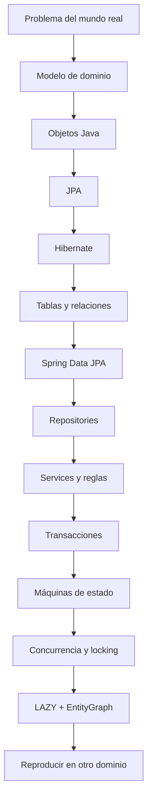
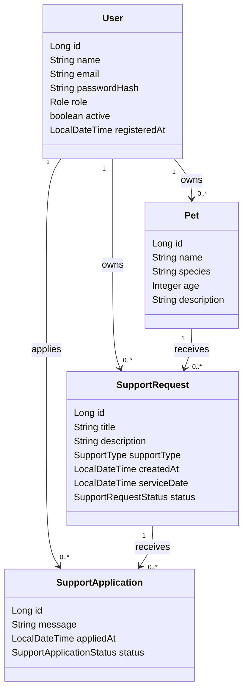

# Bloque 02 — Dominio y persistencia

En el bloque anterior aprendimos a orientarnos dentro de PetMatch Community: qué problema resuelve Spring, cómo arranca Spring Boot, cómo Maven declara dependencias, cómo se configura la aplicación y cómo colaboran Controller, Service y Repository mediante inyección de dependencias.

Este bloque responde dos preguntas:

> **¿Cómo pasan los objetos Java del dominio a persistirse en una base de datos relacional y cómo mantenemos consistentes sus reglas incluso cuando existen estados, relaciones y concurrencia?**

> **¿Cómo aplico esos mismos mecanismos en una aplicación distinta de PetMatch?**

La secuencia no empieza memorizando `JpaRepository`. Primero entiende **qué información representa el sistema**, después cómo se mapea, cómo se relaciona, cómo se consulta, dónde se aplican las reglas y qué mecanismos mantienen consistencia.

Los capítulos 09–17 estudian esas ideas con código real de PetMatch. Al finalizar, una práctica transversal las aplica a un dominio distinto llamado `BookShelf`.

---

## Qué aprenderás en este bloque

Al terminar Dominio y persistencia deberías poder:

- explicar qué es un modelo de dominio;
- distinguir dominio, modelo Java/JPA y modelo relacional;
- explicar qué son JPA, Hibernate y ORM y cómo se relacionan;
- utilizar `@Entity`, `@Table`, `@Id`, `@GeneratedValue` y `@Column` con una razón concreta;
- modelar relaciones many-to-one y one-to-many;
- explicar el lado propietario de una relación JPA y `mappedBy`;
- utilizar `@JoinColumn` y reconocer la foreign key resultante;
- distinguir cardinalidad de cascade;
- explicar qué significa `FetchType.LAZY`;
- crear interfaces `JpaRepository`;
- distinguir métodos heredados, query derivation y `@Query` con JPQL;
- utilizar `Optional`, `existsBy...` y `countBy...` con propósito;
- ubicar reglas de negocio en Services en lugar de Controllers o Repositories;
- explicar cómo se protege ownership y estado en PetMatch;
- definir un límite transaccional con `@Transactional`;
- explicar persistence context y dirty checking;
- explicar commit, rollback y flush;
- representar una máquina de estados y sus guardas;
- detectar una posible race condition;
- explicar por qué `@Transactional` no resuelve por sí solo toda concurrencia;
- justificar `PESSIMISTIC_WRITE` sobre un recurso compartido;
- distinguir pessimistic de optimistic locking;
- explicar por qué PetMatch no utiliza `@Version`;
- trabajar con `open-in-view: false`;
- utilizar `@EntityGraph` para preparar relaciones concretas;
- reconocer el problema N+1 sin convertir todas las relaciones a EAGER;
- trasladar esas decisiones a un dominio distinto como préstamos de biblioteca.

---

## Prerrequisitos

Antes de comenzar este bloque deberías comprender:

- [arquitectura por capas](../01-fundamentos/07-arquitectura-por-capas.md);
- [inyección de dependencias](../01-fundamentos/08-inyeccion-de-dependencias.md);
- [configuración con `application.yaml`](../01-fundamentos/06-configuracion-y-application-yaml.md);
- [Maven y dependencias](../01-fundamentos/05-maven-y-dependencias.md);
- [práctica de transferencia de Fundamentos](../01-fundamentos/practica-transferencia-fundamentos.md).

También es útil tener nociones básicas de SQL:

```text
tabla
fila
columna
primary key
foreign key
UNIQUE
NOT NULL
SELECT / INSERT / UPDATE / DELETE
```

No necesitas conocer JPA ni Hibernate previamente.

---

## Capítulos

1. [09 — Modelo de dominio](09-modelo-de-dominio.md)
2. [10 — JPA y Hibernate](10-jpa-y-hibernate.md)
3. [11 — Relaciones JPA](11-relaciones-jpa.md)
4. [12 — Spring Data JPA](12-spring-data-jpa.md)
5. [13 — Service y reglas de negocio](13-service-y-reglas-de-negocio.md)
6. [14 — Transacciones y consistencia](14-transacciones-y-consistencia.md)
7. [15 — Máquinas de estado](15-maquinas-de-estado.md)
8. [16 — Concurrencia y locking](16-concurrencia-y-locking.md)
9. [17 — Lazy loading y `EntityGraph`](17-lazy-loading-y-entitygraph.md)

Después de los capítulos:

**[Práctica de transferencia — dominio y persistencia con JPA](practica-transferencia-dominio-persistencia.md)**

---

## Dos recorridos simultáneos

Durante el bloque trabajarás con dos dominios.

### PetMatch

Código real del repositorio:

```text
User
Pet
SupportRequest
SupportApplication
```

Sirve para estudiar una implementación completa y sus decisiones reales.

### BookShelf

Proyecto secundario de práctica:

```text
Category
Book
LibraryUser
Loan
```

Sirve para demostrar que puedes reproducir el patrón sin copiar el dominio PetMatch.

> [!IMPORTANT]
> La práctica no intenta convertir `BookShelf` en un clon de PetMatch. Los dominios tienen reglas distintas. Lo que se transfiere son los conceptos y mecanismos.

---

## El recorrido mental del bloque



La secuencia es deliberada: cada mecanismo técnico aparece después del problema que lo hace necesario.

---

# El dominio de PetMatch

El núcleo persistente está formado por cuatro Entities:

```text
User
Pet
SupportRequest
SupportApplication
```

Y cuatro enums:

```text
Role
SupportType
SupportRequestStatus
SupportApplicationStatus
```

Rutas:

```text
src/main/java/com/petmatch/community/model/
src/main/java/com/petmatch/community/model/enums/
```

---

## Mapa de entidades



> [!IMPORTANT]
> **Cardinalidad y cascade son conceptos diferentes.** Las Entities de PetMatch no declaran `cascade` explícito en estas asociaciones.

---

# Del modelo al caso de uso

```mermaid
flowchart TD
    A[Controller MVC / REST] --> B[Service]
    B --> C[Reglas de negocio]
    B --> D[@Transactional]
    B --> E[Repository]
    E --> F[Spring Data JPA]
    F --> G[JPA / Hibernate]
    G --> H[MySQL]
```

Aceptar una postulación, por ejemplo, no es simplemente un `UPDATE`:

```text
validar owner
→ recuperar application
→ bloquear request compartida
→ validar request OPEN
→ validar application PENDING
→ comprobar que no exista otra ACCEPTED
→ selected ACCEPTED
→ request IN_PROGRESS
→ otras PENDING REJECTED
```

Ese caso conecta prácticamente todos los conceptos del bloque.

En la práctica de transferencia, el caso equivalente como problema técnico —no como dominio— será prestar un libro:

```text
recuperar y bloquear Book
→ validar AVAILABLE
→ comprobar ausencia de Loan ACTIVE
→ Book LOANED
→ crear Loan ACTIVE
→ commit
```

---

# Repositories de PetMatch

```text
repository/UserRepository.java
repository/PetRepository.java
repository/SupportRequestRepository.java
repository/SupportApplicationRepository.java
```

Todos extienden `JpaRepository` y combinan, según el caso:

```text
métodos heredados
queries derivadas
exists/count
@EntityGraph
@Query
@Lock
```

Consulta el [capítulo 12](12-spring-data-jpa.md).

---

# Services de PetMatch

```text
service/UserService.java
service/PetService.java
service/SupportRequestService.java
service/SupportApplicationService.java
```

El [capítulo 13](13-service-y-reglas-de-negocio.md) muestra reglas como:

- email no duplicado;
- ownership de mascotas/solicitudes;
- no borrar mascotas con solicitudes;
- no postularse a una solicitud propia;
- no duplicar postulaciones;
- editar/cancelar solo `OPEN`;
- completar solo `IN_PROGRESS`;
- aceptar una sola postulación y rechazar las demás pendientes.

La práctica de transferencia exige que el aprendiz escriba reglas distintas, por ejemplo:

```text
solo AVAILABLE puede prestarse
no puede existir otro Loan ACTIVE para el mismo Book
solo ACTIVE puede devolverse
```

---

# Transacciones, estados y concurrencia

El [capítulo 14](14-transacciones-y-consistencia.md) conecta `@Transactional` con:

```text
persistence context
dirty checking
commit
rollback
flush
constraints
```

El [capítulo 15](15-maquinas-de-estado.md) formaliza:

```text
SupportRequest:
OPEN → IN_PROGRESS → COMPLETED
OPEN → CANCELLED

SupportApplication:
PENDING → ACCEPTED
PENDING → REJECTED
```

El [capítulo 16](16-concurrencia-y-locking.md) explica por qué aceptar una postulación necesita además:

```text
@Lock(PESSIMISTIC_WRITE)
```

sobre la `SupportRequest` compartida.

> [!IMPORTANT]
> PetMatch no utiliza `@Version`; el modelo no implementa optimistic locking.

En `BookShelf`, el recurso compartido será `Book`, lo que obliga al aprendiz a identificar **qué objeto recibe la competencia** en vez de copiar el nombre `SupportRequest`.

---

# LAZY, open-in-view y EntityGraph

Configuración:

```yaml
spring:
  jpa:
    open-in-view: false
```

Las asociaciones `ManyToOne` principales están configuradas como `LAZY`, y los `OneToMany` usan el default lazy de JPA.

El [capítulo 17](17-lazy-loading-y-entitygraph.md) muestra cómo los repositories preparan relaciones específicas mediante `@EntityGraph`.

Ejemplos:

```text
SupportRequest
→ pet
→ owner
```

Y para applications:

```text
applicant
supportRequest
supportRequest.pet
supportRequest.owner
```

Esto permite que las vistas consuman datos ya preparados sin depender de una sesión JPA abierta durante Thymeleaf.

La práctica repite el mecanismo con una consulta distinta:

```text
Loan
→ book
→ book.category
→ borrower
```

---

# Tres niveles que no debemos confundir

## 1. Dominio

```text
usuario
mascota
solicitud
postulación
```

## 2. Modelo Java/JPA

```text
User
Pet
SupportRequest
SupportApplication
```

## 3. Modelo relacional

```text
users
pets
support_requests
support_applications
```

ORM conecta estos niveles; no los vuelve idénticos.

En `BookShelf` deberías poder construir la misma traducción con otros nombres:

```text
libro / préstamo
↓
Book / Loan
↓
books / loans
```

---

# Tecnologías que no forman parte de este bloque

PetMatch no utiliza aquí:

- MongoDB;
- Redis;
- Flyway;
- Liquibase;
- Testcontainers;
- Hibernate Envers;
- segunda caché de Hibernate;
- soft delete automático;
- `CascadeType.ALL`;
- orphan removal;
- optimistic locking con `@Version`;
- Spring Statemachine;
- repositories JDBC escritos manualmente;
- múltiples datasources;
- perfiles específicos de DB para test;
- tests concurrentes reales del lock.

La práctica de transferencia tampoco agrega esas tecnologías solo para ampliar alcance.

---

# Cómo estudiar este bloque

Para cada capítulo:

1. abre los archivos indicados;
2. localiza el fragmento real de PetMatch;
3. traduce entre objeto Java y SQL mental;
4. identifica qué parte es persistencia y qué parte es regla;
5. sigue el caso de uso desde Service hacia Repository;
6. identifica el límite transaccional;
7. reconstruye estados y guardas;
8. pregunta si existe una carrera concurrente;
9. revisa qué asociaciones debe cargar la operación;
10. ejecuta las actividades y preguntas de comprobación;
11. completa el checkpoint equivalente de la práctica `BookShelf`.

La práctica está organizada con checkpoints 09–17 para que cada capítulo tenga una comprobación de transferencia.

---

# Resultado esperado A — explicar PetMatch

Deberías poder abrir `SupportApplicationService.accept(...)` y explicar:

```text
por qué está en Service
qué ownership valida
qué estados exige
qué repositories necesita
por qué es @Transactional
por qué bloquea SupportRequest
qué protege el count de ACCEPTED
qué cambios dependen de dirty checking
por qué otras PENDING pasan a REJECTED
qué relaciones llegan cargadas mediante EntityGraph
qué ocurriría si dos transacciones compitieran
```

Y deberías poder abrir una pantalla Thymeleaf que navega `request.pet.name` y rastrear qué Repository preparó esa relación antes de terminar la transacción.

---

# Resultado esperado B — demostrar transferencia

Sin copiar clases de PetMatch deberías poder construir en `BookShelf`:

```text
Category
Book
LibraryUser
Loan
↓
JpaRepository
↓
LoanService
↓
@Transactional
↓
Book AVAILABLE → LOANED
Loan ACTIVE
↓
PESSIMISTIC_WRITE sobre Book
↓
@EntityGraph para detalles de Loan
```

Y explicar:

```text
por qué esas son las Entities
qué foreign keys existen
qué reglas pertenecen al Service
qué cambios deben compartir transacción
qué recurso recibe competencia concurrente
por qué se bloquea ese recurso
qué relaciones permanecen LAZY
qué consulta necesita EntityGraph
```

Si puedes hacerlo usando nombres y reglas de otro dominio, ya no estás memorizando PetMatch: estás comprendiendo el patrón.

---

# Comienza aquí

**[Capítulo 09 — Modelo de dominio →](09-modelo-de-dominio.md)**

Después de completar los capítulos 09–17:

**[Práctica de transferencia — dominio y persistencia con JPA →](practica-transferencia-dominio-persistencia.md)**

---

[← Bloque 01 — Fundamentos](../01-fundamentos/README.md) · [Índice general](../README.md) · [Siguiente → Capítulo 09](09-modelo-de-dominio.md)