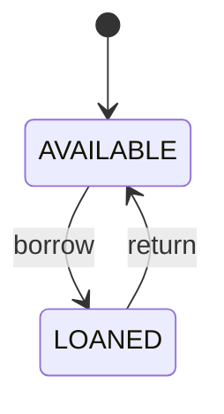
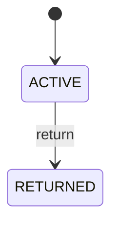

# Práctica de transferencia — dominio y persistencia con JPA

Esta práctica acompaña los capítulos 09–17 y continúa el proyecto `BookShelf` iniciado en la práctica de Fundamentos.

No reemplaza los capítulos conceptuales de PetMatch. Su propósito es comprobar una habilidad distinta:

> **¿Puedes tomar las ideas de dominio, JPA, Repository, Service, transacciones, estados, locking y carga de relaciones y aplicarlas en una aplicación diferente?**

El recorrido utiliza un dominio de biblioteca porque obliga a pensar en relaciones y reglas diferentes de las de PetMatch.

---

## Qué vas a construir

Al terminar tendrás una base persistente con:

```text
Category
Book
LibraryUser
Loan
```

El flujo principal será:

```text
crear Category
→ registrar Book disponible
→ registrar LibraryUser
→ prestar Book
→ Book AVAILABLE → LOANED
→ Loan ACTIVE
→ devolver Loan
→ Loan ACTIVE → RETURNED
→ Book LOANED → AVAILABLE
```

No implementaremos todavía:

- login;
- roles;
- autorización HTTP;
- Thymeleaf;
- formularios web;
- API REST completa.

Esos temas pertenecen a bloques posteriores.

---

# 1. Relación con los capítulos 09–17

| Capítulo | Concepto | Aplicación en `BookShelf` |
|---|---|---|
| 09 | modelo de dominio | `Category`, `Book`, `LibraryUser`, `Loan` y sus reglas |
| 10 | JPA/Hibernate | convertir clases en Entities persistentes |
| 11 | relaciones JPA | `Book → Category`, `Loan → Book`, `Loan → LibraryUser` |
| 12 | Spring Data JPA | crear Repositories y queries por nombre |
| 13 | Service y reglas | impedir préstamos inválidos y coordinar operaciones |
| 14 | transacciones | cambiar `Book` y crear/actualizar `Loan` como una unidad |
| 15 | máquinas de estado | `AVAILABLE/LOANED` y `ACTIVE/RETURNED` |
| 16 | concurrencia/locking | impedir dos préstamos simultáneos del mismo libro |
| 17 | LAZY/EntityGraph | cargar detalles de préstamos sin depender de Open Session in View |

La práctica sigue ese mismo orden.

---

# 2. Punto de partida

Debes tener el proyecto creado en la práctica anterior con una estructura semejante a:

```text
bookshelf/
├── pom.xml
├── mvnw
├── mvnw.cmd
└── src/
    ├── main/
    │   ├── java/com/example/bookshelf/
    │   └── resources/
    └── test/
```

Antes de continuar comprueba:

```bash
java -version
./mvnw test
```

En Windows:

```powershell
java -version
.\mvnw.cmd test
```

No avances si el proyecto base ya falla.

---

# 3. Añade persistencia al proyecto

En `pom.xml` necesitas las capacidades equivalentes a las que PetMatch utiliza para JPA y MySQL.

Dependencia JPA:

```xml
<dependency>
    <groupId>org.springframework.boot</groupId>
    <artifactId>spring-boot-starter-data-jpa</artifactId>
</dependency>
```

Driver MySQL:

```xml
<dependency>
    <groupId>com.mysql</groupId>
    <artifactId>mysql-connector-j</artifactId>
    <scope>runtime</scope>
</dependency>
```

Después ejecuta:

```bash
./mvnw test
```

Si Maven no puede resolver una clase JPA, revisa primero:

```text
pom.xml
→ dependencia
→ scope
→ imports
```

No agregues versiones arbitrarias si Spring Boot ya las administra.

---

# 4. Crea una base MySQL propia

No reutilices la base de PetMatch.

Ejemplo:

```sql
CREATE DATABASE bookshelf
CHARACTER SET utf8mb4
COLLATE utf8mb4_unicode_ci;
```

Configura variables de entorno.

Linux/macOS/WSL:

```bash
export DB_URL="jdbc:mysql://localhost:3306/bookshelf"
export DB_USERNAME="root"
export DB_PASSWORD="TU_PASSWORD_LOCAL"
```

Windows PowerShell:

```powershell
$env:DB_URL="jdbc:mysql://localhost:3306/bookshelf"
$env:DB_USERNAME="root"
$env:DB_PASSWORD="TU_PASSWORD_LOCAL"
```

---

# 5. Configura `application.yaml`

Si tu proyecto tiene `application.properties`, puedes conservarlo o sustituirlo por `application.yaml`.

Para esta práctica utilizaremos:

```text
src/main/resources/application.yaml
```

Contenido mínimo:

```yaml
spring:
  application:
    name: bookshelf

  datasource:
    url: ${DB_URL}
    username: ${DB_USERNAME}
    password: ${DB_PASSWORD}

  jpa:
    hibernate:
      ddl-auto: update
    open-in-view: false
```

> [!IMPORTANT]
> `ddl-auto: update` se utiliza aquí por conveniencia didáctica, igual que en PetMatch. No convierte el proyecto en una aplicación con migraciones controladas.

Comprueba que la aplicación puede arrancar:

```bash
./mvnw spring-boot:run
```

Un error de conexión en este punto suele pertenecer a:

```text
URL JDBC
usuario DB
password DB
servidor MySQL
base inexistente
driver
```

No a una regla de negocio.

---

# 6. Antes de escribir `@Entity`: modela el dominio

No empieces con anotaciones.

Escribe primero los conceptos.

## `Category`

Representa una categoría de libros.

Ejemplos:

```text
Backend
Bases de datos
Arquitectura
```

## `Book`

Representa un libro que puede prestarse.

Datos iniciales:

```text
title
isbn
status
category
```

## `LibraryUser`

Representa una persona que puede recibir un préstamo.

Para este bloque solo necesitamos:

```text
name
email
```

> [!NOTE]
> `LibraryUser` todavía no representa autenticación. Login, `UserDetailsService`, roles y credenciales se estudiarán en Seguridad.

## `Loan`

Representa el préstamo de un libro a una persona.

Datos:

```text
book
borrower
borrowedAt
dueAt
returnedAt
status
```

---

# 7. Define las reglas antes de persistir

Escribe estas reglas en lenguaje natural:

```text
R1. Un Book pertenece a una Category.
R2. Un Loan pertenece a un Book y a un LibraryUser.
R3. Solo un Book AVAILABLE puede prestarse.
R4. Un Book prestado pasa a LOANED.
R5. Al crear el préstamo, Loan inicia ACTIVE.
R6. Solo un Loan ACTIVE puede devolverse.
R7. Al devolverlo, Loan pasa a RETURNED.
R8. Al devolverlo, Book vuelve a AVAILABLE.
R9. No debe existir más de un Loan ACTIVE para el mismo Book.
```

Todavía no has escrito JPA, pero ya sabes qué comportamiento debe proteger el sistema.

Ese orden importa:

```text
problema
→ modelo
→ reglas
→ persistencia
```

no:

```text
@Entity
→ inventar dominio después
```

---

# 8. Crea los estados

Ruta sugerida:

```text
src/main/java/com/example/bookshelf/model/enums/
```

## `BookStatus.java`

```java
package com.example.bookshelf.model.enums;

public enum BookStatus {
    AVAILABLE,
    LOANED
}
```

## `LoanStatus.java`

```java
package com.example.bookshelf.model.enums;

public enum LoanStatus {
    ACTIVE,
    RETURNED
}
```

La máquina de estados será deliberadamente pequeña.

```text
Book
AVAILABLE → LOANED → AVAILABLE
```

```text
Loan
ACTIVE → RETURNED
```

Observa una diferencia:

`Book` puede volver a estar disponible en un nuevo ciclo de préstamo.

Un `Loan` concreto no vuelve de `RETURNED` a `ACTIVE`.

---

# 9. Crea `Category` como Entity

Ruta:

```text
src/main/java/com/example/bookshelf/model/Category.java
```

Ejemplo:

```java
package com.example.bookshelf.model;

import jakarta.persistence.Column;
import jakarta.persistence.Entity;
import jakarta.persistence.GeneratedValue;
import jakarta.persistence.GenerationType;
import jakarta.persistence.Id;
import jakarta.persistence.OneToMany;
import jakarta.persistence.Table;

import java.util.ArrayList;
import java.util.List;

@Entity
@Table(name = "categories")
public class Category {

    @Id
    @GeneratedValue(strategy = GenerationType.IDENTITY)
    private Long id;

    @Column(nullable = false, unique = true, length = 100)
    private String name;

    @OneToMany(mappedBy = "category")
    private List<Book> books = new ArrayList<>();

    protected Category() {
    }

    public Category(String name) {
        this.name = name;
    }

    public Long getId() {
        return id;
    }

    public String getName() {
        return name;
    }

    public List<Book> getBooks() {
        return books;
    }
}
```

Relaciona las anotaciones con conceptos:

```text
@Entity
→ JPA administra persistencia de este tipo

@Table
→ tabla asociada

@Id
→ identidad persistente

@GeneratedValue
→ estrategia de generación del id

@Column
→ restricciones/mapping de columna

@OneToMany(mappedBy = "category")
→ lado inverso de la relación
```

---

# 10. `mappedBy` no crea una segunda foreign key

La colección:

```java
@OneToMany(mappedBy = "category")
private List<Book> books;
```

indica que la relación está gobernada por el atributo:

```text
Book.category
```

La foreign key real estará del lado `Book`.

Modelo:

```text
categories
    id

books
    id
    category_id  → categories.id
```

No confundas:

```text
Category.books
```

con una nueva tabla o una nueva foreign key independiente.

---

# 11. Crea `Book`

Ruta:

```text
src/main/java/com/example/bookshelf/model/Book.java
```

```java
package com.example.bookshelf.model;

import com.example.bookshelf.model.enums.BookStatus;
import jakarta.persistence.Column;
import jakarta.persistence.Entity;
import jakarta.persistence.EnumType;
import jakarta.persistence.Enumerated;
import jakarta.persistence.FetchType;
import jakarta.persistence.GeneratedValue;
import jakarta.persistence.GenerationType;
import jakarta.persistence.Id;
import jakarta.persistence.JoinColumn;
import jakarta.persistence.ManyToOne;
import jakarta.persistence.Table;

@Entity
@Table(name = "books")
public class Book {

    @Id
    @GeneratedValue(strategy = GenerationType.IDENTITY)
    private Long id;

    @Column(nullable = false, length = 180)
    private String title;

    @Column(nullable = false, unique = true, length = 32)
    private String isbn;

    @Enumerated(EnumType.STRING)
    @Column(nullable = false, length = 20)
    private BookStatus status = BookStatus.AVAILABLE;

    @ManyToOne(fetch = FetchType.LAZY, optional = false)
    @JoinColumn(name = "category_id", nullable = false)
    private Category category;

    protected Book() {
    }

    public Book(String title, String isbn, Category category) {
        this.title = title;
        this.isbn = isbn;
        this.category = category;
    }

    public void markLoaned() {
        this.status = BookStatus.LOANED;
    }

    public void markAvailable() {
        this.status = BookStatus.AVAILABLE;
    }

    public Long getId() {
        return id;
    }

    public String getTitle() {
        return title;
    }

    public String getIsbn() {
        return isbn;
    }

    public BookStatus getStatus() {
        return status;
    }

    public Category getCategory() {
        return category;
    }
}
```

La relación propietaria es:

```java
@ManyToOne(...)
@JoinColumn(name = "category_id")
private Category category;
```

El modelo relacional queda aproximadamente:

```text
books.category_id
→ categories.id
```

---

# 12. ¿Por qué `EnumType.STRING`?

Con:

```java
@Enumerated(EnumType.STRING)
```

los valores se representan conceptualmente como:

```text
AVAILABLE
LOANED
```

No como una posición numérica implícita del enum.

La decisión hace más legible la base y reduce el acoplamiento con el orden de declaración de los valores.

---

# 13. Crea `LibraryUser`

Ruta:

```text
src/main/java/com/example/bookshelf/model/LibraryUser.java
```

```java
package com.example.bookshelf.model;

import jakarta.persistence.Column;
import jakarta.persistence.Entity;
import jakarta.persistence.GeneratedValue;
import jakarta.persistence.GenerationType;
import jakarta.persistence.Id;
import jakarta.persistence.Table;

@Entity
@Table(name = "library_users")
public class LibraryUser {

    @Id
    @GeneratedValue(strategy = GenerationType.IDENTITY)
    private Long id;

    @Column(nullable = false, length = 120)
    private String name;

    @Column(nullable = false, unique = true, length = 180)
    private String email;

    protected LibraryUser() {
    }

    public LibraryUser(String name, String email) {
        this.name = name;
        this.email = email;
    }

    public Long getId() {
        return id;
    }

    public String getName() {
        return name;
    }

    public String getEmail() {
        return email;
    }
}
```

De nuevo, no agregamos todavía:

```text
password
role
Spring Security
```

porque no son necesarios para aprender persistencia.

---

# 14. Crea `Loan`

Ruta:

```text
src/main/java/com/example/bookshelf/model/Loan.java
```

```java
package com.example.bookshelf.model;

import com.example.bookshelf.model.enums.LoanStatus;
import jakarta.persistence.Column;
import jakarta.persistence.Entity;
import jakarta.persistence.EnumType;
import jakarta.persistence.Enumerated;
import jakarta.persistence.FetchType;
import jakarta.persistence.GeneratedValue;
import jakarta.persistence.GenerationType;
import jakarta.persistence.Id;
import jakarta.persistence.JoinColumn;
import jakarta.persistence.ManyToOne;
import jakarta.persistence.Table;

import java.time.LocalDateTime;

@Entity
@Table(name = "loans")
public class Loan {

    @Id
    @GeneratedValue(strategy = GenerationType.IDENTITY)
    private Long id;

    @ManyToOne(fetch = FetchType.LAZY, optional = false)
    @JoinColumn(name = "book_id", nullable = false)
    private Book book;

    @ManyToOne(fetch = FetchType.LAZY, optional = false)
    @JoinColumn(name = "borrower_id", nullable = false)
    private LibraryUser borrower;

    @Column(nullable = false)
    private LocalDateTime borrowedAt;

    @Column(nullable = false)
    private LocalDateTime dueAt;

    private LocalDateTime returnedAt;

    @Enumerated(EnumType.STRING)
    @Column(nullable = false, length = 20)
    private LoanStatus status = LoanStatus.ACTIVE;

    protected Loan() {
    }

    public Loan(
        Book book,
        LibraryUser borrower,
        LocalDateTime borrowedAt,
        LocalDateTime dueAt
    ) {
        this.book = book;
        this.borrower = borrower;
        this.borrowedAt = borrowedAt;
        this.dueAt = dueAt;
    }

    public void markReturned(LocalDateTime returnedAt) {
        this.status = LoanStatus.RETURNED;
        this.returnedAt = returnedAt;
    }

    public Long getId() {
        return id;
    }

    public Book getBook() {
        return book;
    }

    public LibraryUser getBorrower() {
        return borrower;
    }

    public LocalDateTime getBorrowedAt() {
        return borrowedAt;
    }

    public LocalDateTime getDueAt() {
        return dueAt;
    }

    public LocalDateTime getReturnedAt() {
        return returnedAt;
    }

    public LoanStatus getStatus() {
        return status;
    }
}
```

---

# 15. Cardinalidad no significa cascade

Hasta ahora tenemos relaciones como:

```text
Category 1 → N Book
Book 1 → N Loan a lo largo del tiempo
LibraryUser 1 → N Loan
```

Eso describe **cardinalidad**.

No hemos escrito:

```java
cascade = CascadeType.ALL
```

Por tanto no debes asumir:

```text
guardar Book
→ guardar automáticamente Category nueva
```

ni:

```text
borrar Category
→ borrar Books
```

En esta práctica guarda primero los objetos que deben existir de forma independiente.

> [!IMPORTANT]
> Cardinalidad responde “¿cuántos se relacionan?”. Cascade responde “¿qué operaciones de persistencia se propagan?”. Son preguntas distintas.

---

# 16. Arranca y comprueba el esquema

Ejecuta:

```bash
./mvnw spring-boot:run
```

Con `ddl-auto: update`, Hibernate debería poder crear o adaptar las tablas necesarias según el modelo.

Desde MySQL puedes revisar:

```sql
USE bookshelf;
SHOW TABLES;
```

Deberías reconocer tablas equivalentes a:

```text
categories
books
library_users
loans
```

Luego inspecciona una tabla:

```sql
DESCRIBE books;
```

Busca:

```text
id
title
isbn
status
category_id
```

La comprobación importante es conectar:

```text
atributo Java
→ anotación JPA
→ columna / foreign key
```

---

# 17. Crea los Repositories

Ruta sugerida:

```text
src/main/java/com/example/bookshelf/repository/
```

## `CategoryRepository`

```java
package com.example.bookshelf.repository;

import com.example.bookshelf.model.Category;
import org.springframework.data.jpa.repository.JpaRepository;

import java.util.Optional;

public interface CategoryRepository
    extends JpaRepository<Category, Long> {

    Optional<Category> findByNameIgnoreCase(String name);
}
```

## `LibraryUserRepository`

```java
package com.example.bookshelf.repository;

import com.example.bookshelf.model.LibraryUser;
import org.springframework.data.jpa.repository.JpaRepository;

import java.util.Optional;

public interface LibraryUserRepository
    extends JpaRepository<LibraryUser, Long> {

    Optional<LibraryUser> findByEmailIgnoreCase(String email);
}
```

---

# 18. `BookRepository`: query derivation y locking

```java
package com.example.bookshelf.repository;

import com.example.bookshelf.model.Book;
import com.example.bookshelf.model.enums.BookStatus;
import jakarta.persistence.LockModeType;
import org.springframework.data.jpa.repository.JpaRepository;
import org.springframework.data.jpa.repository.Lock;
import org.springframework.data.jpa.repository.Query;
import org.springframework.data.repository.query.Param;

import java.util.List;
import java.util.Optional;

public interface BookRepository extends JpaRepository<Book, Long> {

    Optional<Book> findByIsbn(String isbn);

    List<Book> findByStatusOrderByTitleAsc(BookStatus status);

    @Lock(LockModeType.PESSIMISTIC_WRITE)
    @Query("select b from Book b where b.id = :bookId")
    Optional<Book> findByIdForUpdate(@Param("bookId") Long bookId);
}
```

Tres mecanismos distintos:

```text
findByIsbn
→ query derivada

findByStatusOrderByTitleAsc
→ query derivada + orden

findByIdForUpdate
→ JPQL explícito + lock pesimista
```

No conviertas todo en `@Query` por costumbre.

---

# 19. `LoanRepository`: reglas y carga de relaciones

```java
package com.example.bookshelf.repository;

import com.example.bookshelf.model.Loan;
import com.example.bookshelf.model.enums.LoanStatus;
import org.springframework.data.jpa.repository.EntityGraph;
import org.springframework.data.jpa.repository.JpaRepository;

import java.util.List;

public interface LoanRepository extends JpaRepository<Loan, Long> {

    boolean existsByBookIdAndStatus(
        Long bookId,
        LoanStatus status
    );

    @EntityGraph(attributePaths = {
        "book",
        "book.category",
        "borrower"
    })
    List<Loan> findByStatusOrderByBorrowedAtDesc(
        LoanStatus status
    );
}
```

Este Repository conecta cuatro ideas:

```text
existsBy...
→ responder una pregunta booleana de persistencia

findBy...
→ query derivada

@EntityGraph
→ preparar relaciones específicas

LAZY
→ no convertir todas las asociaciones en EAGER
```

---

# 20. Repository no decide la regla de negocio

Esta consulta:

```java
existsByBookIdAndStatus(bookId, LoanStatus.ACTIVE)
```

solo responde:

```text
¿existe un Loan ACTIVE para este Book?
```

No decide:

```text
si se debe permitir otro préstamo
```

Esa decisión pertenece al caso de uso.

Separa:

```text
Repository
→ obtener evidencia desde persistencia

Service
→ decidir según reglas
```

---

# 21. Crea excepciones del dominio

Ruta:

```text
src/main/java/com/example/bookshelf/exception/
```

Ejemplo mínimo:

```java
package com.example.bookshelf.exception;

public class LoanRuleException extends RuntimeException {

    public LoanRuleException(String message) {
        super(message);
    }
}
```

Y:

```java
package com.example.bookshelf.exception;

public class ResourceNotFoundException extends RuntimeException {

    public ResourceNotFoundException(String message) {
        super(message);
    }
}
```

No necesitamos todavía traducir estas excepciones a HTTP.

Ese problema se estudiará más adelante.

---

# 22. Crea `LoanService`

Ruta:

```text
src/main/java/com/example/bookshelf/service/LoanService.java
```

```java
package com.example.bookshelf.service;

import com.example.bookshelf.exception.LoanRuleException;
import com.example.bookshelf.exception.ResourceNotFoundException;
import com.example.bookshelf.model.Book;
import com.example.bookshelf.model.LibraryUser;
import com.example.bookshelf.model.Loan;
import com.example.bookshelf.model.enums.BookStatus;
import com.example.bookshelf.model.enums.LoanStatus;
import com.example.bookshelf.repository.BookRepository;
import com.example.bookshelf.repository.LibraryUserRepository;
import com.example.bookshelf.repository.LoanRepository;
import org.springframework.stereotype.Service;
import org.springframework.transaction.annotation.Transactional;

import java.time.LocalDateTime;

@Service
public class LoanService {

    private final BookRepository bookRepository;
    private final LibraryUserRepository libraryUserRepository;
    private final LoanRepository loanRepository;

    public LoanService(
        BookRepository bookRepository,
        LibraryUserRepository libraryUserRepository,
        LoanRepository loanRepository
    ) {
        this.bookRepository = bookRepository;
        this.libraryUserRepository = libraryUserRepository;
        this.loanRepository = loanRepository;
    }

    @Transactional
    public Loan borrowBook(
        Long bookId,
        Long borrowerId,
        LocalDateTime dueAt
    ) {
        Book book = bookRepository.findByIdForUpdate(bookId)
            .orElseThrow(() -> new ResourceNotFoundException(
                "Book not found: " + bookId
            ));

        LibraryUser borrower = libraryUserRepository.findById(borrowerId)
            .orElseThrow(() -> new ResourceNotFoundException(
                "Library user not found: " + borrowerId
            ));

        if (book.getStatus() != BookStatus.AVAILABLE) {
            throw new LoanRuleException(
                "Only an AVAILABLE book can be borrowed."
            );
        }

        if (loanRepository.existsByBookIdAndStatus(
            book.getId(),
            LoanStatus.ACTIVE
        )) {
            throw new LoanRuleException(
                "The book already has an active loan."
            );
        }

        if (dueAt == null || !dueAt.isAfter(LocalDateTime.now())) {
            throw new LoanRuleException(
                "The due date must be in the future."
            );
        }

        book.markLoaned();

        Loan loan = new Loan(
            book,
            borrower,
            LocalDateTime.now(),
            dueAt
        );

        return loanRepository.save(loan);
    }

    @Transactional
    public void returnLoan(Long loanId) {
        Loan loan = loanRepository.findById(loanId)
            .orElseThrow(() -> new ResourceNotFoundException(
                "Loan not found: " + loanId
            ));

        if (loan.getStatus() != LoanStatus.ACTIVE) {
            throw new LoanRuleException(
                "Only an ACTIVE loan can be returned."
            );
        }

        loan.markReturned(LocalDateTime.now());
        loan.getBook().markAvailable();
    }
}
```

---

# 23. Separa lo que hace cada capa

En `borrowBook(...)`:

## Repository

Responde preguntas como:

```text
¿existe Book 10?
¿existe LibraryUser 4?
¿hay un Loan ACTIVE para Book 10?
```

## Service

Decide:

```text
solo AVAILABLE puede prestarse
no puede existir otro ACTIVE
fecha de devolución debe ser futura
Book pasa a LOANED
Loan inicia ACTIVE
```

## Entity

Mantiene operaciones de estado pequeñas:

```text
book.markLoaned()
loan.markReturned(...)
```

No necesitas que todas las reglas estén dentro de una Entity para tener un modelo útil.

La decisión importante es que no terminen dispersas en Controllers o SQL accidental.

---

# 24. Configuración no es regla de negocio

Compara:

```yaml
spring:
  jpa:
    hibernate:
      ddl-auto: update
```

con:

```java
if (book.getStatus() != BookStatus.AVAILABLE) {
    throw new LoanRuleException(...);
}
```

La primera es configuración de infraestructura.

La segunda es una regla del dominio.

También compara:

```java
@Column(nullable = false, unique = true)
private String isbn;
```

con:

```text
solo un Book AVAILABLE puede prestarse
```

Una constraint de DB protege una propiedad estructural concreta.

No reemplaza todas las reglas del caso de uso.

---

# 25. ¿Por qué `@Transactional` en `borrowBook(...)`?

La operación coordina varias acciones:

```text
leer y bloquear Book
→ leer borrower
→ comprobar reglas
→ cambiar Book a LOANED
→ crear Loan ACTIVE
→ persistir Loan
→ commit
```

Queremos que sea una unidad coherente.

Si una excepción ocurre antes del commit, no queremos conservar solo una parte del proceso.

Modelo mental:

```text
begin transaction
    ↓
validar
    ↓
modificar entidades
    ↓
guardar Loan
    ↓
commit
```

Si falla:

```text
exception
→ rollback
```

---

# 26. Dirty checking: observa el `Book`

Dentro de `borrowBook(...)` hacemos:

```java
book.markLoaned();
```

pero no necesariamente:

```java
bookRepository.save(book);
```

¿Por qué puede persistirse el cambio?

Porque `book` fue recuperado dentro del contexto de persistencia de una transacción.

Es una Entity managed.

Hibernate puede detectar el cambio y generar el `UPDATE` durante flush/commit.

Este mecanismo se conoce como **dirty checking**.

> [!IMPORTANT]
> No conviertas esta idea en “nunca hay que usar save”. La pregunta correcta es si la Entity está managed dentro del contexto transaccional y qué operación estás realizando.

---

# 27. `returnLoan(...)` también es una unidad

La devolución cambia dos objetos coordinados:

```text
Loan ACTIVE → RETURNED
Book LOANED → AVAILABLE
```

Si solo uno de los dos cambios quedara persistido, el dominio sería incoherente.

Por eso el límite transaccional pertenece naturalmente al Service.

---

# 28. Formaliza la máquina de estados

## `Book`



Guardas:

```text
borrow requiere AVAILABLE
```

## `Loan`



Guarda:

```text
return requiere ACTIVE
```

No existe:

```text
RETURNED → ACTIVE
```

para el mismo préstamo.

Un nuevo préstamo debe crear otro `Loan`.

---

# 29. Estado almacenado no significa transición válida

Que Java permita escribir:

```java
loan.status = LoanStatus.RETURNED;
```

no demuestra que cualquier transición tenga sentido.

La máquina de estados vive en las reglas que controlan **cuándo** se permite cambiar.

La misma idea aparece en PetMatch con:

```text
OPEN
IN_PROGRESS
COMPLETED
CANCELLED
```

pero el dominio es distinto.

---

# 30. ¿Dónde aparece el riesgo concurrente?

Imagina dos solicitudes casi simultáneas:

```text
Transacción A
→ quiere prestar Book 10 a User A

Transacción B
→ quiere prestar Book 10 a User B
```

Ambas podrían intentar leer:

```text
Book.status = AVAILABLE
```

antes de que la otra confirme su cambio.

Una transacción por sí sola no garantiza automáticamente que ambas operaciones se serialicen sobre ese recurso compartido.

---

# 31. El recurso que compite es `Book`

La regla es:

```text
máximo un préstamo activo por Book
```

Por tanto el recurso compartido sobre el cual se coordina la decisión es:

```text
Book
```

Eso motiva:

```java
@Lock(LockModeType.PESSIMISTIC_WRITE)
```

sobre `findByIdForUpdate(...)`.

La intención es que las operaciones competidoras no tomen simultáneamente una decisión incompatible sobre el mismo Book.

---

# 32. Pessimistic locking no reemplaza las reglas

El lock no dice:

```text
Book debe estar AVAILABLE
```

ni:

```text
no debe existir Loan ACTIVE
```

El lock coordina acceso concurrente.

Las reglas siguen siendo explícitas:

```java
if (book.getStatus() != BookStatus.AVAILABLE) {
    ...
}
```

```java
if (loanRepository.existsByBookIdAndStatus(...)) {
    ...
}
```

Se combinan:

```text
transacción
+
lock
+
reglas
+
constraints
```

Cada mecanismo protege un problema diferente.

---

# 33. No agregues `@Version` a la vez

PetMatch estudia pessimistic locking y compara conceptualmente optimistic locking.

En esta práctica estamos reproduciendo el mecanismo pesimista.

No agregues también:

```java
@Version
```

solo para “tener ambos”.

Primero debes poder explicar:

```text
qué recurso bloqueas
por qué
cuándo inicia la transacción
cuándo se libera el lock
qué carrera intenta evitar
```

Optimistic locking puede estudiarse como alternativa después.

---

# 34. `FetchType.LAZY`: no cargues todo siempre

En `Book` escribimos:

```java
@ManyToOne(fetch = FetchType.LAZY)
private Category category;
```

Y en `Loan`:

```java
@ManyToOne(fetch = FetchType.LAZY)
private Book book;

@ManyToOne(fetch = FetchType.LAZY)
private LibraryUser borrower;
```

Eso expresa que esas relaciones no tienen que cargarse anticipadamente en cada consulta.

Pero aparece una nueva pregunta:

> **¿Qué pasa cuando sí necesito mostrar un préstamo con libro, categoría y persona?**

---

# 35. `open-in-view: false` cambia la responsabilidad

Configuramos:

```yaml
spring:
  jpa:
    open-in-view: false
```

Por tanto no queremos depender de que una sesión JPA permanezca abierta durante toda la renderización de una futura vista.

Las consultas del caso de uso deben preparar las relaciones que realmente necesitarán las capas superiores.

Esto evita resolver el problema mediante:

```text
hacer todo EAGER
```

---

# 36. Usa `@EntityGraph` para una consulta concreta

En `LoanRepository` declaramos:

```java
@EntityGraph(attributePaths = {
    "book",
    "book.category",
    "borrower"
})
List<Loan> findByStatusOrderByBorrowedAtDesc(
    LoanStatus status
);
```

La intención es:

```text
para esta consulta
→ necesito Loan
→ Book
→ Category del Book
→ borrower
```

No estamos cambiando globalmente las relaciones a `EAGER`.

---

# 37. LAZY y EntityGraph no son opuestos

Modelo útil:

```text
mapping por defecto
→ LAZY cuando conviene

caso de uso concreto
→ EntityGraph con relaciones necesarias
```

Así el fetch plan depende de la consulta.

La pregunta correcta no es:

> “¿LAZY o EAGER para siempre?”

Sino:

> **¿Qué relaciones necesita este caso de uso y en qué momento deben cargarse?**

---

# 38. N+1: reconoce el problema

Imagina obtener 50 préstamos y después, para cada uno, acceder a:

```text
loan.book.title
loan.borrower.name
loan.book.category.name
```

Si cada navegación lazy provoca consultas adicionales, podrías producir muchas queries pequeñas.

Ese patrón puede conducir al problema conocido como **N+1**.

Una solución no es simplemente:

```text
hacer todas las relaciones EAGER
```

porque eso puede sobrecargar otros casos de uso.

`@EntityGraph` permite preparar asociaciones según la consulta que lo necesita.

---

# 39. Ownership sin introducir todavía seguridad

Podemos modelar una consulta:

```java
List<Loan> findByBorrowerIdAndStatus(
    Long borrowerId,
    LoanStatus status
);
```

Esto responde:

```text
¿qué préstamos pertenecen a este borrower?
```

Aquí `borrowerId` es un dato explícito del caso de uso.

Todavía no estamos diciendo:

```text
borrowerId = usuario autenticado
```

porque autenticación se estudiará después.

Esta separación es importante:

```text
relación de ownership del dominio
≠
mecanismo para conocer al usuario autenticado
```

Más adelante Spring Security permitirá conectar ambas ideas.

---

# 40. Crea un método de lectura preparado

Puedes ampliar `LoanRepository`:

```java
@EntityGraph(attributePaths = {
    "book",
    "book.category",
    "borrower"
})
List<Loan> findByBorrowerIdOrderByBorrowedAtDesc(
    Long borrowerId
);
```

Y en `LoanService`:

```java
@Transactional(readOnly = true)
public List<Loan> findBorrowerLoans(Long borrowerId) {
    return loanRepository
        .findByBorrowerIdOrderByBorrowedAtDesc(borrowerId);
}
```

Ahora puedes explicar:

```text
Service define el caso de lectura
Repository define la consulta/fetch plan
EntityGraph prepara relaciones
open-in-view=false no obliga a hacer todo EAGER
```

---

# 41. Cómo comprobar persistencia sin construir todavía una UI

En esta etapa no necesitas crear formularios Thymeleaf ni una API REST completa solamente para verificar JPA.

Puedes utilizar un test de integración pequeño como **scaffold de comprobación**.

No intentaremos todavía estudiar testing en profundidad; eso pertenece al bloque de Calidad.

Ruta:

```text
src/test/java/com/example/bookshelf/PersistenceFlowTests.java
```

Ejemplo:

```java
package com.example.bookshelf;

import com.example.bookshelf.model.Book;
import com.example.bookshelf.model.Category;
import com.example.bookshelf.model.LibraryUser;
import com.example.bookshelf.model.Loan;
import com.example.bookshelf.model.enums.BookStatus;
import com.example.bookshelf.model.enums.LoanStatus;
import com.example.bookshelf.repository.BookRepository;
import com.example.bookshelf.repository.CategoryRepository;
import com.example.bookshelf.repository.LibraryUserRepository;
import com.example.bookshelf.service.LoanService;
import org.junit.jupiter.api.Test;
import org.springframework.beans.factory.annotation.Autowired;
import org.springframework.boot.test.context.SpringBootTest;
import org.springframework.transaction.annotation.Transactional;

import java.time.LocalDateTime;

import static org.junit.jupiter.api.Assertions.assertEquals;

@SpringBootTest
@Transactional
class PersistenceFlowTests {

    @Autowired
    private CategoryRepository categoryRepository;

    @Autowired
    private BookRepository bookRepository;

    @Autowired
    private LibraryUserRepository libraryUserRepository;

    @Autowired
    private LoanService loanService;

    @Test
    void borrowAndReturnKeepStatesConsistent() {
        Category category = categoryRepository.save(
            new Category("Backend")
        );

        Book book = bookRepository.save(
            new Book(
                "Spring in Practice",
                "9780000000001",
                category
            )
        );

        LibraryUser borrower = libraryUserRepository.save(
            new LibraryUser(
                "Ana Torres",
                "ana@example.com"
            )
        );

        Loan loan = loanService.borrowBook(
            book.getId(),
            borrower.getId(),
            LocalDateTime.now().plusDays(7)
        );

        assertEquals(BookStatus.LOANED, book.getStatus());
        assertEquals(LoanStatus.ACTIVE, loan.getStatus());

        loanService.returnLoan(loan.getId());

        assertEquals(BookStatus.AVAILABLE, book.getStatus());
        assertEquals(LoanStatus.RETURNED, loan.getStatus());
    }
}
```

Ejecuta:

```bash
./mvnw test
```

En Windows:

```powershell
.\mvnw.cmd test
```

---

# 42. Qué demuestra este test y qué no

Demuestra de forma básica que:

```text
contexto Spring arranca
Repositories están disponibles
Entities pueden persistirse
LoanService ejecuta el flujo
estados cambian coherentemente
```

No demuestra todavía:

```text
seguridad
HTTP
Thymeleaf
concurrencia real simultánea
EntityGraph desde una vista
```

No llames “end-to-end” a una prueba que no recorre navegador/HTTP completo.

---

# 43. Comprueba también desde MySQL

Si quieres observar datos fuera del test transaccional, crea registros mediante un flujo manual controlado o usa temporalmente una prueba sin rollback solo para explorar tu entorno local.

Después consulta:

```sql
SELECT id, title, isbn, status, category_id
FROM books;
```

```sql
SELECT id, book_id, borrower_id, status, borrowed_at, due_at, returned_at
FROM loans;
```

La finalidad es relacionar:

```text
Entity
→ estado Java
→ fila SQL
```

No uses cambios permanentes en tests compartidos solo para “ver datos”.

---

# 44. Errores frecuentes durante la práctica

## `Not a managed type`

Revisa:

```text
@Entity
package de la Entity
ubicación respecto a la clase principal
```

## `Unknown database`

La base indicada en `DB_URL` no existe.

## `Access denied`

Revisa usuario/password/permisos MySQL.

## `No qualifying bean of type ...Repository`

Revisa:

```text
interface extends JpaRepository
package escaneado
Entity válida
```

## `LazyInitializationException`

Pregunta:

```text
¿intentaste navegar una relación LAZY fuera de la transacción?
¿el caso de uso debía cargarla mediante EntityGraph?
```

No cambies automáticamente todo a EAGER.

## préstamo duplicado bajo carga

Pregunta:

```text
¿la decisión se toma dentro de una transacción?
¿se bloquea el Book compartido?
¿la regla vuelve a comprobarse después de adquirir el lock?
```

---

# 45. No hagas estas simplificaciones

## “JPA es Hibernate”

No exactamente.

```text
JPA
→ especificación/API

Hibernate
→ proveedor/implementación ORM utilizada
```

## “Repository contiene las reglas”

No. Repository consulta/persiste; Service decide casos de uso.

## “`@Transactional` evita cualquier race condition”

No. Aislamiento y concurrencia requieren analizar el recurso compartido y la estrategia de locking.

## “LAZY siempre es malo”

No. El problema es usar el fetch plan incorrecto para el caso de uso.

## “EAGER resuelve N+1”

No como regla general. Puede crear otras cargas y combinaciones innecesarias.

## “Relación JPA implica cascade”

No.

## “`ddl-auto: update` es una regla del dominio”

No. Es configuración de schema durante desarrollo.

---

# 46. Checkpoint 09 — Modelo de dominio

Antes de continuar, deberías poder explicar sin código:

```text
qué es Category
qué es Book
qué es LibraryUser
qué es Loan
qué reglas existen
qué estados existen
```

Si no puedes hacerlo, vuelve al [capítulo 09](09-modelo-de-dominio.md).

---

# 47. Checkpoint 10 — JPA y Hibernate

Debes poder explicar:

```text
qué convierte una clase en Entity
qué representa @Id
qué hace @GeneratedValue
qué significa @Table
qué significa @Column
qué papel tiene Hibernate
```

Revisa [capítulo 10](10-jpa-y-hibernate.md).

---

# 48. Checkpoint 11 — Relaciones

Dibuja:

```text
Category 1 ─── N Book
Book     1 ─── N Loan
LibraryUser 1 ─ N Loan
```

Después identifica:

```text
foreign key
lado propietario
mappedBy
LAZY
cascade explícito: ninguno en esta práctica
```

Revisa [capítulo 11](11-relaciones-jpa.md).

---

# 49. Checkpoint 12 — Spring Data JPA

Sin mirar el archivo, explica qué produce cada método:

```text
findByIsbn
findByStatusOrderByTitleAsc
existsByBookIdAndStatus
findByBorrowerIdOrderByBorrowedAtDesc
```

Después compara una query derivada con:

```java
@Query(...)
```

Revisa [capítulo 12](12-spring-data-jpa.md).

---

# 50. Checkpoint 13 — Service y reglas

Clasifica cada frase:

```text
buscar Book por id
→ persistencia

Book debe estar AVAILABLE
→ regla de negocio

cambiar Book a LOANED
→ transición del caso de uso

buscar borrower
→ persistencia

fecha dueAt debe ser futura
→ regla de negocio
```

Revisa [capítulo 13](13-service-y-reglas-de-negocio.md).

---

# 51. Checkpoint 14 — Transacciones

Explica por qué esto debe quedar coordinado:

```text
Book → LOANED
+
Loan → ACTIVE
```

Y por qué una excepción antes del commit no debería dejar solamente uno de los cambios.

Después explica dirty checking sobre `Book`.

Revisa [capítulo 14](14-transacciones-y-consistencia.md).

---

# 52. Checkpoint 15 — Estados

Escribe las transiciones válidas sin mirar:

```text
Book
?

Loan
?
```

Después inventa dos transiciones inválidas y explica qué regla debe impedirlas.

Revisa [capítulo 15](15-maquinas-de-estado.md).

---

# 53. Checkpoint 16 — Concurrencia

Responde:

```text
¿qué recurso comparten dos intentos de préstamo?
¿por qué @Transactional solo no basta como explicación?
¿qué método adquiere PESSIMISTIC_WRITE?
¿qué reglas se comprueban después de cargar el Book?
```

Revisa [capítulo 16](16-concurrencia-y-locking.md).

---

# 54. Checkpoint 17 — Lazy loading

Responde:

```text
¿qué relaciones son LAZY?
¿qué consulta necesita book + category + borrower?
¿por qué usamos EntityGraph?
¿por qué open-in-view=false importa?
¿por qué no hacemos todo EAGER?
```

Revisa [capítulo 17](17-lazy-loading-y-entitygraph.md).

---

# 55. Prueba de transferencia final

Sin abrir PetMatch, crea en una hoja una tabla:

| Concepto | PetMatch | BookShelf |
|---|---|---|
| Entity principal que recibe competencia | `SupportRequest` | `Book` |
| operación coordinada | aceptar postulación | prestar libro |
| estado inicial | `OPEN` | `AVAILABLE` |
| estado posterior | `IN_PROGRESS` | `LOANED` |
| Entity secundaria | `SupportApplication` | `Loan` |
| estado secundario | `PENDING → ACCEPTED` | `ACTIVE → RETURNED` |
| Repository con lock | `SupportRequestRepository` | `BookRepository` |
| Service con transacción | `SupportApplicationService` | `LoanService` |
| fetch plan explícito | `@EntityGraph` | `@EntityGraph` |

La tabla debe ayudarte a ver **el patrón**, no a concluir que los dominios son equivalentes.

---

# 56. La pregunta que demuestra aprendizaje

No basta con responder:

> “En PetMatch se usa `@Transactional` en `accept`.”

Debes poder responder:

> “En mi dominio, una operación necesita `@Transactional` cuando coordina cambios que deben confirmarse o revertirse como una unidad; en el préstamo, `Book` y `Loan` deben quedar consistentes.”

Ese cambio de explicación es transferencia real.

---

# 57. Checklist de salida

Antes de avanzar a MVC, comprueba que puedes hacer sin copiar PetMatch:

- [ ] definir un modelo pequeño desde una historia de negocio;
- [ ] identificar reglas antes de escribir JPA;
- [ ] crear una Entity con id generado;
- [ ] mapear un enum como `STRING`;
- [ ] crear `ManyToOne` con `JoinColumn`;
- [ ] explicar un `OneToMany(mappedBy = ...)`;
- [ ] distinguir cardinalidad de cascade;
- [ ] crear un `JpaRepository`;
- [ ] escribir una query derivada;
- [ ] usar `Optional`/`existsBy...` con propósito;
- [ ] ubicar reglas en Service;
- [ ] definir un límite `@Transactional`;
- [ ] explicar dirty checking;
- [ ] dibujar una máquina de estados;
- [ ] identificar un recurso compartido bajo concurrencia;
- [ ] justificar un `PESSIMISTIC_WRITE`;
- [ ] explicar por qué no agregaste `@Version`;
- [ ] mantener asociaciones LAZY cuando corresponda;
- [ ] preparar una consulta con `@EntityGraph`;
- [ ] explicar `open-in-view: false`;
- [ ] distinguir configuración, persistencia y regla de negocio;
- [ ] ejecutar `./mvnw test` y leer un fallo antes de modificar código al azar.

---

# 58. Resultado esperado

Al terminar esta práctica deberías poder mirar una nueva necesidad, por ejemplo:

```text
un sistema de reservas
```

y hacer preguntas como:

```text
¿cuáles son las Entities?
¿qué relaciones existen?
¿qué reglas pertenecen al Service?
¿qué operación debe ser transaccional?
¿qué estados existen?
¿qué recurso puede recibir operaciones concurrentes?
¿necesito lock?
¿qué relaciones deben cargarse para cada consulta?
```

Si tus primeras preguntas son esas —y no solamente “¿qué anotación copio?”— el bloque está cumpliendo su objetivo.

---

## Continúa con

Después de completar esta práctica, continúa con:

**[Bloque 03 — Web MVC →](../03-web-mvc/README.md)**

---

[← Índice de Dominio y persistencia](README.md) · [Índice general](../README.md) · [Siguiente bloque → Web MVC](../03-web-mvc/README.md)
