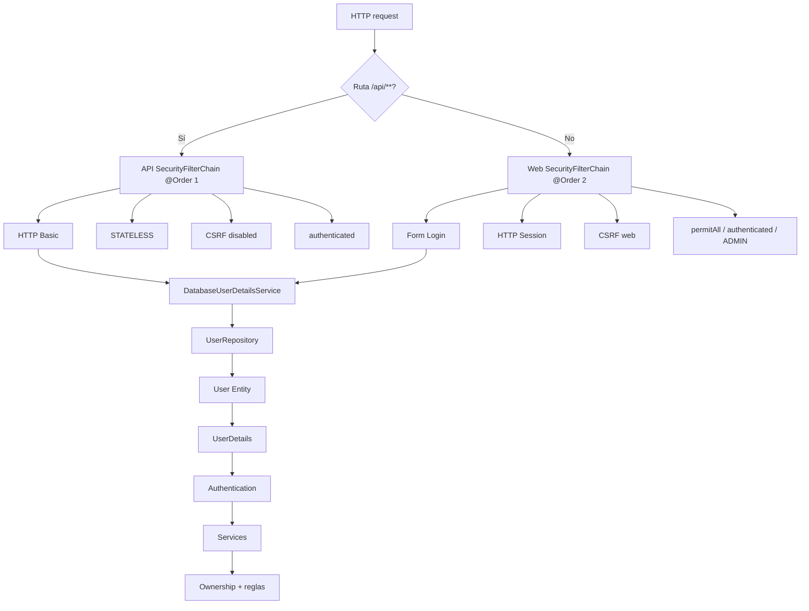

# Bloque 04 — Seguridad

Hasta aquí PetMatch ya puede:

```text
recibir peticiones HTTP
→ mostrar HTML
→ procesar formularios
→ validar entrada
→ ejecutar Services
→ persistir datos
```

Pero una aplicación multiusuario necesita responder preguntas adicionales:

> **¿Quién es el usuario? ¿Cómo demuestra su identidad? ¿Qué rutas puede abrir? ¿Qué recursos puede modificar? ¿Cómo se protege su contraseña? ¿Qué diferencia hay entre seguridad web con sesión y seguridad REST stateless?**

Este bloque estudia la implementación de **Spring Security** en PetMatch Community. Después del capítulo 25, una práctica transversal reproduce autenticación, password hashing, roles y ownership en `BookShelf`; el capítulo 26 completa posteriormente la explicación de CSRF, sesión y seguridad web.

---

## Qué aprenderás en este bloque

Al terminar Seguridad deberías poder explicar:

- qué diferencia hay entre autenticación y autorización;
- cómo PetMatch registra usuarios y cómo luego Spring Security los autentica;
- qué papel cumple `DatabaseUserDetailsService`;
- por qué `UserDetailsService` recibe un username aunque PetMatch use email para iniciar sesión;
- cómo se transforma una Entity `User` en `UserDetails`;
- cómo el campo `active` termina afectando `disabled(...)`;
- qué es un `SecurityFilterChain`;
- por qué PetMatch tiene dos filter chains distintas;
- qué hacen `@Order(1)` y `@Order(2)` conceptualmente;
- cómo `securityMatcher("/api/**")` separa la política REST;
- qué rutas web son públicas;
- qué rutas requieren autenticación;
- qué significa `hasRole("ADMIN")`;
- cómo funciona el login por formulario;
- por qué el parámetro de username se llama `email`;
- cómo Spring Security gestiona el logout;
- qué es un `PasswordEncoder`;
- por qué PetMatch no guarda contraseñas en texto plano;
- qué aporta un `DelegatingPasswordEncoder`;
- qué diferencia hay entre password hashing y cifrado reversible;
- qué significa ownership y por qué no se resuelve solamente con roles;
- cómo Services verifican recursos del usuario actual;
- por qué ocultar botones con Thymeleaf no sustituye autorización backend;
- qué papel cumple la sesión HTTP en la interfaz web;
- qué es CSRF y por qué importa para formularios autenticados;
- por qué la web mantiene CSRF mientras `/api/**` lo desactiva;
- por qué la API usa `SessionCreationPolicy.STATELESS`;
- cómo funciona HTTP Basic en la API;
- cómo reproducir registro, form login, roles y ownership en un dominio distinto.

---

## Prerrequisitos

Antes de este bloque conviene dominar:

- [inyección de dependencias](../01-fundamentos/08-inyeccion-de-dependencias.md);
- [Service y reglas de negocio](../02-dominio-y-persistencia/13-service-y-reglas-de-negocio.md);
- [máquinas de estado](../02-dominio-y-persistencia/15-maquinas-de-estado.md);
- [Spring MVC](../03-web-mvc/18-spring-mvc.md);
- [Thymeleaf](../03-web-mvc/19-thymeleaf.md);
- [Form DTO](../03-web-mvc/20-formularios-y-form-dto.md);
- [Validación](../03-web-mvc/21-validacion.md);
- [práctica de transferencia Web MVC](../03-web-mvc/practica-transferencia-web-mvc.md).

---

## Capítulos y práctica

22. [Autenticación](22-autenticacion.md)
23. [Spring Security](23-spring-security.md)
24. [Contraseñas y `PasswordEncoder`](24-contrasenas-y-password-encoder.md)
25. [Autorización y ownership](25-autorizacion-y-ownership.md)

Después de estudiar autenticación, configuración, contraseñas y ownership, realiza:

**[Práctica de transferencia — autenticación y autorización en BookShelf](practica-transferencia-seguridad.md)**

Luego continúa con:

26. [CSRF, sesión y seguridad web](26-csrf-sesion-y-seguridad-web.md)

---

# El mapa de seguridad



---

# Dos `SecurityFilterChain`

## API

```java
@Bean
@Order(1)
SecurityFilterChain apiSecurityFilterChain(HttpSecurity http)
```

Se aplica a:

```java
.securityMatcher("/api/**")
```

Y configura:

```text
cualquier request API → authenticated
SessionCreationPolicy.STATELESS
CSRF disabled
HTTP Basic
```

## Web

```java
@Bean
@Order(2)
SecurityFilterChain webSecurityFilterChain(HttpSecurity http)
```

Configura:

```text
rutas públicas
rutas autenticadas
/admin/** con rol ADMIN
form login
logout
CSRF estándar
sesión web
```

El [capítulo 23](23-spring-security.md) explica cómo matcher, orden y reglas internas determinan qué política recibe cada request.

---

# Autenticación

El login web se configura con:

```java
.formLogin(form -> form
    .loginPage("/login")
    .usernameParameter("email")
    .defaultSuccessUrl("/", true)
    .permitAll()
)
```

Spring Security gestiona el POST de credenciales. `AuthController` sirve GET `/login` y maneja registro.

```text
login.html
→ POST /login
→ Spring Security
→ DatabaseUserDetailsService
→ UserRepository
→ UserDetails
→ Authentication
```

---

# Entity `User` vs `UserDetails`

`DatabaseUserDetailsService` adapta:

```text
user.email        → username
user.passwordHash → password
user.role         → roles(...)
user.active       → disabled(!active)
```

```text
User Entity
→ dominio/persistencia

UserDetails
→ contrato de seguridad
```

---

# Contraseñas

`SecurityConfig` declara:

```java
@Bean
PasswordEncoder passwordEncoder() {
    return PasswordEncoderFactories
        .createDelegatingPasswordEncoder();
}
```

Y `UserService.register(...)` utiliza:

```java
passwordEncoder.encode(form.getPassword())
```

La Entity almacena `passwordHash`, no la contraseña en texto plano.

---

# Rol vs ownership

PetMatch tiene:

```text
USER
ADMIN
```

pero muchas autorizaciones dependen de la relación con un recurso:

```text
Pet.owner
SupportRequest.owner
SupportApplication.applicant
SupportApplication.supportRequest.owner
```

El [capítulo 25](25-autorizacion-y-ownership.md) desarrolla el patrón:

```text
Authentication
→ current User
→ currentUser.id
→ findByIdAndOwnerId(...)
```

En la práctica de transferencia, el mismo tipo de razonamiento se aplica a:

```text
Authentication
→ LibraryUser actual
→ borrower.id
→ findByIdAndBorrowerId(...)
```

---

# Autorización en dos niveles

PetMatch combina:

```text
SecurityFilterChain
→ acceso general por ruta / autenticación / rol
```

con:

```text
Service + Repository
→ ownership + estado + reglas del recurso
```

```text
usuario autenticado
≠
puede editar cualquier mascota
```

La filter chain permite llegar a `/pets/**` a un usuario autenticado, pero `PetService.findOwnedPet(...)` determina qué Pet concreta pertenece al usuario actual.

---

# Visibilidad también es autorización

`SupportRequestService.findVisibleRequest(...)` permite que una request `OPEN` sea visible dentro del flujo y restringe una request no abierta a owner o applicant relacionado.

```text
identidad
+
relación con recurso
+
estado
```

pueden participar en una decisión de autorización.

---

# Sesión web y CSRF

La web usa form login y mantiene autenticación mediante sesión HTTP.

```text
login una vez
→ /pets
→ /support-requests
→ /support-applications
```

En la chain web no se desactiva CSRF. En cambio `/api/**` declara:

```java
.csrf(csrf -> csrf.disable())
```

porque la API usa HTTP Basic + `STATELESS`.

Este comportamiento se desarrolla específicamente en el [capítulo 26](26-csrf-sesion-y-seguridad-web.md); la práctica previa de transferencia se concentra en los conceptos de los capítulos 22–25.

---

# Logout

La navegación usa:

```html
<form th:action="@{/logout}" method="post">
```

Y la configuración:

```java
.logout(logout -> logout
    .logoutSuccessUrl("/?logout")
)
```

Spring Security gestiona el proceso; no existe un `LogoutController` propio.

---

# Seguridad visual vs seguridad real

Thymeleaf puede usar:

```text
sec:authorize="isAuthenticated()"
sec:authentication="name"
ownerView
condiciones por estado
```

pero:

```text
ocultar botón
≠
proteger endpoint
```

La protección real se mantiene en:

```text
SecurityFilterChain
+
CSRF
+
Service
+
Repository ownership query
+
reglas de estado
```

---

# Evidencia en pruebas

`RestApiIntegrationTests` comprueba:

```text
GET / → 200
GET /api/v1/pets sin Basic → 401
GET /api/v1/pets con Basic válido → 200
```

`MvpFlowIntegrationTests` comprueba reglas de ownership y visibilidad del flujo de negocio.

---

# Archivos centrales del bloque

```text
src/main/java/com/petmatch/community/config/SecurityConfig.java
src/main/java/com/petmatch/community/security/DatabaseUserDetailsService.java
src/main/java/com/petmatch/community/service/UserService.java
src/main/java/com/petmatch/community/service/PetService.java
src/main/java/com/petmatch/community/service/SupportRequestService.java
src/main/java/com/petmatch/community/service/SupportApplicationService.java
src/main/java/com/petmatch/community/model/User.java
src/main/java/com/petmatch/community/model/enums/Role.java
src/main/java/com/petmatch/community/repository/UserRepository.java
src/main/java/com/petmatch/community/repository/PetRepository.java
src/main/java/com/petmatch/community/repository/SupportRequestRepository.java
src/main/java/com/petmatch/community/repository/SupportApplicationRepository.java
src/main/java/com/petmatch/community/controller/AuthController.java
src/main/resources/templates/auth/login.html
src/main/resources/templates/auth/register.html
src/main/resources/templates/fragments/navigation.html
```

---

# Tecnologías que no se estudian como parte de esta implementación

Este bloque no presenta como parte de PetMatch:

- JWT;
- OAuth2;
- OpenID Connect;
- login con Google/GitHub/Facebook;
- 2FA;
- refresh tokens;
- API keys;
- SSO;
- LDAP;
- rate limiting;
- recuperación de contraseña;
- remember-me;
- configuración CORS propia.

---

# Cómo estudiar este bloque

Para cada operación protegida pregunta:

1. ¿qué filter chain atiende la ruta?
2. ¿la ruta es pública o requiere autenticación?
3. ¿cómo se obtuvo el principal?
4. ¿qué `UserDetails` se cargó?
5. ¿qué rol tiene?
6. ¿la interfaz usa sesión o HTTP Basic?
7. ¿la petición web mutante requiere CSRF?
8. ¿el recurso requiere ownership?
9. ¿qué Service/Repository comprueba la relación?
10. ¿qué regla de estado/negocio falta después de autorizar?

Después del capítulo 25, repite las preguntas 2–5 y 8–10 en la [práctica de transferencia](practica-transferencia-seguridad.md) sobre cuentas y préstamos de `BookShelf`. El capítulo 26 completa después las preguntas sobre sesión y CSRF.

---

# Resultado esperado del bloque

## PetMatch

Al finalizar deberías poder explicar un recorrido como:

```text
POST /support-applications/{id}/accept
↓
web SecurityFilterChain
↓
Authentication desde sesión
↓
CSRF
↓
Controller
↓
SupportApplicationService.accept
↓
current User
↓
findByIdAndSupportRequestOwnerId
↓
ownership
↓
findByIdForUpdate
↓
state rules
↓
transaction
```

Y distinguirlo de una request `/api/**` autenticada mediante HTTP Basic y procesada de forma stateless.

## Transferencia después del capítulo 25

Antes de estudiar CSRF/sesión en profundidad, deberías ser capaz de reproducir:

```text
registro
→ PasswordEncoder
→ LibraryUser persistente
→ UserDetailsService
→ form login
→ Authentication
→ LoanService
→ findByIdAndBorrowerId
→ ownership
→ state rule
```

sin copiar las clases `User`, `Pet` o `SupportRequest` de PetMatch.

---

# Continúa con

Empieza por:

**[Capítulo 22 — Autenticación →](22-autenticacion.md)**

Después del capítulo 25 realiza:

**[Práctica de transferencia — autenticación y autorización en BookShelf →](practica-transferencia-seguridad.md)**

Luego continúa con:

**[Capítulo 26 — CSRF, sesión y seguridad web →](26-csrf-sesion-y-seguridad-web.md)**

Y después:

**[Bloque 05 — REST →](../05-rest/README.md)**

---

[← Bloque 03 — Web MVC](../03-web-mvc/README.md) · [Índice general](../README.md) · [Capítulo 22 →](22-autenticacion.md) · [Práctica de seguridad →](practica-transferencia-seguridad.md) · [Siguiente bloque → REST](../05-rest/README.md)
