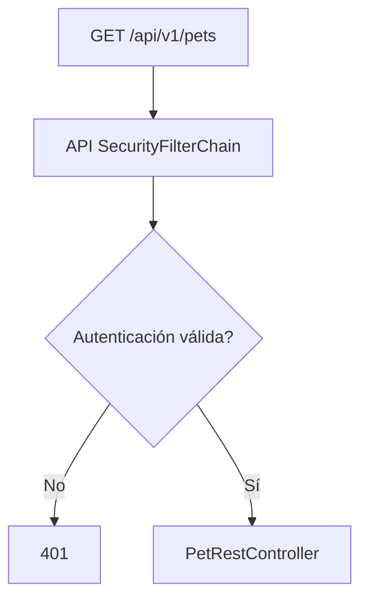

# 30 — `ProblemDetail` y errores HTTP

Hasta ahora vimos principalmente el camino exitoso de una petición REST:

```text
request válida
→ autenticación
→ Controller
→ Service
→ respuesta 200 / 201 / 204
```

Una API también necesita un contrato claro cuando algo falla. En PetMatch la pieza central para varios de esos casos es:

```text
src/main/java/com/petmatch/community/controller/api/ApiExceptionHandler.java
```

implementado con `@RestControllerAdvice` y respuestas `ProblemDetail`.

---

# 1. ¿Qué problema resuelve un manejador centralizado?

Sin una estrategia común, cada Controller podría traducir errores de forma diferente. Eso obligaría al cliente a interpretar formatos distintos para validación, recursos inexistentes o conflictos de negocio.

PetMatch separa responsabilidades:

```text
Service
→ lanza excepciones con significado para el caso de uso

ApiExceptionHandler
→ traduce excepciones seleccionadas a HTTP + JSON
```

Los Services no necesitan devolver `HttpStatus` ni `ResponseEntity` para representar sus reglas.

---

# 2. Alcance de `ApiExceptionHandler`

El advice declara:

```java
@RestControllerAdvice(
    basePackages = "com.petmatch.community.controller.api"
)
```

Por tanto está dirigido a los Controllers REST del paquete API. No debe interpretarse como un manejador global de toda la interfaz MVC.

---

# 3. ¿Qué es `ProblemDetail`?

`ProblemDetail` es un tipo de Spring para representar problemas HTTP de forma estructurada.

PetMatch configura principalmente:

```text
status
title
detail
```

y para errores de validación agrega:

```text
errors
```

El helper central es:

```java
private ProblemDetail problem(
    HttpStatus status,
    String title,
    String detail
) {
    ProblemDetail problem =
        ProblemDetail.forStatusAndDetail(status, detail);

    problem.setTitle(title);
    return problem;
}
```

---

# 4. `404 Not Found`

PetMatch agrupa excepciones como:

```java
PetNotFoundException.class
SupportRequestNotFoundException.class
SupportApplicationNotFoundException.class
```

Y las transforma en:

```text
404 Not Found
Title: Resource not found
```

Un 404 no tiene que significar únicamente que una fila no exista físicamente. En PetMatch también puede expresar que un recurso no es visible bajo las reglas del caso de uso.

Por ejemplo, `PetService.findOwnedPet(...)` utiliza una consulta filtrada por id y owner. Si no encuentra coincidencia, el resultado observable es un `PetNotFoundException`, tanto si el id no existe como si pertenece a otro usuario.

```text
Basic válido
→ Controller
→ Service
→ findByIdAndOwnerId(...)
→ Optional.empty
→ PetNotFoundException
→ ApiExceptionHandler
→ 404
```

---

# 5. `409 Conflict`

El handler agrupa:

```java
PetDeletionException.class
SupportRequestStateException.class
SupportApplicationRuleException.class
SupportApplicationStateException.class
DataIntegrityViolationException.class
```

Y responde:

```text
409 Conflict
Title: Business rule conflict
```

El detail es deliberadamente genérico:

```text
La operación no puede realizarse en el estado actual del recurso.
```

Esto permite no exponer automáticamente mensajes internos o detalles técnicos de persistencia.

Casos que pueden terminar en 409 incluyen:

```text
borrar una Pet con solicitudes asociadas
completar una SupportRequest que no está IN_PROGRESS
self-apply
postulación duplicada
transición de estado inválida
conflicto de integridad manejado
```

`409` comunica que la petición puede ser comprensible, pero la operación entra en conflicto con el estado o las reglas del recurso.

---

# 6. Bean Validation → `400 Validation failed`

Cuando un DTO recibido con:

```java
@Valid @RequestBody
```

viola constraints, Spring puede producir:

```text
MethodArgumentNotValidException
```

PetMatch responde:

```text
400 Bad Request
Title: Validation failed
Detail: Uno o más campos no son válidos.
```

Además construye:

```java
Map<String, String> errors = new LinkedHashMap<>();
```

recorriendo los field errors y conservando un mensaje por campo mediante `putIfAbsent(...)`.

Ejemplo:

```json
{
  "title": "Validation failed",
  "status": 400,
  "detail": "Uno o más campos no son válidos.",
  "errors": {
    "name": "El nombre es obligatorio",
    "age": "La edad no puede ser negativa"
  }
}
```

`RestApiIntegrationTests` verifica el status, el title y la existencia de errores para campos concretos.

---

# 7. JSON ilegible → `400 Invalid request body`

Un cuerpo que no puede convertirse al tipo esperado puede generar:

```text
HttpMessageNotReadableException
```

PetMatch lo traduce a:

```text
400 Bad Request
Title: Invalid request body
Detail: El cuerpo JSON no tiene el formato esperado.
```

Ejemplo conceptual:

```json
{
  "age": "cuatro"
}
```

si el DTO espera un `Integer`.

Esto es diferente de:

```json
{
  "age": -1
}
```

que sí puede convertirse a `Integer`, pero puede violar `@Min(0)`.

La distinción es:

```text
¿Spring puede construir el request DTO?
→ conversión JSON

¿el DTO construido cumple sus constraints?
→ Bean Validation
```

---

# 8. El `401` pertenece a Spring Security

Una petición como:

```text
GET /api/v1/pets sin HTTP Basic
```

produce `401`, pero ese resultado ocurre en la cadena de Spring Security antes de llegar normalmente al REST Controller.

`ApiExceptionHandler` no declara un handler específico de `AuthenticationException` para construir el contrato del 401.



Por eso no debe suponerse que todos los 401 tienen el mismo `ProblemDetail` personalizado por el advice.

---

# 9. Errores por capa

| Capa | Ejemplo | Resultado |
|---|---|---|
| Security | falta HTTP Basic | `401` |
| conversión JSON | body no convertible | `400 Invalid request body` |
| Bean Validation | constraints inválidos | `400 Validation failed` |
| Service / visibilidad | recurso no encontrado o no visible | `404 Resource not found` |
| Service / dominio | regla o estado conflictivo | `409 Business rule conflict` |
| persistencia | `DataIntegrityViolationException` manejada | `409 Business rule conflict` |

Esto ayuda a no usar `400` como respuesta genérica para cualquier problema.

---

# 10. `400`, `404` y `409` no significan lo mismo

```text
400
→ la entrada HTTP no puede interpretarse correctamente
  o el DTO viola constraints
```

```text
404
→ el recurso no está disponible bajo el caso de uso
```

```text
409
→ la operación entra en conflicto con una regla o estado
```

Ejemplos:

```text
Pet ajena
→ 404

Pet propia con solicitudes asociadas + DELETE
→ 409
```

---

# 11. `ProblemDetail` pertenece a la frontera HTTP

`ProblemDetail` no es:

```text
Entity
DTO del dominio
registro persistente de errores
```

Es una representación HTTP construida para comunicar un problema al cliente.

Eso mantiene una separación útil:

```text
Service exception
→ ApiExceptionHandler
→ HTTP status + ProblemDetail
```

La interfaz MVC puede representar la misma situación de otra manera sin modificar el Service.

---

# 12. No exponer stacktrace como contrato

`application.yaml` contiene:

```yaml
server:
  error:
    include-message: never
    include-binding-errors: never
    include-stacktrace: never
```

Esto es coherente con no convertir stacktraces o detalles internos en la respuesta normal de la API.

La configuración `server.error.*` y `ApiExceptionHandler` son mecanismos relacionados, pero diferentes: el primero configura el manejo general de errores de Spring Boot y el segundo traduce explícitamente excepciones REST seleccionadas.

---

# 13. Un advice evita `try/catch` repetidos

Sin un manejador centralizado, los Controllers podrían repetir una estructura como:

```java
try {
    service...;
} catch (...) {
    return ...;
}
```

Con el advice, el Controller puede concentrarse en:

```text
routing
binding
Service
respuesta exitosa
```

mientras la traducción de errores se concentra en otro lugar.

---

# 14. Cobertura de pruebas: implementación ≠ prueba dedicada

`RestApiIntegrationTests` confirma explícitamente comportamientos como:

```text
401 sin autenticación
200 con Basic válido
201 + Location al crear Pet
400 ProblemDetail de validación
```

La suite REST no contiene una prueba dedicada para cada handler de:

```text
404
409
Invalid request body
```

Por tanto debemos distinguir dos afirmaciones:

```text
el comportamiento está implementado
```

y:

```text
existe una prueba REST específica que lo demuestra
```

No son equivalentes.

Una prueba adicional para 404, por ejemplo, podría crear una Pet con un usuario y consultarla con otro. Una prueba 409 podría intentar eliminar una Pet propia que tenga una solicitud asociada.

---

# 15. No existe un handler genérico para `Exception`

`ApiExceptionHandler` declara handlers para categorías concretas. No contiene:

```java
@ExceptionHandler(Exception.class)
```

Por tanto no debe asumirse que cualquier `RuntimeException` terminará convertida por este advice al mismo `ProblemDetail` personalizado.

Las excepciones no contempladas seguirán el mecanismo general correspondiente de Spring/Spring Boot.

Un handler genérico puede ser válido en otros sistemas, pero debe ser una decisión explícita y no algo que se dé por supuesto.

---

# 16. Contrato resumido

```text
401
→ autenticación HTTP Basic faltante/incorrecta
→ Spring Security

400 Validation failed
→ MethodArgumentNotValidException
→ ProblemDetail + errors

400 Invalid request body
→ HttpMessageNotReadableException
→ ProblemDetail

404 Resource not found
→ NotFound exceptions
→ ProblemDetail

409 Business rule conflict
→ state/rule/integrity exceptions
→ ProblemDetail
```

---

# 17. Tabla de errores manejados

| Situación | Excepción/capa | Status | Title |
|---|---|---:|---|
| falta autenticación API | Spring Security | 401 | no definido por `ApiExceptionHandler` |
| validación DTO | `MethodArgumentNotValidException` | 400 | `Validation failed` |
| body JSON ilegible | `HttpMessageNotReadableException` | 400 | `Invalid request body` |
| Pet no encontrada/owned | `PetNotFoundException` | 404 | `Resource not found` |
| Request no encontrada/visible | `SupportRequestNotFoundException` | 404 | `Resource not found` |
| Application no encontrada/owned | `SupportApplicationNotFoundException` | 404 | `Resource not found` |
| delete Pet bloqueado | `PetDeletionException` | 409 | `Business rule conflict` |
| request state inválido | `SupportRequestStateException` | 409 | `Business rule conflict` |
| application rule | `SupportApplicationRuleException` | 409 | `Business rule conflict` |
| application state | `SupportApplicationStateException` | 409 | `Business rule conflict` |
| integridad DB manejada | `DataIntegrityViolationException` | 409 | `Business rule conflict` |

---

# 18. Flujo completo de error

```mermaid
flowchart TD
    A[Cliente] --> B[Security]
    B -->|sin auth| X[401]
    B -->|auth OK| C[REST Controller]
    C --> D{JSON convertible?}
    D -->|No| E[HttpMessageNotReadableException]
    D -->|Sí| F{@Valid OK?}
    F -->|No| G[MethodArgumentNotValidException]
    F -->|Sí| H[Service]
    H --> I{Resource visible/owned?}
    I -->|No| J[NotFound exception]
    I -->|Sí| K{Rule/state OK?}
    K -->|No| L[Rule/state exception]
    K -->|Sí| M[Success]

    E --> N[ApiExceptionHandler → 400]
    G --> O[ApiExceptionHandler → 400 + errors]
    J --> P[ApiExceptionHandler → 404]
    L --> Q[ApiExceptionHandler → 409]
```

---

# 19. ⚠️ Errores frecuentes

## Confundir JSON ilegible con Bean Validation

La conversión del body y la validación del DTO son etapas diferentes.

## Usar `400` para cualquier problema

PetMatch diferencia entrada inválida, recurso no disponible y conflicto de negocio.

## Suponer que ownership siempre produce `403`

En PetMatch algunas consultas filtradas por owner/visibilidad terminan expresándose como 404.

## Atribuir el `401` al `ApiExceptionHandler`

El 401 por falta de HTTP Basic pertenece a Spring Security.

## Exponer detalles técnicos de base de datos

El handler de conflictos utiliza un detail público genérico para las excepciones que agrupa.

## Confundir comportamiento implementado con cobertura específica

La existencia de un handler no implica que exista un test REST dedicado para cada rama.

## Suponer que existe un handler genérico

No hay `@ExceptionHandler(Exception.class)` en `ApiExceptionHandler`.

---

# 20. 🛠 Prueba en el código

1. Abre `ApiExceptionHandler` y clasifica sus handlers en NotFound, Conflict, Validation y Unreadable body.
2. Sigue `PetApiRequest → @Valid → MethodArgumentNotValidException → errors → ProblemDetail`.
3. Sigue `GET /api/v1/pets/{id} → findOwnedPet → PetNotFoundException → 404`.
4. Escoge una transición inválida de negocio y rastrea cómo termina en 409.
5. Explica por qué un `GET /api/v1/pets` sin Basic puede producir 401 aunque el advice no tenga un handler de autenticación.

---

# 21. 🧪 Comprueba que entendiste

1. ¿Qué anotación usa `ApiExceptionHandler`?
2. ¿A qué paquete limita su alcance?
3. ¿Qué tipo utiliza para los errores REST seleccionados?
4. ¿Qué situaciones producen 404?
5. ¿Qué grupo produce 409?
6. ¿Qué diferencia hay entre body ilegible y DTO inválido?
7. ¿Quién produce el 401 cuando falta HTTP Basic?
8. ¿Ownership puede terminar en 404?
9. ¿Existe un `@ExceptionHandler(Exception.class)` genérico?
10. ¿Cada handler tiene necesariamente una prueba REST dedicada?

### Respuestas esperadas

1. `@RestControllerAdvice`.
2. `com.petmatch.community.controller.api`.
3. `ProblemDetail`.
4. Excepciones NotFound de Pet, SupportRequest y SupportApplication.
5. Reglas, estados e integridad seleccionados.
6. El primero impide convertir correctamente el body al DTO; el segundo construye el DTO pero viola constraints.
7. Spring Security.
8. Sí.
9. No.
10. No.

---

# 22. ✅ Qué debes recordar

- **`ApiExceptionHandler` centraliza la traducción de excepciones REST seleccionadas.**
- El advice está limitado al paquete `controller.api`.
- PetMatch utiliza `ProblemDetail` para varios errores REST.
- NotFound exceptions → `404 Resource not found`.
- Reglas/estados/integridad seleccionados → `409 Business rule conflict`.
- Bean Validation → `400 Validation failed` + `errors`.
- JSON ilegible → `400 Invalid request body`.
- El 401 por HTTP Basic pertenece a Spring Security.
- Ownership puede expresarse como 404.
- Los Services lanzan excepciones y la frontera HTTP las traduce.
- La implementación de una rama de error y su cobertura mediante un test específico son cosas distintas.
- No existe un handler genérico `Exception.class` en `ApiExceptionHandler`.

---

# Continúa con

**[Bloque 06 — Calidad y recorrido completo →](../06-calidad-y-recorrido/README.md)**

---

[← Capítulo 29 — Seguridad REST](29-seguridad-rest.md) · [Índice del bloque](README.md) · [Índice general](../README.md) · [Siguiente bloque → Calidad y recorrido](../06-calidad-y-recorrido/README.md)
