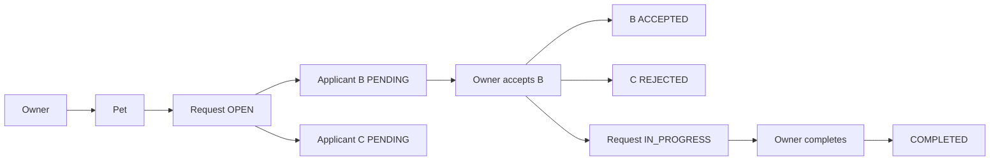
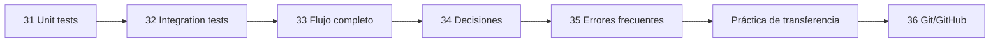

# Bloque 06 — Calidad y recorrido completo

Hasta aquí ya sabemos cómo está construida PetMatch y hemos reproducido los mecanismos principales en `BookShelf`.

Hemos estudiado:

```text
Spring Boot
→ configuración
→ Controller
→ Service
→ Repository
→ JPA/Hibernate
→ MVC/Thymeleaf
→ Security
→ REST/JSON
```

Este bloque responde tres preguntas:

> **¿Cómo comprobamos que las piezas hacen lo esperado?**

> **¿Cómo se conectan todas esas piezas en un flujo real y qué errores debemos evitar?**

> **¿Cómo demuestro esas mismas habilidades en una aplicación distinta de PetMatch?**

---

# Capítulos

31. [Pruebas unitarias](31-pruebas-unitarias.md)
32. [Pruebas de integración](32-pruebas-de-integracion.md)
33. [Flujo completo PetMatch](33-flujo-completo-petmatch.md)
34. [Buenas prácticas y decisiones](34-buenas-practicas-y-decisiones.md)
35. [Errores frecuentes](35-errores-frecuentes.md)

Después de los capítulos completa:

**[Práctica de transferencia — calidad, pruebas y recorrido completo](practica-transferencia-calidad-recorrido.md)**

Luego continúa con el [Bloque 07 — Referencia](../07-referencia/README.md).

---

# Objetivos del bloque

Al terminar deberías poder explicar y reproducir:

- qué diferencia hay entre prueba unitaria e integración;
- qué parte de PetMatch se prueba con Mockito;
- qué significan `@Mock`, `@InjectMocks` y `MockitoExtension`;
- cómo se usan `when(...)`, `verify(...)` y `assertThrows(...)`;
- qué hace `@SpringBootTest`;
- qué aporta `MockMvc`;
- qué prueba `contextLoads()` y qué no;
- qué dependencia de DB tienen las pruebas de integración;
- qué cubren realmente los tests;
- cómo se recorre el flujo owner → Pet → request → applications → accept → complete;
- cómo se combinan Authentication, ownership, estado, transacciones y locking;
- cómo convergen MVC y REST sobre los mismos Services;
- qué decisiones de diseño están implementadas;
- qué trade-offs tienen esas decisiones;
- cómo diagnosticar errores frecuentes de capas, JPA, Security, REST, testing y configuración;
- cómo escribir un unit test de un Service distinto de PetMatch;
- cómo construir una integración Service + JPA + DB en `BookShelf`;
- cómo probar una API propia con `MockMvc`, HTTP Basic, status, headers y JSON;
- cómo describir con precisión qué demuestra y qué no demuestra cada prueba.

---

# Prerrequisitos

Antes de este bloque deberías haber recorrido:

- [Dominio y persistencia](../02-dominio-y-persistencia/README.md);
- [Web MVC](../03-web-mvc/README.md);
- [Seguridad](../04-seguridad/README.md);
- [REST](../05-rest/README.md);
- [Práctica de transferencia REST](../05-rest/practica-transferencia-rest.md).

Para ejecutar las pruebas `@SpringBootTest` de PetMatch o una estrategia equivalente en `BookShelf`, recuerda que la configuración estudiada depende de un datasource válido.

---

# Pruebas del repositorio

```text
src/test/java/com/petmatch/community/
├── PetMatchCommunityApplicationTests.java
├── service/
│   ├── SupportRequestServiceTests.java
│   └── SupportApplicationServiceTests.java
└── integration/
    ├── MvpFlowIntegrationTests.java
    └── RestApiIntegrationTests.java
```

Estas clases son la base de los capítulos 31 y 32.

---

# Dos niveles principales en PetMatch

## Unitarias

```text
SupportRequestServiceTests
SupportApplicationServiceTests
```

Modelo:

```text
Service real
+
Repository mock
+
otros colaboradores mock
```

No levantan el `ApplicationContext` de Spring.

## Integración

```text
PetMatchCommunityApplicationTests
MvpFlowIntegrationTests
RestApiIntegrationTests
```

Usan `@SpringBootTest`, pero integran fronteras diferentes:

```text
contextLoads
→ arranque del contexto

MvpFlowIntegrationTests
→ Services + Repositories + JPA + DB + reglas

RestApiIntegrationTests
→ HTTP + Security + MVC REST + Validation + Services + DB
```

La práctica de transferencia reconstruye las mismas diferencias con `LoanService`, préstamos y libros.

---

# Herramientas utilizadas

En los tests del proyecto aparecen:

```text
JUnit 5
Mockito
Spring Boot Test
Spring Security Test
MockMvc
```

No forman parte de la infraestructura de pruebas de PetMatch:

```text
Testcontainers
H2 de test
WireMock
Selenium
Playwright
Cypress
ArchUnit
JaCoCo configurado
```

La práctica no añade esas herramientas como requisitos solo para aumentar la lista tecnológica.

---

# El principio de testing del bloque

No preguntamos:

```text
¿cuántas anotaciones tiene el test?
```

Preguntamos:

```text
¿qué comportamiento quiero demostrar?
```

Ejemplo unitario en PetMatch:

```text
cancel OPEN
→ request CANCELLED
→ applications PENDING REJECTED
```

Ejemplo unitario transferido:

```text
Book LOANED
→ LoanService.borrowBook rechaza operación
```

Ejemplo de integración HTTP:

```text
GET /api/v1/pets sin Basic
→ 401
```

Y en `BookShelf`:

```text
POST /api/v1/books válido
→ 201 + Location + JSON
```

Son preguntas distintas y requieren niveles distintos.

---

# Flujo completo del MVP

El capítulo 33 conecta todo alrededor de esta historia:



Ese recorrido permite ver juntas:

```text
Authentication
ownership
DTO
Service
Repository
transactions
dirty checking
locking
state machines
visibility
testing
```

En la práctica, el método de análisis se traslada a:

```text
usuario
→ Book AVAILABLE
→ préstamo
→ Loan ACTIVE
→ ownership
→ devolución
→ Loan RETURNED
→ Book AVAILABLE
```

No se copia el dominio; se transfiere la forma de recorrer una funcionalidad completa.

---

# Casos de prueba que conviene reconocer

`SupportRequestServiceTests` comprueba reglas aisladas de Service, por ejemplo cancelar una request `OPEN` y rechazar applications pendientes.

`SupportApplicationServiceTests` comprueba, entre otros escenarios, la aceptación de una application y el rechazo de una solicitud expirada.

`MvpFlowIntegrationTests` recorre usuarios con roles funcionales distintos:

```text
owner
applicant B
applicant C
outsider
```

Y sigue:

```text
Pet
→ SupportRequest
→ applications
→ accept
→ IN_PROGRESS
→ visibility
→ complete
→ COMPLETED
```

`RestApiIntegrationTests` verifica, entre otros:

```text
GET / → 200
GET /api/v1/pets sin Basic → 401
GET /api/v1/pets con Basic → 200
POST pet → 201 + Location + JSON
POST inválido → 400 + ProblemDetail
```

---

# Dependencia de base de datos

`application.yaml` usa:

```yaml
spring:
  datasource:
    url: ${DB_URL}
    username: ${DB_USERNAME}
    password: ${DB_PASSWORD}
```

El proyecto no configura una sustitución de test mediante H2 o Testcontainers.

Por tanto las pruebas `@SpringBootTest` pueden necesitar variables de entorno válidas y una base compatible.

> [!IMPORTANT]
> Esta es una característica de la configuración de PetMatch; no implica que sea la única estrategia posible para pruebas de integración.

La práctica obliga a distinguir:

```text
fallo de lógica
```

frente a:

```text
fallo de infraestructura de test
```

---

# Decisiones y trade-offs

[Buenas prácticas y decisiones](34-buenas-practicas-y-decisiones.md) revisa decisiones como:

```text
constructor injection
arquitectura por capas
ownership backend
DTO separados
transactions
PESSIMISTIC_WRITE
open-in-view false
EntityGraph
dos SecurityFilterChain
ProblemDetail
unit + integration tests
```

Y las compara con alternativas como:

```text
JWT/OAuth2
MapStruct
@Version
Flyway/Liquibase
Testcontainers
SPA frontend
```

La práctica de transferencia exige describir una decisión mediante:

```text
problema
→ decisión
→ beneficio
→ trade-off
→ alternativa si cambia la necesidad
```

---

# Errores frecuentes

[Errores frecuentes](35-errores-frecuentes.md) agrupa problemas como:

```text
negocio en Controller
Entity usada como DTO
ownership solo en UI
@Valid usado como sustituto de Service
CSRF desactivado globalmente
confundir Basic con HTTPS
cargar todo EAGER
ignorar dirty checking
creer que ddl-auto es migration tool
confundir Mockito y MockMvc
asumir cobertura no demostrada
```

En `BookShelf` los usarás como preguntas de diagnóstico, no como una lista para memorizar.

---

# Qué puede concluirse de la suite

La existencia de tests no implica:

```text
100 % de cobertura
```

No hay tests dedicados para cada Controller MVC, cada Repository, cada endpoint REST ni una carrera real con dos transacciones concurrentes.

El libro distingue entre:

```text
regla implementada
```

y:

```text
regla con test específico
```

La práctica añade una tercera pregunta:

```text
¿qué frontera cubre exactamente ese test?
```

---

# Cómo estudiar este bloque

Para cada capítulo:

1. identifica una afirmación de comportamiento;
2. localiza qué test real de PetMatch la demuestra, si existe;
3. identifica la frontera del test;
4. señala qué colaboradores son reales y cuáles no;
5. separa lógica de infraestructura;
6. completa el checkpoint equivalente en `BookShelf`;
7. evita afirmar cobertura que no esté respaldada por una prueba concreta.

Después de 31–35 completa la práctica completa:

**[Práctica de transferencia — calidad, pruebas y recorrido completo →](practica-transferencia-calidad-recorrido.md)**

---

# Resultado esperado A — explicar PetMatch

Deberías poder comparar:

```text
SupportApplicationServiceTests
MvpFlowIntegrationTests
RestApiIntegrationTests
```

Y explicar para cada clase:

```text
qué comportamiento comprueba
qué infraestructura levanta
qué dependencias son reales
qué depende de DB
qué capa HTTP incluye
qué NO demuestra
```

También deberías poder recorrer el MVP desde identidad hasta persistencia y señalar qué tests aportan evidencia en partes concretas del flujo.

---

# Resultado esperado B — demostrar transferencia

Sin copiar los tests de PetMatch literalmente deberías poder construir en `BookShelf`:

```text
LoanServiceTests
→ Service real + Mockito

BookShelfFlowIntegrationTests
→ Spring + Services + JPA + DB

BookRestApiIntegrationTests
→ MockMvc + Security + REST + Validation + DB
```

Y explicar:

```text
por qué cada prueba existe
qué riesgo cubre
por qué usa ese nivel
qué falla si no hay DB
qué significa un 401/400/404/409
qué no está cubierto todavía
```

Si puedes hacerlo usando un dominio distinto y sin llamar “end-to-end” a todo `@SpringBootTest`, estás razonando sobre calidad y no memorizando anotaciones.

---

# Recorrido del bloque



---

# Comienza aquí

**[Capítulo 31 — Pruebas unitarias →](31-pruebas-unitarias.md)**

Después de completar 31–35:

**[Práctica de transferencia — calidad, pruebas y recorrido completo →](practica-transferencia-calidad-recorrido.md)**

Luego continúa con:

**[Bloque 07 — Referencia →](../07-referencia/README.md)**

---

[← Bloque 05 — REST](../05-rest/README.md) · [Índice general](../README.md) · [Capítulo 31 →](31-pruebas-unitarias.md) · [Práctica de transferencia →](practica-transferencia-calidad-recorrido.md) · [Siguiente bloque → Referencia](../07-referencia/README.md)
