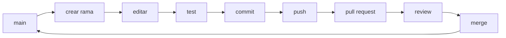

# 36 — Git, GitHub y versionado en PetMatch

Hasta este punto hemos estudiado cómo funciona la aplicación. Ahora aparece una pregunta diferente:

> **¿Cómo conservamos, compartimos y revisamos los cambios de un proyecto sin perder su historial?**

La respuesta combina dos herramientas relacionadas, pero distintas:

```text
Git
+
GitHub
```

Este capítulo se concentra en los conceptos y comandos que un aprendiz necesita para trabajar de forma segura en PetMatch y que podrá reutilizar en otros repositorios.

---

# 1. Git y GitHub no son lo mismo

## Git

Es un sistema de control de versiones distribuido. Registra cambios en archivos y permite construir un historial mediante commits y ramas.

## GitHub

Es una plataforma que aloja repositorios Git y agrega colaboración mediante pull requests, reviews, issues, permisos y otras herramientas.

```text
Git
→ historial y versionado

GitHub
→ alojamiento y colaboración
```

---

# 2. El repositorio de PetMatch

El proyecto público para aprendices se encuentra en:

```text
ethan-fullstack/petmatch-community
```

Su rama por defecto es:

```text
main
```

`main` es una rama Git como cualquier otra; en muchos proyectos se utiliza como rama principal donde terminan los cambios que ya fueron integrados.

---

# 3. ¿Qué es un repositorio?

Un repositorio Git contiene:

```text
archivos del proyecto
+
historial de commits
+
ramas
+
referencias
```

No es simplemente una carpeta comprimida. El historial también forma parte del proyecto.

---

# 4. Working tree, staging area e historial

Tres estados ayudan a entender el flujo básico:

```text
working tree
→ archivos que estás editando

staging area
→ cambios seleccionados para el próximo commit

repository history
→ commits ya registrados
```

Un flujo típico es:

```text
editar
→ revisar
→ git add
→ git commit
```

---

# 5. `git status`

Es uno de los comandos más importantes:

```bash
git status
```

Permite revisar:

```text
rama actual
archivos modificados
archivos staged
archivos untracked
```

Úsalo antes de agregar archivos, antes de cambiar de rama y antes de crear un commit.

---

# 6. Tracked, untracked e ignored

## Tracked

Archivo que Git ya conoce y versiona.

## Untracked

Archivo local que todavía no fue agregado al control de versiones.

## Ignored

Archivo que coincide con una regla de `.gitignore` y normalmente no se propone para tracking.

Estas categorías son diferentes.

---

# 7. `.gitignore` de PetMatch

Entre otras reglas, el repositorio excluye elementos como:

```text
target/
.idea/
.vscode/
.env
/petmatch-community.zip
```

Estas reglas representan categorías comunes:

| Categoría | Ejemplos |
|---|---|
| artefactos de build | `target/` |
| configuración local de IDE | `.idea/`, `.vscode/` |
| configuración local/sensible | `.env` |
| archivos generados | `petmatch-community.zip` |

La finalidad no es ignorar todo lo que sea “configuración”, sino separar archivos reproducibles del proyecto de archivos locales o generados.

---

# 8. ¿Por qué ignorar `target/`?

Maven genera `target/` al compilar y empaquetar.

Como puede reconstruirse mediante el código fuente, `pom.xml` y Maven Wrapper, versionarlo normalmente agregaría:

```text
ruido
archivos pesados
conflictos innecesarios
```

---

# 9. ¿Por qué ignorar `.env`?

PetMatch obtiene credenciales de base de datos mediante:

```text
DB_URL
DB_USERNAME
DB_PASSWORD
```

Un `.env` local podría contener valores sensibles o específicos del equipo.

> [!WARNING]
> `.gitignore` no elimina un secreto que ya fue committeado. Si una credencial fue expuesta, debe considerarse comprometida y normalmente debe rotarse o revocarse.

---

# 10. `.gitignore` no deja de trackear mágicamente un archivo

Si un archivo ya fue agregado al repositorio y después se incluye en `.gitignore`, Git puede seguir considerándolo tracked.

Por eso:

```text
archivo ignorado
≠
archivo eliminado del historial
```

---

# 11. `.gitattributes`

PetMatch contiene reglas como:

```text
/mvnw text eol=lf
*.cmd text eol=crlf
```

Esto ayuda a conservar finales de línea apropiados para scripts utilizados en sistemas diferentes.

Simplificando:

```text
Linux/macOS → LF
Windows → frecuentemente CRLF
```

---

# 12. Maven Wrapper se versiona

El repositorio contiene:

```text
mvnw
mvnw.cmd
.mvn/
```

Eso permite ejecutar Maven sin exigir una instalación global idéntica en cada equipo.

Linux/macOS/WSL:

```bash
./mvnw test
```

Windows:

```powershell
.\mvnw.cmd test
```

---

# 13. Revisar cambios con `git diff`

Antes de preparar un commit:

```bash
git diff
```

te permite revisar qué cambió en el working tree.

La pregunta práctica es:

> **¿Estos son exactamente los cambios que quería hacer?**

---

# 14. Preparar cambios con `git add`

Ejemplo:

```bash
git add src/main/java/com/petmatch/community/service/PetService.java
```

No es obligatorio utilizar siempre:

```bash
git add .
```

Seleccionar archivos relacionados ayuda a construir commits coherentes.

---

# 15. Revisar el staging

Antes de crear el commit:

```bash
git diff --staged
```

muestra qué cambios están preparados para entrar en él.

Puedes tener al mismo tiempo:

```text
archivo A → staged
archivo B → modificado pero no staged
```

---

# 16. ¿Qué es un commit?

Un commit registra una unidad del historial con información como:

```text
cambios
autor
fecha
mensaje
SHA
```

No es simplemente “guardar el archivo”.

Un buen commit intenta representar una intención coherente.

Mal mensaje:

```text
cambios
```

Más útil:

```text
fix: enforce ownership when updating pets
```

O:

```text
docs: explain pessimistic locking
```

---

# 17. Pequeño no significa microscópico

Un commit puede incluir varias piezas relacionadas:

```text
DTO
+
Controller que lo usa
+
test del mismo caso
```

Lo importante es evitar mezclar cambios independientes como seguridad, CSS, configuración DB y reformateos masivos dentro de una sola historia difícil de revisar.

---

# 18. Probar antes de commit

Para PetMatch puedes ejecutar:

Linux/macOS/WSL:

```bash
./mvnw clean test
```

Windows:

```powershell
.\mvnw.cmd clean test
```

Las pruebas de integración pueden requerir las variables de base de datos y una instancia MySQL compatible, como se explica en los capítulos de testing.

---

# 19. Flujo recomendado para un cambio pequeño

```text
1. git status
2. actualizar referencias/remoto según el flujo del equipo
3. crear o cambiar de rama si corresponde
4. realizar el cambio
5. ejecutar pruebas relevantes
6. git diff
7. git add <archivos relacionados>
8. git diff --staged
9. git commit
10. git push
11. revisar el resultado en GitHub
```

El orden puede variar según el equipo, pero la idea principal es **revisar antes de registrar y compartir**.

---

# 20. ¿Qué es una rama?

Una rama es una referencia móvil a una línea de commits.

Un equipo puede usar ramas para desarrollar cambios sin incorporarlos inmediatamente a `main`.

Crear una rama:

```bash
git switch -c feature/pet-notes
```

Cambiar a `main`:

```bash
git switch main
```

Antes de cambiar de rama revisa:

```bash
git status
```

porque cambios locales sin commit pueden interferir con la operación.

---

# 21. ¿Qué representa `main`?

En muchos equipos, `main` representa la línea principal de trabajo integrado.

Eso no significa que una rama local sea “incorrecta”; significa que puede contener trabajo que todavía no fue integrado.

```text
main
→ trabajo integrado

feature/*
→ cambio en desarrollo o revisión
```

La política exacta depende del equipo.

---

# 22. `origin` y remotos

Al clonar un repositorio normalmente se crea un remote llamado:

```text
origin
```

Puedes verlo con:

```bash
git remote -v
```

`origin` es una convención frecuente, no una palabra reservada obligatoria.

---

# 23. `git fetch`

```bash
git fetch
```

actualiza información del remoto sin integrar automáticamente esos commits en tu rama de trabajo.

Una forma útil de pensarlo:

```text
fetch
→ conocer qué cambió en remoto
```

Después puedes decidir cómo integrar esa historia.

---

# 24. `git push`

```bash
git push
```

envía commits locales al remote correspondiente, si tienes permisos y la operación es válida.

```text
archivo guardado localmente
≠
archivo visible en GitHub
```

Para que el cambio llegue al remoto debe formar parte de un commit y ese commit debe enviarse.

---

# 25. `git pull`

`git pull` obtiene e integra cambios según la configuración del repositorio.

Para aprender, conviene separar mentalmente:

```text
¿qué cambió en remoto?
→ fetch

¿cómo se integrará?
→ merge/rebase según el flujo
```

Así `pull` deja de parecer una operación misteriosa.

---

# 26. Merge

Un merge combina historias de ramas.

```text
main
   \
    feature commits
```

Git puede resolver automáticamente muchos cambios, pero no todos.

---

# 27. Conflictos de merge

Un conflicto aparece cuando Git no puede decidir cómo combinar cambios incompatibles.

No significa que Git esté “dañado”. Significa que se necesita una decisión humana.

Resolver un conflicto requiere comprender qué debe conservarse. Por ejemplo, si dos ramas modifican reglas de `SupportApplicationService.accept(...)`, no basta con elegir al azar una versión: deben mantenerse ownership, locking, estados y reglas válidas.

Después de resolverlo, ejecuta nuevamente las pruebas relevantes.

---

# 28. Pull Request

Un Pull Request propone integrar cambios de una rama hacia otra en GitHub.

Permite revisar:

```text
qué cambió
por qué cambió
qué pruebas se ejecutaron
qué riesgos existen
```

Los Pull Requests son una capacidad de plataformas como GitHub, no una operación básica del propio Git.

---

# 29. Code review

Una revisión no debería limitarse a “compila”.

En PetMatch podrían plantearse preguntas como:

```text
¿se conserva ownership?
¿la regla está en Service?
¿el DTO expone campos apropiados?
¿la transición de estado es válida?
¿requiere transacción?
¿hay riesgo concurrente?
¿hay una prueba apropiada?
```

Para documentación también son útiles preguntas transferibles:

```text
¿el enlace funciona?
¿la ruta del archivo es exacta?
¿el comando puede ejecutarse como está escrito?
¿el ejemplo sigue siendo válido?
¿la explicación coincide con el comportamiento mostrado?
```

---

# 30. SHA, `git log` y `git show`

Cada commit tiene un identificador SHA.

Para inspeccionar la historia de forma resumida:

```bash
git log --oneline
```

Para estudiar un commit concreto:

```bash
git show <sha>
```

El historial puede ayudar a responder cuándo y por qué cambió una parte del sistema.

---

# 31. Revertir cambios compartidos

Para deshacer de forma explícita un commit ya compartido puede utilizarse:

```bash
git revert <sha>
```

Esto crea un nuevo commit que invierte el anterior y conserva la historia de lo ocurrido.

---

# 32. `reset`, `clean` y force push requieren cuidado

Comandos como:

```text
git reset --hard
git clean -fd
git push --force
```

pueden descartar trabajo o reescribir historia.

Antes de usar una operación destructiva revisa:

```bash
git status
git diff
git log --oneline
```

Y comprende exactamente qué estado quieres modificar.

Un push rechazado no debe resolverse automáticamente con force push. Primero conviene comprobar si el remoto contiene commits que no tienes, por ejemplo con `git fetch`.

---

# 33. Secretos y Git

No deberías versionar deliberadamente:

```text
passwords reales
tokens
claves privadas
API keys
```

PetMatch utiliza variables de entorno para las credenciales de MySQL.

Si un secreto llega al historial, eliminar el archivo en un commit posterior no hace que el valor deje de haber estado expuesto. Debe evaluarse su rotación/revocación y el tratamiento del historial según el contexto.

---

# 34. Código, documentación y datos no son lo mismo

Git versiona archivos como:

```text
.java
.yaml
.md
pom.xml
```

MySQL guarda datos de ejecución.

```text
Git
→ código, configuración y documentación versionables

MySQL
→ datos persistentes de la aplicación
```

Git no guarda automáticamente las filas de la base de datos.

---

# 35. `.env` ignorado no significa `.env` cargado

Son dos mecanismos diferentes:

```text
.gitignore
→ decide qué archivos propone Git para tracking

Spring configuration
→ decide cómo llegan propiedades al proceso
```

Que `.env` esté ignorado no hace que Spring Boot lo cargue automáticamente.

---

# 36. Tags y versiones

Git permite crear tags para marcar puntos del historial, por ejemplo:

```text
v1.0.0
```

También existe la convención de versionado semántico:

```text
MAJOR.MINOR.PATCH
```

Son conceptos útiles, pero cada proyecto debe definir si adopta una política formal de releases y versionado.

---

# 37. Flujo de colaboración



Un proyecto personal o educativo también puede utilizar un flujo más directo. No existe una única estrategia correcta; debe existir una política consciente y comprensible.

---

# 38. Checklist antes de crear un commit

- revisar `git status`;
- revisar cambios con `git diff`;
- revisar staging con `git diff --staged`;
- ejecutar pruebas relevantes;
- confirmar que no haya secretos;
- evitar artefactos generados;
- incluir documentación cuando cambie un contrato que el usuario necesita conocer;
- usar un mensaje que describa la intención;
- mantener un propósito técnico coherente.

---

# 39. Después de `push`

En GitHub comprueba:

```text
¿aparece el commit esperado?
¿cambiaron los archivos correctos?
¿la rama correcta recibió el commit?
¿se coló un archivo local o sensible?
```

La revisión visual del resultado sigue siendo útil aunque el comando haya terminado sin error.

---

# 40. Conventional Commits

Prefijos como:

```text
feat:
fix:
docs:
test:
refactor:
```

son una convención habitual para expresar intención.

Ejemplos:

```text
fix: enforce ownership when updating pets

docs: explain REST security

test: cover expired support request application
```

No son una obligación técnica de Git; un equipo puede adoptar otra convención.

---

# 41. Git como herramienta para comprender arquitectura

Un diff pequeño puede mostrar:

```text
qué capa cambió
qué prueba acompaña el cambio
qué documentación se ve afectada
```

Por eso un historial coherente también ayuda a estudiar cómo evoluciona una aplicación.

---

# 42. 🛠 Práctica guiada

Sin modificar código productivo, crea localmente un archivo temporal y observa:

```bash
git status
```

Después:

1. identifica que esté `untracked`;
2. agrégalo con `git add`;
3. revisa `git diff --staged`;
4. retíralo del staging si no quieres committearlo;
5. elimina el archivo temporal.

El objetivo es comprender los estados de Git, no generar un commit innecesario.

---

# 43. 🧪 Comprueba que entendiste

1. ¿Git y GitHub son lo mismo?
2. ¿Qué es el working tree?
3. ¿Qué es la staging area?
4. ¿Qué muestra `git status`?
5. ¿Qué diferencia hay entre tracked, untracked e ignored?
6. ¿Por qué normalmente no se versiona `target/`?
7. ¿Por qué `.env` merece especial cuidado?
8. ¿`.gitignore` elimina un secreto del historial?
9. ¿Para qué sirve `.gitattributes`?
10. ¿Por qué se versiona Maven Wrapper?
11. ¿Qué hace `git diff --staged`?
12. ¿Qué es un commit?
13. ¿Qué es una rama?
14. ¿Qué hace `git fetch`?
15. ¿Qué hace `git push`?
16. ¿Qué es un merge conflict?
17. ¿Qué es un Pull Request?
18. ¿Por qué un force push requiere cuidado?
19. ¿Git versiona automáticamente los datos de MySQL?
20. ¿Ignorar `.env` hace que Spring lo cargue?

### Respuestas esperadas

1. No; Git versiona y GitHub aloja/facilita colaboración.
2. Los archivos locales actuales del repositorio.
3. La zona donde seleccionamos cambios para el próximo commit.
4. Rama y estado de archivos.
5. Tracked ya pertenece al historial; untracked todavía no; ignored coincide con reglas de ignore.
6. Porque es un artefacto reconstruible generado por Maven.
7. Porque puede contener configuración local o secretos.
8. No.
9. Para definir atributos de archivos, como finales de línea.
10. Para conservar una forma reproducible de ejecutar Maven.
11. Muestra los cambios preparados para el siguiente commit.
12. Una unidad registrada del historial con cambios y metadata.
13. Una referencia móvil a una línea de commits.
14. Actualiza información del remoto sin integrar automáticamente los commits en la rama actual.
15. Envía commits locales al remoto correspondiente.
16. Una situación donde Git necesita una decisión humana para combinar cambios incompatibles.
17. Una propuesta de integración y revisión en GitHub.
18. Porque puede reescribir historia remota y eliminar commits visibles.
19. No.
20. No.

---

# 44. ✅ Qué debes recordar

```text
working tree
→ estoy editando

staging area
→ seleccioné los cambios del próximo commit

commit
→ registré una historia coherente

fetch
→ actualicé información del remoto

push
→ envié commits al remoto
```

Y conserva esta disciplina:

```text
cambio pequeño
→ probar
→ revisar diff
→ preparar staging
→ revisar staging
→ commit coherente
→ push / review
```

Ese flujo es transferible a cualquier proyecto versionado con Git, no solamente a PetMatch.

---

# Continúa con

**[Capítulo 37 — Glosario →](37-glosario.md)**

---

[← Capítulo 35 — Errores frecuentes](../06-calidad-y-recorrido/35-errores-frecuentes.md) · [Índice del bloque](README.md) · [Índice general](../README.md) · [Siguiente → Capítulo 37](37-glosario.md)
