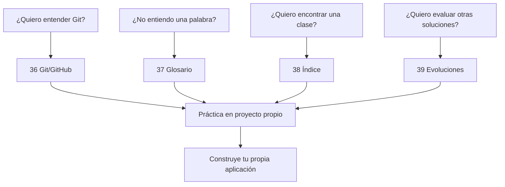

# Bloque 07 — Referencia

Este bloque cierra el libro con herramientas para **volver rápidamente a lo aprendido y aplicarlo sobre un proyecto propio** sin releer todo en orden.

No introduce un nuevo framework ni una nueva arquitectura.

Su objetivo es servir como capa de consulta y autonomía:

```text
Git y GitHub
→ cómo conservar y revisar cambios

Glosario
→ qué significa un término y dónde aparece

Índice de clases y conceptos
→ dónde encontrar una responsabilidad

Posibles evoluciones
→ qué podría cambiar si aparece una necesidad real

Práctica de transferencia
→ usar esas cuatro herramientas sobre BookShelf
```

---

# Objetivos del bloque

Al terminar deberías poder:

- distinguir Git de GitHub;
- explicar working tree, staging, commit, branch, push, fetch y merge;
- interpretar `.gitignore` y `.gitattributes` del repositorio;
- comprender por qué `target/`, `.env` y archivos del IDE no deben mezclarse con el código compartido;
- localizar rápidamente términos como `Bean`, `EntityGraph`, `ProblemDetail`, `STATELESS` o `Authentication`;
- localizar cada Controller, Service, Repository, Entity, DTO, enum, excepción y test relevante;
- saltar de un concepto a las clases donde puede estudiarse;
- distinguir claramente entre capacidades de PetMatch y posibles extensiones;
- reproducir ese mismo mapa sobre `BookShelf` o una aplicación propia;
- describir una tecnología futura desde el problema que resolvería y no desde su popularidad;
- decir con precisión qué evidencia respalda una afirmación técnica.

---

# Capítulos

36. [Git, GitHub y versionado](36-git-github-y-versionado.md)
37. [Glosario](37-glosario.md)
38. [Índice de clases y conceptos](38-indice-de-clases-y-conceptos.md)
39. [Posibles evoluciones no implementadas](39-posibles-evoluciones-no-implementadas.md)

Después de los capítulos completa:

**[Práctica de transferencia — usa la referencia sobre tu propio proyecto](practica-transferencia-referencia.md)**

Después da el salto final a un dominio elegido por ti:

**[Construye tu propia aplicación con Spring Boot →](../construye-tu-propia-aplicacion.md)**

---

# 36 — Git, GitHub y versionado

Este capítulo usa archivos del repositorio:

```text
.gitignore
.gitattributes
mvnw
mvnw.cmd
README.md
docs/
```

para explicar:

```text
tracked / untracked / ignored
working tree
staging area
commit
branch
main
push
fetch
merge
conflicts
pull requests
reviews
secretos
artefactos generados
```

También conecta control de versiones con un flujo de trabajo sencillo:

```text
cambio pequeño
→ prueba
→ diff
→ commit coherente
```

En la práctica lo aplicarás sobre tu propio repositorio `BookShelf`.

---

# 37 — Glosario

El glosario responde preguntas como:

```text
¿Qué es un Bean?
¿Qué significa dirty checking?
¿Qué diferencia hay entre JPA e Hibernate?
¿Qué significa STATELESS?
¿Qué diferencia hay entre Mockito y MockMvc?
```

Cada definición intenta incluir:

```text
significado
→ uso
→ ejemplo PetMatch
→ capítulo relacionado
```

No sustituye los capítulos largos; sirve para recuperar contexto rápidamente.

La transferencia consiste en explicar el mismo concepto mediante clases de otro dominio, por ejemplo:

```text
ownership
→ LoanService
→ LoanRepository
→ LibraryUserService
```

---

# 38 — Índice de clases y conceptos

Este capítulo funciona en dos direcciones.

## Clase → explicación

Ejemplo:

```text
SupportApplicationService
→ responsabilidad
→ ruta
→ capítulos donde se estudia
```

## Concepto → clases

Ejemplo:

```text
ownership
→ UserService
→ PetService
→ SupportRequestService
→ SupportApplicationService
→ Repositories con owner
```

Es especialmente útil cuando ya conoces el concepto y quieres volver al código.

En la práctica construirás el mismo movimiento con `BookShelf`:

```text
concepto
↔
clase
↔
responsabilidad
```

---

# 39 — Posibles evoluciones no implementadas

Este capítulo mantiene una distinción fundamental:

> **una idea posible para ampliar el sistema no describe el comportamiento de PetMatch.**

Allí aparecen, entre otras, alternativas como:

```text
Flyway/Liquibase
Testcontainers
@Version
OpenAPI
JWT/OAuth2
MapStruct
Docker
CI/CD
observabilidad
File & Image Upload
```

Se presentan como tecnologías que podrían evaluarse si una necesidad futura las justificara.

La práctica aplica el mismo criterio a `BookShelf`:

```text
problema real
→ necesidad
→ alternativas
→ beneficio
→ coste
→ prueba necesaria
```

---

# Mapa de uso rápido



---

# Lo que este bloque NO hace

Que una tecnología aparezca como referencia o alternativa no significa que PetMatch la utilice.

Ejemplos:

```text
JWT
OAuth2
Flyway
Liquibase
Testcontainers
Docker
File Upload
chat
pagos
geolocalización
microservicios
```

Tampoco significa que debas añadirla a `BookShelf`.

Primero debe existir una necesidad que justifique evaluar el cambio.

---

# Cómo estudiar este bloque

1. lee 36–39 usando PetMatch como referencia real;
2. abre tu proyecto `BookShelf`;
3. repite cada ejercicio con tus propias clases y commits;
4. evita copiar nombres de PetMatch como si fueran parte de Spring;
5. cuando afirmes que algo está cubierto, señala el código o test que lo demuestra;
6. cuando propongas una evolución, empieza por el problema que resolvería.

Después completa:

**[Práctica de transferencia — usa la referencia sobre tu propio proyecto →](practica-transferencia-referencia.md)**

Cuando puedas hacer esos ejercicios sin depender de los nombres de `BookShelf`, continúa con:

**[Construye tu propia aplicación con Spring Boot →](../construye-tu-propia-aplicacion.md)**

---

# Resultado esperado A — usar PetMatch como referencia

Deberías poder:

```text
localizar una clase
→ explicar su responsabilidad
→ conectar conceptos
→ encontrar el capítulo relacionado
```

Y también:

```text
leer una posible evolución
→ distinguirla de lo implementado
→ explicar qué necesidad podría justificarla
```

---

# Resultado esperado B — demostrar autonomía

Sin copiar la estructura textual de PetMatch deberías poder construir para `BookShelf`:

```text
un historial Git coherente
+
un mini-glosario
+
un mapa concepto ↔ clase
+
una lista de evoluciones justificadas por necesidades
```

Y responder preguntas como:

```text
¿dónde vive ownership?
¿qué test lo demuestra?
¿qué parte es una Entity y qué parte es un DTO?
¿qué capa cambiaría si necesito otro contrato REST?
¿qué tecnología futura tendría sentido y por qué?
```

El siguiente nivel es repetir el recorrido con un dominio que no te entregue el libro.

---

# Ruta recomendada

Si estás leyendo el libro por primera vez:

```text
35 Errores frecuentes
→ Práctica de Calidad
→ 36 Git/GitHub
→ 37 Glosario
→ 38 Índice
→ 39 Evoluciones
→ Práctica de Referencia
→ Construye tu propia aplicación
```

Después puedes volver a este bloque de forma no lineal según tu necesidad.

---

# Comienza aquí

**[Capítulo 36 — Git, GitHub y versionado →](36-git-github-y-versionado.md)**

Después de 36–39:

**[Práctica de transferencia — usa la referencia sobre tu propio proyecto →](practica-transferencia-referencia.md)**

Y como cierre:

**[Construye tu propia aplicación con Spring Boot →](../construye-tu-propia-aplicacion.md)**

---

[← Bloque 06 — Calidad y recorrido](../06-calidad-y-recorrido/README.md) · [Índice general](../README.md) · [Siguiente → Capítulo 36](36-git-github-y-versionado.md) · [Práctica de transferencia →](practica-transferencia-referencia.md) · [Ruta autónoma →](../construye-tu-propia-aplicacion.md)
