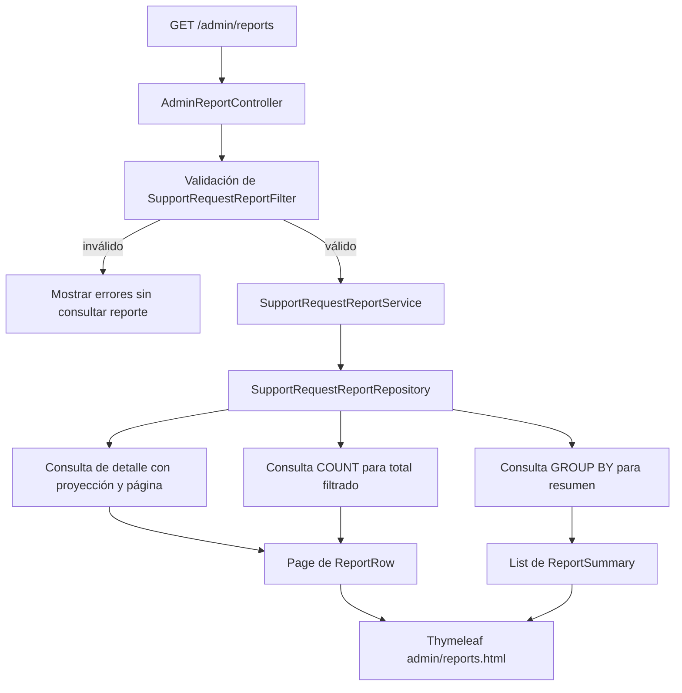

# 41 — Reportes dinámicos con JPA: filtros, proyecciones y agrupaciones

En el [capítulo 40](40-roles-autorizacion-y-auditoria.md) aprendiste cómo proteger una operación administrativa y por qué una persona con sesión iniciada no adquiere automáticamente todos los permisos del sistema. Ahora necesitamos resolver otro problema:

> **¿Cómo consultar todas las solicitudes de apoyo mediante filtros combinables, obtener el total correcto, resumir los resultados por estado o tipo y mostrar una página sin cargar innecesariamente todos los registros?**

En una aplicación real, un listado de trabajo y un **reporte administrativo** tienen propósitos distintos. PetMatch muestra solicitudes abiertas a quienes buscan participar; el panel de reportes, en cambio, permite analizar solicitudes de todos los propietarios y estados, incluidas las ya completadas o canceladas.

Este capítulo utiliza **Spring Boot, Spring MVC, Thymeleaf, JPA y Criteria API** sobre el código existente de PetMatch Community. No necesitas copiar el dominio de mascotas para aprender el mecanismo: podrás trasladarlo a reservas, préstamos, inventarios, facturación u otro problema que requiera consultas globales.

Al finalizar podrás definir un contrato de filtros, construir predicados opcionales, interpretar las tres consultas que alimentan el reporte, distinguir una proyección de una entidad, razonar sobre fechas inclusivas, explicar por qué el total no es el número de filas visibles y justificar cuándo conviene **no** introducir un patrón de diseño.

---

## 1. El problema: un catálogo no responde todas las preguntas administrativas

En PetMatch existen preguntas diferentes:

- **Catálogo público de solicitudes:** ¿qué solicitudes están `OPEN` y tienen una fecha de servicio futura?
- **Mis solicitudes:** ¿cuáles pertenecen al usuario autenticado?
- **Reporte administrativo:** ¿cuántas solicitudes existen para un tipo, estado y periodo, independientemente de su propietario?

No deberíamos reutilizar sin más la consulta del catálogo público para un reporte global.

**🔎 Código real — [SupportRequestService.findOpenRequests()](../../src/main/java/com/petmatch/community/service/SupportRequestService.java):**

```java
@Transactional(readOnly = true)
public List<SupportRequest> findOpenRequests() {
    return supportRequestRepository.findByStatusAndServiceDateAfterOrderByServiceDateAsc(
        SupportRequestStatus.OPEN,
        LocalDateTime.now()
    );
}
```

Esta consulta tiene sentido para el catálogo de oportunidades futuras. Sin embargo, excluye `IN_PROGRESS`, `COMPLETED`, `CANCELLED` y solicitudes pasadas. Utilizarla como base de un reporte histórico haría desaparecer información que sí importa para analizar el negocio.

**🧠 Idea mental**

```text
Listado operativo
    → datos relevantes para una tarea concreta

Reporte administrativo
    → población definida + filtros explícitos
      + detalles + total + resumen
```

**Antes de continuar:** en un sistema de biblioteca, ¿sería correcto crear un reporte de préstamos históricos a partir de una consulta que solo devuelve préstamos pendientes? Explica qué información se perdería.

---

## 2. Antes de escribir código, define la población y los filtros

La población base del reporte de PetMatch incluye las solicitudes de **todos los propietarios**, sin imponer el filtro del catálogo público.

Sobre esa población, el usuario administrador puede aplicar:

| Entrada | Tipo Java | Significado |
|---|---|---|
| `status` | `SupportRequestStatus` | Estado de la solicitud |
| `supportType` | `SupportType` | Tipo de ayuda |
| `fromDate` | `LocalDate` | Primer día del intervalo, incluido |
| `toDate` | `LocalDate` | Último día del intervalo, incluido |
| `grouping` | `ReportGrouping` | Dimensión del resumen: estado o tipo |

Los primeros cuatro criterios son **opcionales**. Cuando se omite uno, no se agrega su condición a la consulta. `grouping` tiene un valor inicial y no puede quedar nulo tras la validación.

### Ejemplo de datos

Trabajaremos conceptualmente con cuatro registros, que corresponden a los casos de borde utilizados en las pruebas del repositorio:

| Solicitud | Propietario | Tipo | Estado | Fecha de servicio |
|---|---|---|---|---|
| A | Ana | `WALK` | `CANCELLED` | 09-01-2030 23:59:59 |
| B | Ana | `WALK` | `OPEN` | 10-01-2030 00:00:00 |
| C | Bruno | `WALK` | `COMPLETED` | 10-01-2030 23:59:59 |
| D | Ana | `FEEDING` | `OPEN` | 11-01-2030 00:00:00 |

**Antes de ejecutar:**

1. Sin filtros, ¿cuántas filas debe devolver el reporte?
2. Si `supportType=WALK`, ¿cuáles filas quedan?
3. Si además `status=OPEN`, ¿cuáles quedan?
4. Si el intervalo empieza y termina el 10 de enero, ¿qué ocurre con A, B, C y D?
5. ¿Por qué el reporte debe incluir C, aunque pertenezca a otra persona y tenga estado `COMPLETED`?

La respuesta no debe depender de cómo esté construida la pantalla. Debe surgir del contrato de consulta.

---

## 3. Un filtro es un objeto del contrato de entrada

PetMatch representa los criterios en [SupportRequestReportFilter.java](../../src/main/java/com/petmatch/community/dto/report/SupportRequestReportFilter.java).

**Código real — campos relevantes:**

```java
public class SupportRequestReportFilter {
    private SupportRequestStatus status;
    private SupportType supportType;

    @DateTimeFormat(iso = DateTimeFormat.ISO.DATE)
    private LocalDate fromDate;

    @DateTimeFormat(iso = DateTimeFormat.ISO.DATE)
    private LocalDate toDate;

    @NotNull(message = "Selecciona una agrupación válida")
    private ReportGrouping grouping = ReportGrouping.STATUS;

    // Getters, setters and validation methods.
}
```

En el archivo real, `@NotNull` es una constraint de Jakarta Validation y los accesos usan los getters y setters públicos.

### ¿Por qué no colocar todos los parámetros directamente en el Repository?

Un objeto de filtro concentra la interpretación de la entrada:

- los enums evitan manejar estados y tipos como cadenas arbitrarias;
- `LocalDate` representa una fecha de calendario, no una hora concreta;
- `ReportGrouping.STATUS` define la agrupación predeterminada;
- los getters y setters permiten el *binding* de parámetros HTTP en Spring MVC;
- la validación del intervalo no necesita repetirse en cada consulta.

No confundas este DTO con una Entity de JPA. **No se persiste** como tabla ni representa una solicitud individual; transporta criterios de búsqueda.

**🔁 Relación con capítulos anteriores:** en [Formularios y Form DTO](../03-web-mvc/20-formularios-y-form-dto.md) ya separaste los datos recibidos por el usuario del modelo persistido. Un filtro de reporte es otro ejemplo de esa misma separación de responsabilidades.

---

## 4. La combinación de filtros utiliza AND, no consultas independientes

Supongamos la pregunta:

> Solicitudes `OPEN`, de tipo `WALK`, cuyo servicio ocurre el 10 de enero de 2030.

La intención equivale a:

```text
status = OPEN
AND supportType = WALK
AND serviceDate >= 2030-01-10T00:00
AND serviceDate <  2030-01-11T00:00
```

El usuario quiere la **intersección** de todos los criterios, no la unión de los resultados de cuatro consultas.

### SQL conceptual — no es una consulta literal del Repository

```sql
SELECT id, title, support_type, status, service_date
FROM support_requests
WHERE status = 'OPEN'
  AND support_type = 'WALK'
  AND service_date >= '2030-01-10 00:00:00'
  AND service_date <  '2030-01-11 00:00:00';
```

En PetMatch **no se construye este SQL concatenando cadenas**. Hibernate genera SQL a partir de la consulta JPA. El ejemplo solo sirve para visualizar la lógica.

### ¿Qué sucede cuando falta un filtro?

Si el administrador deja vacío el campo `status`, la condición sobre `status` **no existe**. No debe compararse contra un valor inexistente ni debe interpretarse automáticamente como `OPEN`.

De manera semejante:

```text
Sin filtros de estado ni tipo
    → todas las solicitudes

Solo status=OPEN
    → todas las solicitudes abiertas

Solo supportType=WALK
    → solicitudes WALK de todos los estados

status=OPEN y supportType=WALK
    → solicitudes que cumplen ambos criterios
```

**⚠️ Error frecuente:** sumar las cantidades de resultados individuales como si representaran el número de registros que cumplen todos los filtros. Una solicitud puede aparecer en varias consultas individuales.

---

## 5. Fechas inclusivas: representar correctamente el último día

El campo de dominio [SupportRequest.serviceDate](../../src/main/java/com/petmatch/community/model/SupportRequest.java) es `LocalDateTime`: contiene fecha **y hora**.

En cambio, el formulario recibe `LocalDate` para `fromDate` y `toDate`. Una fecha como `2030-01-10` no contiene una hora.

Si el usuario escribe:

```text
Desde: 2030-01-10
Hasta: 2030-01-10
```

espera encontrar **todo el día 10**, no únicamente los registros de medianoche.

### La forma de comparar los límites

PetMatch utiliza un intervalo semiabierto:

```text
serviceDate >= comienzoDelPrimerDía
serviceDate <  comienzoDelDíaSiguienteAlÚltimo
```

**Código real — [SupportRequestReportFilter](../../src/main/java/com/petmatch/community/dto/report/SupportRequestReportFilter.java):**

```java
public LocalDateTime start() {
    return fromDate == null ? null : fromDate.atStartOfDay();
}

public LocalDateTime endExclusive() {
    return toDate == null ? null : toDate.plusDays(1).atStartOfDay();
}
```

Con las fechas del ejemplo:

```text
Inicio incluido: 2030-01-10T00:00
Fin excluido:    2030-01-11T00:00
```

Así se incluye una solicitud del 10 de enero a las `23:59:59` y se excluye otra del 11 de enero a las `00:00:00`.

**¿Por qué no escribir «hasta las 23:59:59»?** Porque una columna puede contener fracciones de segundo. Elegir manualmente una supuesta última hora podría omitir valores válidos.

### Límite del modelo temporal

La aplicación utiliza fechas y horas **locales**, sin convertirlas a zonas horarias globales. Un sistema internacional con instantes UTC o transiciones de horario de verano necesitaría analizar un modelo temporal distinto. Este capítulo no atribuye esa capacidad al código actual.

---

## 6. Validar el contrato antes de consultar la base

Un reporte no debe aceptar silenciosamente un intervalo invertido o una agrupación inexistente.

En el DTO hay una regla con `@AssertTrue`:

**Código real — método central:**

```java
@AssertTrue(
        message =
                "El rango debe ser válido: fecha inicial ≤ final y fecha final anterior a"
                    + " 9999-12-31")
public boolean isValidRange() {
    return (fromDate == null || toDate == null || !fromDate.isAfter(toDate))
            && validDate(fromDate)
            && validDate(toDate);
}
```

La validación permite intervalos incompletos: puedes definir solamente `fromDate` o solamente `toDate`. Si ambas fechas existen, `fromDate` no puede ser posterior a `toDate`.

El método `validDate(...)` también restringe las fechas admitidas al dominio de años que la aplicación definió: año igual o mayor a `1000`, y fecha estrictamente anterior al `9999-12-31`. Esta última regla deja margen para calcular `toDate.plusDays(1)` dentro de los límites admitidos por la aplicación.

Además existe una validación explícita en Service:

```java
public void validate() {
    if (!isValidRange() || grouping == null)
        throw new IllegalArgumentException("Filtros inválidos");
}
```

### Validación HTTP y validación del Service no son lo mismo

- En **Spring MVC**, `@Valid` y `BindingResult` permiten mostrar errores del formulario.
- En la **capa de Service/Repository**, `validate()` protege el caso de uso ante llamadas que no se originaron en ese formulario.

La repetición tiene un propósito concreto: no suponer que todas las llamadas futuras llegarán siempre por el mismo Controller.

**Antes de continuar:** ¿qué esperas que ocurra si el usuario introduce `2030-02-01` como fecha inicial y `2030-01-01` como fecha final? ¿Debe la aplicación ejecutar el query y devolver cero filas, o avisar que el filtro es inválido? Explica tu decisión.

---

## 7. Criteria API: construir una consulta a partir de condiciones presentes

JPA Criteria API permite construir consultas mediante objetos Java. En lugar de escribir una variante textual diferente para cada combinación de filtros, PetMatch arma una lista de predicados.

**Código real — método [SupportRequestReportRepository.predicates(...)](../../src/main/java/com/petmatch/community/repository/SupportRequestReportRepository.java):**

```java
private Predicate[] predicates(
        CriteriaBuilder builder,
        Root<SupportRequest> root,
        SupportRequestReportFilter filter) {

    filter.validate();
    var predicates = new ArrayList<Predicate>();

    if (filter.getStatus() != null)
        predicates.add(builder.equal(root.get("status"), filter.getStatus()));

    if (filter.getSupportType() != null)
        predicates.add(builder.equal(root.get("supportType"), filter.getSupportType()));

    if (filter.start() != null)
        predicates.add(builder.greaterThanOrEqualTo(
                root.get("serviceDate"), filter.start()));

    if (filter.endExclusive() != null)
        predicates.add(builder.lessThan(
                root.get("serviceDate"), filter.endExclusive()));

    return predicates.toArray(Predicate[]::new);
}
```

### Descomponer las piezas

| Pieza | Función |
|---|---|
| `CriteriaBuilder` | Construye expresiones, condiciones, agregaciones y consultas. |
| `Root<SupportRequest>` | Representa la entidad raíz que se consulta. |
| `Predicate` | Representa una condición de selección. |
| `builder.equal(...)` | Expresa igualdad, como `status = OPEN`. |
| `greaterThanOrEqualTo(...)` | Expresa el inicio incluido del intervalo. |
| `lessThan(...)` | Expresa el final excluido del intervalo. |

Cuando una condición es opcional, su `if` decide si se incorpora o no.

Los predicados se pasan después a `.where(...)` mediante el arreglo devuelto. Con este diseño se puede mantener **una definición común de filtros** en tres consultas diferentes.

**🧠 Idea mental**

```text
Filtro recibido
      ↓
Campos válidos y opcionales
      ↓
Lista de Predicate
      ↓
WHERE del query de detalle / COUNT / GROUP BY
```

### ¿Es automáticamente la mejor API de consultas?

No. Para filtros simples y fijos, métodos derivados de Spring Data JPA pueden resultar más concisos. `@Query` también puede ser apropiado cuando una consulta JPQL bien definida es fácil de mantener. `Specification` permite componer predicados en proyectos que lo necesitan.

PetMatch usa **Criteria API con `EntityManager` directamente** en este reporte. No utiliza QueryDSL ni `JpaSpecificationExecutor` para esta funcionalidad.

La decisión responde a la necesidad real de construir filtros combinables y reutilizarlos. No se agrega otro framework solo porque exista.

---

## 8. Proyecciones: consultar lo necesario para una tabla

Una Entity como [SupportRequest](../../src/main/java/com/petmatch/community/model/SupportRequest.java) representa un objeto del dominio persistido. Contiene relaciones con `Pet`, `User` y postulaciones, además de campos que no se necesitan para cada fila del reporte.

La pantalla administrativa necesita solamente:

```text
ID
Título
Tipo de ayuda
Estado
Nombre de mascota
Fecha del servicio
```

PetMatch utiliza un `record`:

**Código real — [ReportRow.java](../../src/main/java/com/petmatch/community/dto/report/ReportRow.java):**

```java
public record ReportRow(
        Long id,
        String title,
        SupportType supportType,
        SupportRequestStatus status,
        String petName,
        LocalDateTime serviceDate) {}
```

Este record es una **proyección de lectura**: reúne los campos que requiere la tabla sin entregar una Entity JPA completa.

### ¿Cómo se construye la proyección?

**Código real — parte de `detailQuery(...)`:**

```java
query.select(builder.construct(
        ReportRow.class,
        root.get("id"),
        root.get("title"),
        root.get("supportType"),
        root.get("status"),
        root.join("pet").get("name"),
        root.get("serviceDate")))
    .where(predicates(builder, root, filter))
    .orderBy(
        builder.asc(root.get("serviceDate")),
        builder.asc(root.get("id")));
```

`builder.construct(...)` indica qué valores serán recibidos por el constructor de `ReportRow`, **en el mismo orden** de sus componentes.

`root.join("pet").get("name")` permite seleccionar el nombre de la mascota asociada. En vez de recorrer desde Thymeleaf una lista de `SupportRequest` para cargar cada `Pet`, la consulta selecciona los datos de la tabla y la relación en una misma operación lógica.

**Ventajas concretas:**

- no se cargan de forma intencional todas las propiedades de cada Entity del reporte;
- no se expone al modelo de vista el grafo completo de relaciones;
- el nombre de mascota se obtiene mediante un `JOIN` definido por la consulta;
- la lectura es compatible con `spring.jpa.open-in-view: false`.

### Un matiz sobre rendimiento

Una proyección reduce los datos solicitados, pero **no demuestra por sí sola** que la consulta sea rápida ni que todos los escenarios carezcan de problemas de rendimiento. Debes observar el SQL generado y medirlo en condiciones reproducibles cuando el volumen lo justifique.

**⚠️ Error frecuente:** asumir que `@EntityGraph`, `JOIN` y proyección son mecanismos intercambiables. Cada uno responde a una necesidad concreta de obtención de datos.

---

## 9. Orden estable y paginación: ¿qué representa una página?

En un reporte grande no tiene sentido mostrar miles de registros en una sola tabla. PetMatch muestra **20 filas por página**.

El Service crea la petición:

**Código real — [SupportRequestReportService.search(...)](../../src/main/java/com/petmatch/community/service/report/SupportRequestReportService.java):**

```java
return new Report(
        repository.search(
            filter,
            PageRequest.of(Math.min(100000, Math.max(0, page)), 20)),
        repository.aggregate(filter));
```

El número de página comienza en **cero** en Spring Data:

```text
page=0 → primera página
page=1 → segunda página
page=2 → tercera página
```

La implementación normaliza valores negativos a cero y limita el número solicitado a `100000`. No se está mostrando una cantidad ilimitada de filas.

### ¿Cómo se obtiene la porción de datos?

**Código real — fragmento de `SupportRequestReportRepository.search(...)`:**

```java
entityManager.createQuery(detailQuery(builder, filter))
        .setFirstResult(Math.toIntExact(pageable.getOffset()))
        .setMaxResults(pageable.getPageSize())
        .getResultList()
```

El desplazamiento se calcula como:

```text
offset = númeroDePágina × tamañoDePágina
```

Para una página de 20 registros:

| Página | Offset | Filas buscadas |
|---|---:|---|
| 0 | 0 | Primeras 20 |
| 1 | 20 | Siguientes 20 |
| 2 | 40 | Siguientes 20 |

En PetMatch se ordenan las filas primero por `serviceDate` y después por `id` ascendente.

**¿Por qué también ordenar por ID?** Dos solicitudes pueden tener la misma fecha y hora. Usar el ID como segundo criterio evita un orden ambiguo entre esas filas cuando el conjunto de datos se mantiene estable.

No obstante, una paginación por offset **no garantiza una fotografía inmutable** si otras transacciones insertan o eliminan registros entre una petición y la siguiente. Ese problema requiere otras decisiones cuando el producto necesita navegar datos cambiantes con garantías fuertes.

---

## 10. Total filtrado: no es igual al tamaño de la página

Supongamos que existen **26 solicitudes** que cumplen los filtros:

```text
Primera página: 20 filas
Segunda página: 6 filas
Total filtrado: 26
```

Si la interfaz mostrara `20` como «Total», estaría informando el tamaño de la primera página, no el número de solicitudes que cumplen la búsqueda.

PetMatch ejecuta una consulta `COUNT` separada:

**Código real — fragmento:**

```java
var count = builder.createQuery(Long.class);
var countRoot = count.from(SupportRequest.class);

count.select(builder.count(countRoot))
    .where(predicates(builder, countRoot, filter));
```

Después, el resultado paginado se construye con:

```java
return new PageImpl<>(
        rows,
        pageable,
        entityManager.createQuery(count).getSingleResult());
```

La construcción real de `PageImpl` utiliza el contenido obtenido mediante `setFirstResult` y `setMaxResults`, el `Pageable` y el total calculado.

### ¿Por qué reutilizar `predicates(...)`?

Porque una diferencia involuntaria entre filtros de detalle y filtros del contador haría que la página mostrara una población y el total describiera otra.

Por ejemplo:

```text
Consulta detalle:
status=OPEN AND supportType=WALK

Consulta COUNT equivocada:
status=OPEN
```

Ese diseño mostraría un número engañoso. La reutilización del método de predicados reduce este riesgo.

**🧪 Prueba real:** `ReportIntegrationTests.totalsAreNotLimitedToPage()` añade registros y comprueba que la segunda página contiene seis filas, pero el total filtrado sigue siendo 26.

---

## 11. Agrupación: una tercera pregunta sobre la misma población

Además del detalle y del total, la interfaz necesita un **resumen**.

Por ejemplo, sin filtros y usando los cuatro registros del inicio:

| Estado | Cantidad |
|---|---:|
| `OPEN` | 2 |
| `COMPLETED` | 1 |
| `CANCELLED` | 1 |

La suma del resumen es cuatro, igual al total filtrado.

Si agrupamos por tipo de ayuda:

| Tipo | Cantidad |
|---|---:|
| `WALK` | 3 |
| `FEEDING` | 1 |

El número de solicitudes **no cambia** por escoger otra agrupación. Lo que cambia es la dimensión utilizada para explicarlo.

### Qué es `GROUP BY`

En SQL, agrupar permite reunir filas por el valor de una expresión y aplicar funciones agregadas como `COUNT`.

**SQL conceptual — no copiado del Repository:**

```sql
SELECT status, COUNT(*)
FROM support_requests
GROUP BY status;
```

Los resultados muestran una fila por estado presente en la población filtrada. No hay una fila por solicitud individual.

---

## 12. Agrupación parametrizada: aquí no necesitamos Strategy

En una versión anterior del proyecto existieron clases separadas para agrupar por estado y por tipo. El código actual simplificó esa estructura.

En PetMatch, la diferencia real entre ambas consultas es **el atributo de agrupación**, no dos algoritmos independientes.

**Código real — [ReportGrouping.java](../../src/main/java/com/petmatch/community/dto/report/ReportGrouping.java):**

```java
public enum ReportGrouping {
    STATUS("status"),
    SUPPORT_TYPE("supportType");

    private final String entityAttribute;

    ReportGrouping(String entityAttribute) {
        this.entityAttribute = entityAttribute;
    }

    public String entityAttribute() {
        return entityAttribute;
    }
}
```

Este `enum` actúa como una **lista permitida** de atributos JPA. La entrada HTTP no se convierte en un nombre arbitrario de columna: Spring primero vincula el valor a uno de los dos miembros conocidos de `ReportGrouping`.

**Código real — [SupportRequestReportRepository.aggregate(...)](../../src/main/java/com/petmatch/community/repository/SupportRequestReportRepository.java):**

```java
public List<ReportSummary> aggregate(SupportRequestReportFilter filter) {
    filter.validate();

    var builder = entityManager.getCriteriaBuilder();
    var query = builder.createTupleQuery();
    var root = query.from(SupportRequest.class);
    var groupKey = root.get(filter.getGrouping().entityAttribute());

    query.multiselect(groupKey, builder.count(root))
            .where(predicates(builder, root, filter))
            .groupBy(groupKey)
            .orderBy(builder.asc(groupKey));

    return entityManager.createQuery(query).getResultList().stream()
            .map(tuple -> new ReportSummary(
                    tuple.get(0).toString(),
                    tuple.get(1, Long.class)))
            .toList();
}
```

### ¿Qué significa cada pieza?

- `createTupleQuery()` permite seleccionar más de una expresión sin crear una Entity.
- `groupKey` representa el atributo elegido: `status` o `supportType`.
- `multiselect(groupKey, builder.count(root))` selecciona la clave de grupo y su cantidad.
- `.where(predicates(...))` conserva exactamente la población filtrada.
- `.groupBy(groupKey)` genera la agrupación.
- `.orderBy(builder.asc(groupKey))` ordena las claves de grupo.
- Cada resultado se transforma en [ReportSummary](../../src/main/java/com/petmatch/community/dto/report/ReportSummary.java).

**Código real:**

```java
public record ReportSummary(String label, Long total) {}
```

### ¿Por qué esta decisión es más sencilla?

No necesitas crear una interfaz, dos implementaciones y un mapa de estrategias para cambiar solamente una columna de `GROUP BY`.

Este es un buen ejemplo de **KISS**: mantener la variabilidad donde realmente está, en la consulta de persistencia.

No significa que Strategy sea un patrón incorrecto. PetMatch utiliza Strategy en una necesidad diferente: **generar PDF y Excel**, donde hay dos algoritmos y dos bibliotecas realmente distintos. Esa decisión se estudia después, al abordar exportación.

**⚠️ Error frecuente:** decir que el reporte todavía utiliza `StatusReportAggregationStrategy` y `SupportTypeReportAggregationStrategy`. Esas clases pertenecían a una implementación anterior y **no forman parte del diseño vigente**.

---

## 13. Las tres consultas cumplen responsabilidades diferentes

Ahora podemos reconstruir todo el flujo:



La clase [SupportRequestReportService](../../src/main/java/com/petmatch/community/service/report/SupportRequestReportService.java) devuelve un resultado compuesto:

**Código real:**

```java
public record Report(
        Page<ReportRow> rows,
        List<ReportSummary> summary) {}
```

| Resultado | Consulta responsable | Representación Java |
|---|---|---|
| Filas de la página | Detalle con proyección, orden y límites | `Page<ReportRow>` |
| Total filtrado | `COUNT` con los mismos predicados | `Page.getTotalElements()` |
| Resumen | `GROUP BY` y `COUNT` con los mismos predicados | `List<ReportSummary>` |

Esta separación explica por qué **la agrupación, el total y las filas visibles deben mantenerse coherentes**.

### Un límite de consistencia temporal

Se ejecutan consultas separadas dentro de una operación `@Transactional(readOnly = true)`. Eso organiza la lectura como un caso de uso y comunica su intención, pero **no equivale automáticamente a una fotografía histórica inmutable**.

Si otra transacción modifica registros simultáneamente, las garantías exactas dependen del aislamiento de la base de datos y de su comportamiento. La anotación `readOnly` no es un mecanismo de autorización ni una prohibición universal de escritura.

Para un reporte regulatorio con necesidad de corte exacto, habría que establecer requisitos adicionales de consistencia. No los supongas implementados aquí.

---

## 14. El Controller vincula y valida los filtros

El endpoint está en [AdminReportController.java](../../src/main/java/com/petmatch/community/controller/AdminReportController.java).

**Código real — método completo:**

```java
@GetMapping("/admin/reports")
public String report(
        @Valid @ModelAttribute("filter") SupportRequestReportFilter filter,
        BindingResult errors,
        @RequestParam(defaultValue = "0") int page,
        Model model) {

    model.addAttribute("statuses", SupportRequestStatus.values());
    model.addAttribute("types", SupportType.values());
    model.addAttribute("groupings", ReportGrouping.values());

    if (!errors.hasErrors())
        model.addAttribute("report", service.search(filter, page));

    return "admin/reports";
}
```

### ¿Qué hace cada elemento?

1. `@GetMapping` indica una consulta sin modificación intencional de datos.
2. `@ModelAttribute("filter")` recibe parámetros del query string y construye el filtro.
3. `@Valid` activa Bean Validation sobre el objeto vinculado.
4. `BindingResult` permite recuperar errores de conversión y validación.
5. `page` determina qué porción se solicita.
6. `Model` proporciona las opciones del formulario y, cuando procede, los resultados.
7. El método devuelve el nombre de la plantilla Thymeleaf.

**Importante:** si el filtro no es válido, el Controller **no llama a `service.search(...)`**. La plantilla puede mostrar errores y permitir la corrección.

En el endpoint HTML, el formulario inválido se presenta con una respuesta HTTP exitosa para la página y errores en el modelo; no debe describirse como una descarga ni confundirse con el contrato HTTP del endpoint de exportación, que responde de otra manera.

---

## 15. Thymeleaf: el reporte no necesita conocer Criteria API

La plantilla [admin/reports.html](../../src/main/resources/templates/admin/reports.html) muestra los campos de búsqueda y, si existe un resultado, la tabla, el total y los grupos.

**Código real — formulario:**

```html
<form th:action="@{/admin/reports}" th:object="${filter}" method="get">
    <div class="pm-filter-field">
        <label class="pm-label" for="status">Estado</label>
        <select class="pm-input" id="status" th:field="*{status}">
            <option value="">Todos los estados</option>
            <option th:each="s : ${statuses}"
                    th:value="${s}"
                    th:text="${s}">
            </option>
        </select>
    </div>
</form>
```

El método `GET` hace posible representar los filtros mediante una URL como:

```text
/admin/reports?status=OPEN&supportType=WALK&fromDate=2030-01-10&toDate=2030-01-10
```

Es una consulta administrativa: **la URL sigue protegida** por la configuración de Spring Security. Que los criterios viajen en el query string no concede acceso por sí solo.

### El total y el resumen

**Código real — fragmentos de la vista:**

```html
<strong th:text="${report.rows.totalElements}">0</strong>
```

```html
<ul aria-label="Resumen agrupado"
    class="pm-summary-list"
    th:if="${!report.summary.empty}">
    <li th:each="s : ${report.summary}">
        <span th:text="${s.label}">Estado</span>
        <strong th:text="${s.total}">0</strong>
    </li>
</ul>
```

La vista tampoco reconstruye el total sumando filas visibles. Utiliza el valor ya calculado por la consulta de contador.

### El estado vacío es un caso legítimo

Si no hay coincidencias, la plantilla presenta un mensaje específico invitando a cambiar los filtros. **Cero resultados no es un error de base de datos** ni debe mostrarse como una excepción.

### Conservar filtros entre páginas

Los enlaces de paginación incluyen explícitamente `page`, `status`, `supportType`, `fromDate`, `toDate` y `grouping`.

Así, al navegar a la segunda página se mantiene la **misma búsqueda**, en lugar de recuperar de manera accidental todos los registros.

**🔁 Relación con MVC:** el Controller interpreta HTTP y construye el modelo; la plantilla presenta datos; el Repository decide cómo consultarlos. Ninguna de estas capas debería asumir la responsabilidad completa de las otras.

---

## 16. Seguridad: un reporte global requiere autorización global

La diferencia más sensible entre el catálogo y el reporte es su **alcance**.

El reporte no filtra automáticamente por `ownerId`, porque su requisito es analizar las solicitudes de **todos** los propietarios. Eso no lo convierte en un recurso público.

El endpoint `/admin/reports` está protegido por:

```java
.requestMatchers("/admin/**").access(currentAdminAuthorization)
```

[CurrentAdminAuthorization](../../src/main/java/com/petmatch/community/security/CurrentAdminAuthorization.java) comprueba una autoridad administrativa de la sesión y el rol activo persistido.

**Dos decisiones se complementan:**

```text
Autorización HTTP
    → ¿puede esta persona acceder a un reporte global?

Contrato de consulta
    → ¿qué solicitudes, estados y fechas deben aparecer?
```

No introduzcas un filtro por propietario solo para parecer más seguro si eso invalida el requisito administrativo. Tampoco elimines la autorización porque el reporte sea de solo lectura: **leer información global también puede requerir privilegios**.

**⚠️ Error frecuente:** aplicar en la consulta global la regla de `findCurrentUserRequests(...)` y después concluir que los resultados de otros propietarios «no existen».

---

## 17. Verificar el reporte con pruebas de integración

La clase [ReportIntegrationTests.java](../../src/test/java/com/petmatch/community/integration/ReportIntegrationTests.java) construye solicitudes de más de un propietario, con estados, tipos y fechas diferentes.

Sus pruebas ayudan a reconocer qué casos de borde importan.

| Prueba del repositorio | Qué comprueba |
|---|---|
| `unfilteredIncludesAllOwnersAndStates` | El reporte global no oculta otros propietarios ni estados. |
| `filtersIndividuallyAndTogether` | Los predicados opcionales se combinan correctamente. |
| `dateBoundsIncludeWholeLastDayAndExcludeNextMidnight` | El último día se incluye completo y el siguiente no. |
| `bothStrategiesAggregateSameFilteredPopulation` | Dos agrupaciones mantienen la misma población filtrada. |
| `totalsAreNotLimitedToPage` | El total del reporte no se limita a las primeras 20 filas. |
| `emptyResultAndInvalidRange` | Un resultado vacío es válido y un intervalo invertido se rechaza. |
| `adminViewAndValidationErrorsRender` | El formulario muestra errores de entrada sin presentar datos incorrectos. |
| `reportsRenderResponsiveFiltersAndLocalStyles` | La vista incluye estructura de filtros y estilos esperados. |

> [!NOTE]
> El nombre de prueba `bothStrategiesAggregateSameFilteredPopulation` es **histórico**: después de la refactorización ya no existen las dos clases Strategy para agrupar. La prueba sigue comprobando la igualdad de población entre agrupaciones, pero su nombre no describe la arquitectura actual.

### 17.1 Un caso de fecha

El fixture registra solicitudes en:

```text
2030-01-09T23:59:59
2030-01-10T00:00:00
2030-01-10T23:59:59
2030-01-11T00:00:00
```

Al consultar solamente el 10 de enero, deben entrar las dos solicitudes del día 10 y quedar fuera las otras dos.

### 17.2 Un caso de total global

La prueba añade registros hasta obtener 26 coincidencias. Comprueba:

```text
Página 0: 20 filas
Página 1: 6 filas
Total:    26 filas
```

El resumen agregado también debe sumar 26.

### 17.3 Un caso de filtro inválido

Si `fromDate` es posterior a `toDate`, el Service rechaza el contrato. En la pantalla MVC, el usuario ve errores asociados al formulario y puede corregirlos.

Estas pruebas muestran **comportamiento ejecutado contra las capas reales**, no solamente que compila una consulta Criteria.

### Cómo ejecutar la suite de forma segura

El proyecto utiliza una base de datos separada para pruebas, configurada mediante:

```text
TEST_DB_URL
TEST_DB_USERNAME
TEST_DB_PASSWORD
```

**No utilices una base de producción** ni una base que contenga información que necesites conservar. Con el entorno de tests aislado y configurado, puedes ejecutar:

```bash
./mvnw clean verify
```

El resultado de la suite corresponde al commit y al ambiente donde se ejecutó. Una ejecución satisfactoria no garantiza que todos los filtros o escenarios imaginables hayan sido probados.

---

## 18. Rendimiento: medir antes de añadir índices o cachés

Una consulta correctamente diseñada puede volverse lenta si el volumen de datos cambia. En este caso hay trabajo asociado a:

- seleccionar y ordenar las filas de la página;
- contar las filas de toda la población filtrada;
- agrupar toda esa misma población;
- realizar el `JOIN` necesario para obtener el nombre de mascota.

PetMatch utiliza un test de medición reproducible, [ReportQueryPerformanceTests.java](../../src/test/java/com/petmatch/community/integration/ReportQueryPerformanceTests.java), que:

1. crea **120 solicitudes sintéticas**;
2. aplica filtros por estado y tipo;
3. realiza cinco ejecuciones de calentamiento;
4. repite 25 mediciones del método `service.search(filter, 0)`;
5. registra la **mediana** y el **percentil 95** en `target/report-query-performance.json`.

No es una medición de latencia HTTP de extremo a extremo: mide la operación del Service, incluida su interacción con el Repository, bajo las condiciones del test.

Tampoco es un objetivo contractual de producción. Para comparar cambios debes conservar motor de base, volumen, distribución de registros, índices, entorno, condiciones de concurrencia y versión de código.

### ¿Cómo optimizar con criterio?

Antes de agregar índices compuestos o una caché, pregunta:

1. ¿Cuál consulta resulta costosa: detalle, total o agrupación?
2. ¿Qué filtros se utilizan de verdad?
3. ¿Qué plan de ejecución produce la base?
4. ¿El índice mejora las lecturas más importantes sin introducir un costo excesivo en escrituras?
5. ¿La mejora se mantiene cuando aumenta la cantidad de registros?

En bases que lo soportan, `EXPLAIN` ayuda a revisar el plan de ejecución. **No** debemos declarar que Criteria API garantiza eficiencia; solo proporciona una forma programática de expresar la consulta.

### Escalabilidad y límites del diseño actual

- El detalle usa paginación por offset.
- El total y el resumen son consultas adicionales.
- No existen réplicas de lectura, motores analíticos separados ni vistas materializadas configuradas para este módulo.
- `open-in-view: false` evita depender de cargas diferidas durante la renderización, pero no reemplaza la medición de consultas.

Para el alcance actual, este diseño es comprensible y verificable. Si los datos crecieran mucho, convendría evaluar opciones basadas en mediciones y necesidades reales.

---

## 19. ¿Dónde encaja la descarga PDF y Excel?

En la página de reportes aparecen las acciones:

```text
Descargar PDF
Descargar Excel
```

Ambas conservan los mismos criterios del filtro de la pantalla. Sin embargo, una descarga tiene una responsabilidad diferente: producir un archivo válido y comunicar al navegador su tipo y nombre.

La exportación vigente utiliza [ReportExportService](../../src/main/java/com/petmatch/community/service/report/ReportExportService.java) y un contrato [ReportExporter](../../src/main/java/com/petmatch/community/service/report/ReportExporter.java) con dos implementaciones: [PdfReportExporter](../../src/main/java/com/petmatch/community/service/report/PdfReportExporter.java) y [ExcelReportExporter](../../src/main/java/com/petmatch/community/service/report/ExcelReportExporter.java).

**Diferencia esencial:**

```text
Agrupar SQL
    → cambia un atributo de la misma consulta
    → solución directa con Criteria API

Exportar PDF y XLSX
    → cambian algoritmos, estructuras y bibliotecas
    → Strategy puede justificar implementaciones separadas
```

El Repository también contiene `findForExport(...)`, que consulta los registros coincidentes más allá de una sola página. `ReportExportService` aplica un límite de **3.000 registros** para controlar la cantidad de datos procesados en una descarga.

La generación de archivos, sus tipos MIME y sus pruebas pertenecen a un tema específico que se desarrollará en el **capítulo 42**. No es necesario añadir esa complejidad dentro de cada consulta del reporte.

---

## 20. ⚠️ Errores frecuentes

### Error A — Reutilizar el listado público como reporte

```text
Reporte = solicitudes OPEN con fecha futura
```

Esa decisión elimina estados históricos y otros casos que la administración necesita analizar. **Primero define la población del reporte.**

### Error B — Tratar las fechas como instantes exactos de medianoche

```text
toDate=2030-01-10
→ serviceDate <= 2030-01-10T00:00
```

Esta comparación perdería casi todo el último día. Usa el comienzo del día siguiente como límite excluido cuando el contrato expresa fechas locales inclusivas.

### Error C — Contar las filas visibles

```text
20 registros en pantalla → Total = 20
```

No es correcto si existen 26 coincidencias. La consulta de `COUNT` no debe usar el límite de la página.

### Error D — Filtrar diferente en cada consulta

Si el detalle usa `status` y `supportType`, pero el `COUNT` solo utiliza `status`, los resultados dejan de describir la misma población. Reutiliza predicados y comprueba los bordes.

### Error E — Cargar todas las Entities para formar una tabla

No hace falta materializar el grafo completo de asociaciones si solo necesitas seis columnas. Considera una proyección de lectura y consulta las relaciones necesarias de forma controlada.

### Error F — Aceptar nombres de columnas arbitrarios

Un valor HTTP no debería decidir libremente el texto de `GROUP BY`. PetMatch utiliza un enum que enumera dos atributos permitidos.

### Error G — Agregar Strategy donde solo cambia una columna

Crear clases separadas sin comportamiento realmente diferente puede aumentar la dispersión del código. Prefiere una consulta parametrizada hasta que exista una variación que justifique la abstracción.

### Error H — Declarar rendimiento óptimo sin medirlo

Un test que verifica totales correctos no demuestra desempeño bajo carga. Mide y compara sobre datos reproducibles, indicando qué operación y ambiente se evaluaron.

---

## 21. 🔁 Llévalo a tu proyecto

No copies `SupportRequest`, `Pet` ni `SupportType`. Define un reporte que tenga sentido en tu dominio.

**Ejemplo de otro dominio:** un sistema de reservas necesita responder cuántas reservas están confirmadas, canceladas o pendientes en determinado periodo.

### Paso 1 — Define la población

Escribe qué registros pueden aparecer, incluso si están cerrados o pertenecen a diferentes usuarios. Identifica quién está autorizado a consultar la población completa.

### Paso 2 — Selecciona dos filtros opcionales

Elige dos criterios de negocio, como estado y categoría. Decide qué ocurre cuando uno o ambos están vacíos.

### Paso 3 — Elige una fecha correcta

Define si quieres filtrar por fecha de creación, fecha de reserva o fecha de ejecución. Son columnas diferentes y responden preguntas diferentes.

Si el formulario recibe días completos, explica cómo representarás el último día de forma inclusiva.

### Paso 4 — Diseña la proyección

Haz una tabla con las columnas que la pantalla realmente necesita. Decide si bastan valores simples o si es necesaria una relación mediante `JOIN`.

### Paso 5 — Separa las preguntas

Escribe qué información debe obtener cada consulta:

- filas visibles;
- total de coincidencias;
- resumen agrupado.

Comprueba que las tres utilizan la misma definición de filtros.

### Paso 6 — Crea datos de frontera

Propón al menos **cinco registros ficticios**: uno antes del intervalo, uno al comienzo del primer día, uno al final del último, uno después del intervalo y uno con otro estado. Predice cuáles deben aparecer.

### Paso 7 — Justifica la arquitectura

Compara `@Query`, métodos derivados, Criteria API y `Specification` sin afirmar que todos están implementados. Escoge la alternativa más simple que cubra los criterios reales.

No agregues Strategy si únicamente vas a cambiar un atributo de agrupación.

### Paso 8 — Diseña las pruebas

Define casos para:

- sin filtros;
- cada filtro individual;
- filtros combinados;
- intervalos válidos e inválidos;
- conjunto vacío;
- total mayor que una página;
- dos agrupaciones distintas con la misma población;
- usuario sin autorización.

Si incorporas una medición de desempeño, registra **qué mediste**, con qué datos y en cuál versión. No inventes cifras.

La evidencia esperada es un contrato de reporte, un conjunto pequeño de casos reproducibles y una explicación de las decisiones. No se necesita generar PDF ni instalar una herramienta externa para resolver la parte conceptual.

---

## 22. 🧪 Comprueba que entendiste

Responde sin consultar el código:

1. ¿Por qué el catálogo de solicitudes abiertas no sirve directamente como reporte histórico?
2. ¿Qué diferencia existe entre `SupportRequest` y `SupportRequestReportFilter`?
3. ¿Qué significa que un filtro sea opcional?
4. ¿Por qué combinar filtros mediante `AND` no es lo mismo que sumar resultados?
5. ¿Cómo se representa un intervalo que incluya el último día completo?
6. ¿Qué problema podría producir el límite `23:59:59` en un campo con fracciones de segundo?
7. ¿Qué representan `CriteriaBuilder`, `Root` y `Predicate`?
8. ¿Qué obtiene la consulta al usar `builder.construct(ReportRow.class, ...)`?
9. ¿Por qué un `JOIN` controlado puede evitar cargar relaciones por fila desde la vista?
10. ¿Por qué una página de 20 registros puede tener un total de 26?
11. ¿Para qué se usan los dos campos de ordenamiento `serviceDate` e `id`?
12. ¿Por qué el resumen agrupado debe utilizar los mismos predicados del detalle?
13. ¿Qué ventaja tiene limitar la agrupación a `ReportGrouping.STATUS` y `SUPPORT_TYPE`?
14. ¿Por qué las agrupaciones del reporte ya no necesitan clases Strategy?
15. ¿Qué diferencia hay entre un test de exactitud del filtro y uno de rendimiento?
16. ¿Cómo se controla que `/admin/reports` no sea una consulta global pública?

### Diagnóstico de resultados — antes de ejecutar

Con los cuatro registros A, B, C y D de la sección 2, aplica:

```text
supportType = WALK
fromDate = 2030-01-10
toDate = 2030-01-10
grouping = STATUS
```

Explica:

- qué filas aparecen;
- cuál es el total filtrado;
- cuántos grupos hay;
- qué cantidad tiene cada grupo;
- qué cambiaría si se agrega `status=OPEN`;
- por qué ninguna de esas respuestas depende del número de página.

Después busca una prueba de integración del repositorio que ayude a comprobar al menos uno de esos razonamientos.

---

## ✅ Qué debes recordar

Un reporte dinámico es más que un formulario con varias opciones.

**Primero se define la población; después se validan los filtros; finalmente, detalle, total y agrupación responden preguntas diferentes sobre el mismo conjunto.**

PetMatch utiliza Criteria API para construir condiciones opcionales, proyecciones para leer solo los campos necesarios, paginación para limitar la tabla y un enum para controlar la agrupación sin introducir un Strategy artificial.

La lógica que importa no pertenece exclusivamente al dominio de mascotas: sirve cada vez que necesitas consultar registros de manera consistente y explicar por qué el resultado es correcto.

### Para continuar

- [40 — Administración de roles, autorización y auditoría](40-roles-autorizacion-y-auditoria.md).
- [10 — JPA y Hibernate](../02-dominio-y-persistencia/10-jpa-y-hibernate.md).
- [12 — Spring Data JPA](../02-dominio-y-persistencia/12-spring-data-jpa.md).
- [17 — Lazy loading y EntityGraph](../02-dominio-y-persistencia/17-lazy-loading-y-entitygraph.md).
- [18 — Spring MVC](../03-web-mvc/18-spring-mvc.md).
- [19 — Thymeleaf](../03-web-mvc/19-thymeleaf.md).
- [21 — Validación](../03-web-mvc/21-validacion.md).
- [32 — Pruebas de integración](../06-calidad-y-recorrido/32-pruebas-de-integracion.md).

### Referencias oficiales

- [Spring Data JPA — Specifications y Criteria API](https://docs.spring.io/spring-data/jpa/reference/jpa/specifications.html).
- [Spring Data JPA — Definición de métodos de consulta](https://docs.spring.io/spring-data/jpa/reference/repositories/query-methods-details.html).
- [Spring Data JPA — Paginación, iteración y ordenamiento](https://docs.spring.io/spring-data/jpa/reference/repositories/query-methods-details.html#repositories.special-parameters).
- [Jakarta Persistence — Especificación y API](https://jakarta.ee/specifications/persistence/3.2/).
