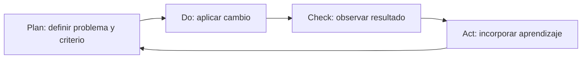

# 44 — Modelos de calidad del software: del requisito a una decisión verificable

En los [capítulos 40](40-roles-autorizacion-y-auditoria.md), [41](41-reportes-dinamicos-jpa.md), [42](42-exportacion-reportes-pdf-excel-strategy.md) y [43](43-usabilidad-navegacion-y-accesibilidad.md) estudiamos autorizaciones, reportes, exportaciones y experiencia de uso. Cada tema permitió resolver un problema técnico distinto, pero todavía falta una pregunta que los conecte:

> **¿Cómo podemos afirmar, con argumentos y evidencias, que una aplicación tiene la calidad necesaria para las personas y situaciones en las que se utilizará?**

No basta con decir que «compila», «usa Spring Boot», «tiene un patrón GoF» o «pasó las pruebas». Esas afirmaciones pueden ser ciertas y, aun así, dejar sin resolver problemas de seguridad, utilidad, rendimiento o interacción.

Este capítulo introduce **modelos y enfoques de calidad** como herramientas para pensar y decidir. Utilizaremos la edición **ISO/IEC 25010:2023** como referencia de **calidad del producto** y estudiaremos **ISO 9001:2015** como marco de **gestión de la calidad**. El ciclo **PDCA** servirá para reconocer cómo una organización puede mejorar sus procesos; no lo confundiremos con una característica del producto ni con un modelo equivalente a ISO/IEC 25010.

El caso de estudio será **PetMatch Community**, pero no vamos a auditar un cronograma ni a copiar una tabla de cumplimiento institucional. Aprenderás a hacer las mismas preguntas sobre un sistema de préstamos, una biblioteca, una aplicación de reservas o cualquier otro proyecto.

Al finalizar podrás:

- distinguir calidad del **producto**, calidad del **proceso** y evidencia de uso real;
- explicar para qué sirve un modelo y por qué no equivale a una certificación;
- reconocer las **nueve características** de ISO/IEC 25010:2023 sin mezclarlas con la edición de 2011;
- relacionar riesgos y requisitos de PetMatch con características pertinentes;
- comparar ISO/IEC 25010:2023, ISO 9001:2015 y PDCA respetando sus diferencias;
- proponer criterios de aceptación y evidencia adecuada sin inventar mediciones;
- decidir qué comprobar primero en función del riesgo;
- transferir el método a un proyecto propio sin agregar funcionalidades artificiales.

---

## 1. ¿Qué significa que el software tenga calidad?

Imagina dos versiones de una aplicación para reservar espacios deportivos.

La primera permite crear una reserva, tiene colores agradables y carga rápidamente. Sin embargo, permite que una persona modifique reservas ajenas.

La segunda impide modificaciones no autorizadas y conserva bien los datos, pero su formulario no explica los errores y los usuarios no logran completar las reservas.

¿Podemos afirmar que alguna es «de calidad» en términos generales?

El problema de esa expresión es que no explica **qué propiedad se evaluó**, para **qué necesidad** ni con **qué evidencia**.

### De una afirmación vaga a una pregunta comprobable

| Afirmación vaga | Pregunta de ingeniería |
|---|---|
| «La aplicación es segura». | ¿Una cuenta normal puede ejecutar una operación administrativa? |
| «Los reportes funcionan». | ¿Los filtros y el total representan exactamente la población solicitada? |
| «La aplicación es rápida». | ¿Qué operación medimos, con qué datos y bajo qué carga? |
| «El código es mantenible». | ¿Puede modificarse un comportamiento sin afectar responsabilidades ajenas? |
| «La interfaz es accesible». | ¿Qué criterios se evaluaron y con qué tecnologías de apoyo? |

La calidad requiere **un contexto y un propósito**. No existe una única cifra capaz de demostrar que todos los riesgos están resueltos.

**🧠 Idea mental**

```text
Necesidad de una persona o del negocio
                ↓
Riesgo si no se satisface
                ↓
Característica de calidad pertinente
                ↓
Criterio observable
                ↓
Prueba, medición u observación
                ↓
Conclusión limitada a esa evidencia
```

**Antes de continuar:** escoge una característica de tu proyecto que consideres «buena». Convierte esa opinión en una pregunta que otra persona pueda comprobar.

---

## 2. ¿Qué es un modelo de calidad?

Un **modelo de calidad** organiza propiedades importantes para evaluar un producto o sistema. Ayuda a que el equipo no dependa únicamente de impresiones generales.

Por ejemplo, si solo revisamos que los formularios guardan datos, podríamos olvidar la confidencialidad de la información, el comportamiento ante fallos o la capacidad de mantener el software.

Un modelo ofrece un **vocabulario de análisis**; después el equipo debe definir requisitos, criterios y evidencias adecuados a su producto.

### No es lo mismo que una herramienta

| Elemento | Qué aporta | Qué no garantiza |
|---|---|---|
| Modelo de calidad del producto | Categorías para definir y evaluar propiedades | Que el software ya cumpla todas |
| Requisito de calidad | Resultado o condición que debe satisfacerse | Que la implementación sea correcta |
| Métrica | Valor calculado con una definición y una fuente | Que todas las propiedades del producto sean buenas |
| Caso de prueba | Evidencia sobre un comportamiento específico | Que no existan defectos fuera del caso |
| Evaluación con usuarios | Observación de tareas reales en un contexto | Que todas las personas o escenarios se comporten igual |
| Certificación externa | Atestación conforme a un alcance y un esquema concretos | Que cualquier producto de la organización esté libre de errores |

**⚠️ Error frecuente:** decir que «el sistema aplica ISO» como si eso fuera un resultado medido. Es necesario indicar la norma, la edición, el alcance y el tipo de actividad realizada.

---

## 3. Tres preguntas que no debemos mezclar

Nuestro punto de partida es distinguir el **producto**, la **gestión** y la **mejora**.

| Referencia | Pregunta principal | Objeto de estudio |
|---|---|---|
| **ISO/IEC 25010:2023** | ¿Qué características de calidad necesitamos en el producto? | Propiedades de productos de software y otros productos TIC |
| **ISO 9001:2015** | ¿Cómo organiza y controla una organización sus procesos para cumplir requisitos y mejorar? | Sistema de gestión de la calidad |
| **PDCA** | ¿Cómo planificamos, realizamos, comprobamos y ajustamos una mejora? | Ciclo de gestión y mejora aplicable a procesos |

**ISO/IEC 25010 y ISO 9001 no son dos escalas alternativas para calificar un programa Java.**

Una aplicación podría satisfacer varios criterios técnicos del modelo de producto y existir en una organización sin un sistema de gestión certificado bajo ISO 9001. También podría ocurrir que una organización tenga un sistema de gestión certificado y que un producto concreto contenga defectos: **el alcance de una certificación de gestión no equivale a una garantía de ausencia de errores del software**.

PDCA, por su parte, es una manera de organizar la mejora, no una décima característica de ISO/IEC 25010.

**🔎 En PetMatch:** podremos estudiar propiedades del código, seguridad, pruebas y comportamiento observable. No existe una certificación ISO 9001 ni una certificación de conformidad ISO/IEC 25010 atribuible a esta aplicación.

---

## 4. ISO/IEC 25010:2023: calidad del producto

La norma **ISO/IEC 25010:2023**, dentro de la familia **SQuaRE** (*Systems and software Quality Requirements and Evaluation*), establece un **modelo de calidad del producto** aplicable a productos TIC y de software. Su publicación de noviembre de 2023 corresponde a la segunda edición.

La edición de 2023 organiza el modelo en **nueve características**, cada una con subcaracterísticas.

### Las nueve características

| Característica | Pregunta de análisis | Ejemplo posible |
|---|---|---|
| **Adecuación funcional** (*functional suitability*) | ¿Las funciones satisfacen las tareas y necesidades especificadas? | Un reporte devuelve las solicitudes correctas. |
| **Eficiencia del desempeño** (*performance efficiency*) | ¿Qué recursos y tiempos necesita el producto? | Medir el tiempo de una consulta con datos conocidos. |
| **Compatibilidad** (*compatibility*) | ¿Puede coexistir e intercambiar información adecuadamente? | Interoperar mediante formatos y protocolos acordados. |
| **Capacidad de interacción** (*interaction capability*) | ¿Las personas pueden interactuar eficazmente con el producto? | Comprender un formulario y operar sus controles. |
| **Confiabilidad** (*reliability*) | ¿Mantiene funciones y comportamiento adecuados bajo las condiciones definidas? | Conservar reglas de estado ante peticiones simultáneas. |
| **Seguridad** (*security*) | ¿Se protegen los datos y las operaciones frente a accesos o usos indebidos? | Impedir que una cuenta normal cambie roles. |
| **Mantenibilidad** (*maintainability*) | ¿El producto puede analizarse, modificarse y probarse con un esfuerzo adecuado? | Mantener PDF y Excel en implementaciones separadas. |
| **Flexibilidad** (*flexibility*) | ¿Puede adaptarse a cambios de contexto, entorno o escala según los requisitos? | Evaluar adaptación a mayor volumen o a distintos entornos. |
| **Safety / seguridad ante daños** (*safety*) | ¿Se reducen riesgos de daños inaceptables asociados a la operación del producto? | Un sistema que controla equipos físicos debe fallar de forma segura. |

Los nombres en español se ofrecen como **traducciones explicativas de los términos ingleses**. Para interpretaciones formales, revisa la terminología y las definiciones de la edición oficial aplicable.

### Dos advertencias de versión

1. La edición **2011** y la edición **2023** no tienen la misma estructura. La edición 2023 utiliza **nueve** características; no copies una lista antigua de ocho afirmando que corresponde a 2023.
2. **Capacidad de interacción** y **flexibilidad** son nombres importantes en el modelo actualizado. No los sustituyas mecánicamente por los encabezados «usabilidad» y «portabilidad» de tablas antiguas.

En el capítulo 43 estudiamos **usabilidad y accesibilidad** como necesidades prácticas. Eso sigue siendo válido, pero no significa que «Usabilidad» sea el nombre de una de las nueve características principales de ISO/IEC 25010:2023.

### ¿Seguridad y safety son lo mismo?

No.

- La **seguridad** del producto se relaciona con accesos, protección y uso indebido de información y capacidades.
- **Safety** trata los riesgos de **daño** en contextos donde la operación del producto puede producir consecuencias inaceptables, por ejemplo en controles físicos o sistemas críticos.

En una aplicación comunitaria como PetMatch es evidente la importancia de autorización y protección de datos. No sería riguroso afirmar que la aplicación ya ha sido evaluada como un sistema *safety-critical* solo porque contiene mascotas o usuarios.

**Fuente oficial:** [ISO/IEC 25010:2023 — modelo de calidad del producto](https://www.iso.org/standard/78176.html). La referencia pública confirma su edición y el modelo de nueve características. Este capítulo presenta **paráfrasis educativas** y no reproduce el texto normativo íntegro.

---

## 5. ¿Cómo se utiliza el modelo sin convertirlo en una lista de casillas?

La tabla de nueve características **no obliga a construir nueve funcionalidades nuevas**. La utilidad aparece al relacionar una necesidad del proyecto con la propiedad más pertinente.

Por ejemplo, si un administrador consulta solicitudes y el reporte omite registros del último día, la primera pregunta es de **adecuación funcional**. No se resuelve agregando un patrón de diseño ni cambiando los colores de la pantalla.

Un mismo problema puede relacionarse con varias características, pero conviene señalar **cuál es el riesgo principal**.

### Ejemplo de selección

| Situación | Característica principal | Pregunta secundaria |
|---|---|---|
| El reporte no incluye todas las solicitudes filtradas | Adecuación funcional | ¿Las pruebas detectan el caso de borde? |
| Una sesión degradada conserva acceso administrativo | Seguridad | ¿La revocación permanece consistente en el tiempo? |
| La consulta tarda demasiado cuando crecen los datos | Eficiencia del desempeño | ¿La solución sigue siendo flexible ante el crecimiento? |
| El usuario no puede identificar un error de formulario | Capacidad de interacción | ¿También se percibe correctamente con tecnología de apoyo? |
| Agregar un formato de exportación obliga a reescribir el Controller | Mantenibilidad | ¿Existe una separación razonable de responsabilidades? |

**🧠 Idea mental:** **característica → riesgo → criterio → evidencia**. No empieces por una herramienta que quieres utilizar, sino por una propiedad que importa.

---

## 6. Adecuación funcional: hacer lo que se necesita, con el resultado correcto

El reporte administrativo de PetMatch permite aplicar filtros por estado, tipo y fecha de servicio, mostrar el total filtrado y generar agrupaciones.

Un requisito concreto sería:

> Al seleccionar un intervalo de fechas inclusivo, el reporte debe incluir las solicitudes del último día hasta antes de la medianoche siguiente.

Esta necesidad pertenece principalmente a **adecuación funcional**.

**🔎 En PetMatch — [SupportRequestReportFilter.java](../../src/main/java/com/petmatch/community/dto/report/SupportRequestReportFilter.java):**

```java
public LocalDateTime start() {
    return fromDate == null ? null : fromDate.atStartOfDay();
}

public LocalDateTime endExclusive() {
    return toDate == null ? null : toDate.plusDays(1).atStartOfDay();
}
```

La implementación transforma un intervalo de días **incluidos** en un intervalo temporal con límite superior **excluido**.

**Evidencia disponible:** [ReportIntegrationTests.dateBoundsIncludeWholeLastDayAndExcludeNextMidnight()](../../src/test/java/com/petmatch/community/integration/ReportIntegrationTests.java) comprueba los registros en los límites.

### Qué podemos concluir

Podemos comprobar que **ese caso de borde** está cubierto por una prueba de integración y que el código representa la regla descrita.

### Qué no podemos concluir

No significa que todos los reportes imaginables, todas las zonas horarias, todos los formatos y todas las combinaciones de datos estén validados.

**Antes de continuar:** si hay 26 registros coincidentes pero la primera página muestra 20, ¿qué criterio de adecuación funcional debería comprobar el total que aparece en la pantalla?

---

## 7. Seguridad: no confiar en el menú ni en una sesión antigua

Una persona que se registra en PetMatch recibe el rol normal `USER`. La administración de permisos solo está disponible para cuentas autorizadas.

El riesgo no es meramente visual. Un cliente HTTP puede llamar a un endpoint sin utilizar el menú Thymeleaf.

**🔎 En PetMatch — [CurrentAdminAuthorization.java](../../src/main/java/com/petmatch/community/security/CurrentAdminAuthorization.java):**

```java
boolean permitted = users.findByEmailIgnoreCase(current.getName())
        .map(user -> user.isActive() && user.getRole() == Role.ADMIN)
        .orElse(false);

return new AuthorizationDecision(permitted);
```

Este fragmento forma parte de una comprobación más amplia que también exige la autoridad `ROLE_ADMIN` en la autenticación.

**Criterio observable:** una sesión que antes tenía permiso administrativo debe perder acceso a `/admin/**` después de que la cuenta sea degradada o desactivada.

**Evidencia disponible:** [AdminIntegrationTests.rolePromotionNeedsFreshLoginAndDemotionRevokesExistingAdminSession()](../../src/test/java/com/petmatch/community/integration/AdminIntegrationTests.java) prueba la diferencia entre el rol de la sesión y el estado persistido.

### Lo que esta prueba no representa

No es una auditoría integral de seguridad. No demuestra resistencia a todos los ataques web, revisión de dependencias, pruebas de penetración ni cumplimiento normativo completo.

**⚠️ Error frecuente:** afirmar «la seguridad cumple al 100 % porque las pruebas pasan». Lo correcto es nombrar el comportamiento y el alcance efectivamente comprobados.

---

## 8. Confiabilidad: conservar reglas ante fallos y simultaneidad

Una aplicación puede funcionar cuando una sola persona hace clic y producir resultados incorrectos cuando dos peticiones llegan al mismo tiempo.

Imagina que una persona acepta una postulación mientras otra operación intenta cancelar la misma solicitud. La aplicación debe preservar una combinación válida de estados.

**🔎 En PetMatch — [SupportWorkflowConcurrencyTests.java](../../src/test/java/com/petmatch/community/integration/SupportWorkflowConcurrencyTests.java):**

```java
@Test
@Timeout(45)
void simultaneousAcceptanceAndCancellationLeaveConsistentRequestAndApplicationStates()
        throws Exception {
    // The test starts competing operations and verifies the final states.
}
```

El código presentado es una **síntesis didáctica** de la prueba; el archivo enlazado contiene el fixture transaccional, las operaciones paralelas y las comprobaciones completas.

Esta prueba persigue un resultado concreto: aceptar y cancelar no deben dejar la solicitud y su postulación en una combinación contradictoria.

### De riesgo a criterio

| Riesgo | Criterio observable |
|---|---|
| Dos cambios incompatibles sobre la misma solicitud | El estado final pertenece a una transición permitida |
| Rechazar y aceptar una postulación simultáneamente | No quedan decisiones incompatibles confirmadas |
| Dos administradores se degradan a la vez | Permanece al menos uno activo |

La última regla está cubierta por [RoleConcurrencyTests.simultaneousSelfDemotionsLeaveOneActiveAdmin()](../../src/test/java/com/petmatch/community/integration/RoleConcurrencyTests.java).

**Matiz importante:** una prueba concurrente puede reproducir una carrera representativa, pero **no demuestra** todas las intercalaciones posibles del motor de base de datos ni todas las condiciones de carga.

---

## 9. Mantenibilidad: modificar sin mezclar responsabilidades

En el capítulo 42 vimos una decisión concreta: exportar PDF y XLSX mediante dos implementaciones que comparten una interfaz.

**🔎 En PetMatch — [ReportExporter.java](../../src/main/java/com/petmatch/community/service/report/ReportExporter.java):**

```java
public interface ReportExporter {
    ReportExportFormat format();

    MediaType mediaType();

    byte[] export(
            SupportRequestReportFilter filter,
            List<ReportRow> rows,
            List<ReportSummary> summary) throws IOException;
}
```

[PdfReportExporter](../../src/main/java/com/petmatch/community/service/report/PdfReportExporter.java) usa PDFBox, mientras [ExcelReportExporter](../../src/main/java/com/petmatch/community/service/report/ExcelReportExporter.java) usa Apache POI.

**¿Por qué se relaciona con mantenibilidad?**

Porque las bibliotecas y algoritmos de generación están separados de la selección de datos y de la respuesta HTTP. Eso puede facilitar modificaciones, pruebas y aislamiento de errores.

Pero **no** basta con contar interfaces o mencionar SOLID. La mantenibilidad también exige analizar legibilidad, complejidad, pruebas, dependencias y cambios reales.

### La alternativa más sencilla también puede ser mejor

En el capítulo 41, PetMatch eliminó una estructura Strategy artificial para cambiar únicamente la columna de `GROUP BY`. Ahora utiliza `ReportGrouping` y una consulta Criteria parametrizada.

Este contraste muestra algo importante:

> **La calidad de diseño no aumenta automáticamente con la cantidad de patrones.**

Una buena decisión puede ser introducir una abstracción cuando hay dos algoritmos genuinos y **retirarla** cuando solo agrega complejidad.

### Criterio de revisión transferible

Pregunta si puedes cambiar el formato PDF sin modificar las consultas del Repository ni el algoritmo XLSX. Después comprueba que las pruebas correspondientes siguen funcionando.

Eso aporta más información que escribir «Mantenibilidad: excelente» sin una evidencia concreta.

---

## 10. Eficiencia del desempeño: medir una operación definida

El rendimiento no se deduce de la tecnología seleccionada. Una consulta construida con Criteria API puede ser correcta y seguir siendo costosa según los datos, índices y consultas generadas.

**🔎 En PetMatch — [ReportQueryPerformanceTests.java](../../src/test/java/com/petmatch/community/integration/ReportQueryPerformanceTests.java):**

```java
private static final int ROWS = 120;
private static final int SAMPLES = 25;
```

El test crea datos sintéticos, realiza **cinco llamadas de calentamiento** y después mide 25 ejecuciones del método `service.search(filter, 0)`. Registra valores de mediana y percentil 95 en un archivo JSON de resultados.

### Qué representa la medición

- **Operación medida:** búsqueda y resumen a nivel de Service.
- **Datos de prueba:** 120 solicitudes sintéticas.
- **Muestras:** 25.
- **Entorno:** el utilizado al ejecutar la suite.
- **Salida:** un archivo bajo `target/` con los tiempos y referencia de ejecución.

### Qué no representa

No equivale automáticamente a latencia HTTP de producción, capacidad de atender miles de usuarios simultáneos o escalabilidad de una base de datos grande.

El código permite **obtener una línea base reproducible dentro de un ambiente definido**, pero no debemos insertar tiempos de una ejecución antigua como si describieran la aplicación en cualquier entorno actual.

**¿Qué harías si el reporte se vuelve lento?** Primero identifica la operación y los datos, obtén una línea base, estudia el SQL y el plan de ejecución, aplica un cambio justificado y repite la medición.

El cálculo y la interpretación de indicadores se trabajarán en el capítulo 45.

---

## 11. Capacidad de interacción: la tarea importa más que la apariencia

En el [capítulo 43](43-usabilidad-navegacion-y-accesibilidad.md) revisamos navegación, etiquetas, mensajes de error, foco y diseños adaptables.

Esos mecanismos apoyan la **capacidad de interacción** del producto, pero no demuestran por sí solos que una persona pueda completar la tarea.

**🔎 En PetMatch — [pets/form.html](../../src/main/resources/templates/pets/form.html):**

```html
<input id="name"
       type="text"
       th:field="*{name}"
       th:attr="aria-invalid=${#fields.hasErrors('name')},
                aria-describedby=${#fields.hasErrors('name') ? 'name-error' : null}"
       maxlength="100">

<p th:if="${#fields.hasErrors('name')}"
   id="name-error"
   role="alert"
   th:errors="*{name}">
</p>
```

Este fragmento vincula mensajes de error a controles de formulario, como parte del tratamiento de accesibilidad.

**Evidencia técnica:** [tools/check-accessibility.py](../../tools/check-accessibility.py) inspecciona asociaciones en cuatro plantillas mediante una comprobación estática.

**Evidencia pendiente:** recorridos humanos y pruebas completas con tecnologías de apoyo. El script estático no certifica conformidad WCAG ni satisfacción de usuarios.

### Un criterio de calidad útil

> Una persona que envía un formulario inválido puede identificar qué campo debe corregir y comprender el mensaje, sin depender únicamente del color.

Ese criterio requiere tanto verificaciones técnicas como observación de uso. La calidad de interacción no se reduce a «la página se ve moderna».

---

## 12. Compatibilidad, flexibilidad y safety: aplicar con criterio

Las características del modelo no tienen la misma prioridad para todas las aplicaciones. Debemos evitar forzar ejemplos poco relevantes solo para completar una tabla.

### Compatibilidad

Pregunta si un producto debe **coexistir** con otros programas o **intercambiar información** correctamente.

PetMatch expone una API REST y genera PDF/XLSX. Eso permite estudiar contratos HTTP y formatos, pero **no demuestra automáticamente interoperabilidad con cualquier servicio externo** ni compatibilidad universal entre lectores de archivos.

Un criterio concreto podría ser comprobar que un XLSX generado puede abrirse y contener fechas nativas. [ReportExportIntegrationTests.java](../../src/test/java/com/petmatch/community/integration/ReportExportIntegrationTests.java) abre el archivo con Apache POI, lo cual aporta evidencia técnica limitada al escenario probado.

### Flexibilidad

Pregunta qué cambios de entorno, escala o necesidades debe soportar el producto.

Por ejemplo, PetMatch utiliza una consulta paginada de reportes y limita la exportación a 3.000 filas. Son decisiones explícitas de alcance. **No prueban que la aplicación escale linealmente** ni que sea automáticamente portable a cualquier infraestructura.

Si una organización necesita soportar cientos de miles de exportaciones o múltiples motores de base, debe definir y comprobar esos requisitos en lugar de presumir que el producto ya los satisface.

### Safety o seguridad ante daños

Esta característica cobra especial importancia en productos cuya operación puede producir consecuencias de daño inaceptables: sistemas industriales, equipos médicos o control de infraestructura, por ejemplo.

**No** debe confundirse con proteger la contraseña o impedir una solicitud HTTP no autorizada; esas preguntas pertenecen principalmente a seguridad (*security*).

No necesitamos inventar una funcionalidad crítica en PetMatch para «cubrir» safety. La decisión honesta puede ser indicar que el proyecto académico no presenta un análisis formal de peligros y que su prioridad de estudio está en otras características.

**Antes de continuar:** propone un sistema en el que safety sea más importante que en PetMatch. Explica qué tipo de daño se intentaría evitar y por qué una prueba de inicio de sesión no bastaría.

---

## 13. ISO 9001:2015: gestionar la calidad no equivale a medir el código

Hasta ahora estudiamos **propiedades del producto**. Pero la calidad también depende de cómo una organización entiende requisitos, organiza responsabilidades, revisa resultados y corrige problemas.

**ISO 9001:2015** especifica requisitos para un **sistema de gestión de la calidad**. Su alcance es organizacional y no se limita al desarrollo de software.

En términos educativos, ese enfoque nos invita a hacer preguntas diferentes:

- ¿Quién determina los requisitos y cómo se revisan?
- ¿Cómo se controlan los cambios?
- ¿Cómo se identifican los riesgos relevantes?
- ¿Qué evidencia se conserva después de una verificación?
- ¿Qué sucede cuando una prueba o una revisión detecta un problema?
- ¿Cómo se determina si una acción correctiva fue eficaz?

### Comparar sin mezclar

| Pregunta | Modelo de producto ISO/IEC 25010 | Enfoque de gestión ISO 9001 |
|---|---|---|
| ¿El filtro de fecha es correcto? | Adecuación funcional | Cómo se definió, verificó y mantuvo su requisito |
| ¿Se conserva un administrador activo? | Seguridad y confiabilidad | Cómo se administra el riesgo y la evidencia |
| ¿El reporte responde con suficiente rapidez? | Eficiencia del desempeño | Cómo se planifica la medición y se revisa el resultado |
| ¿El usuario entiende la navegación? | Capacidad de interacción | Cómo se obtiene retroalimentación y se toman decisiones |
| ¿Una corrección evita una regresión? | Confiabilidad y mantenibilidad | Cómo se registra y revisa la acción de mejora |

El modelo del producto ayuda a **definir qué propiedades importa lograr**. La gestión de la calidad ayuda a **organizar cómo se trabaja para lograrlas y sostenerlas**.

### La distinción entre utilizar y certificar

Estudiar la orientación de ISO 9001, redactar una matriz o emplear PDCA **no significa que PetMatch ni el equipo estén certificados** bajo ISO 9001.

La certificación, cuando aplica, exige un proceso y un alcance propios. Un repositorio de GitHub con una CI verde no sustituye una evaluación externa de un sistema de gestión.

**Fuente oficial:** [ISO 9001:2015 — Quality management systems](https://www.iso.org/standard/62085.html) y [ISO/TC 176 — ISO 9001](https://committee.iso.org/sites/tc176sc2/home/projects/published/iso-9001-2015.html).

---

## 14. PDCA: convertir una observación en una mejora verificable

El ciclo **Plan – Do – Check – Act (PDCA)** proporciona un esquema para planificar, ejecutar, comprobar y ajustar actividades y procesos.

**No es una característica adicional del modelo ISO/IEC 25010** ni una fórmula para obtener un porcentaje de calidad.



### Ejemplo conceptual aplicado a formularios

**Plan:** encontramos que un mensaje de error no está relacionado con su campo. Definimos el criterio: el control debe indicar el error y exponer una asociación con el texto explicativo.

**Do:** modificamos la plantilla Thymeleaf para utilizar IDs de error y `aria-describedby`.

**Check:** ejecutamos la misma verificación antes y después; además planificamos una revisión en navegador y con tecnología de apoyo.

**Act:** conservamos la comprobación de regresión y actualizamos el criterio usado en formularios nuevos. Si la experiencia humana sigue siendo deficiente, regresamos a Plan con un nuevo hallazgo.

### Lo que sería incorrecto afirmar

No podemos escribir «PDCA completado con satisfacción del cliente» si nunca se realizó una sesión de validación con una persona que represente al usuario.

Es válido distinguir:

```text
Corrección técnica: ejecutada y verificada
Evaluación humana: pendiente
Decisión de mejora: documentada con sus límites
```

El [enfoque de procesos y PDCA publicado por ISO](https://www.iso.org/iso/iso9001_2015_process_approach.pdf) ayuda a contextualizar este ciclo. Su aplicación concreta y los registros de mejora se desarrollarán en el capítulo 47.

---

## 15. Cómo elegir prioridades cuando el tiempo es limitado

Un equipo casi nunca puede profundizar con la misma intensidad en todas las características al mismo tiempo. Debe decidir según el impacto y la exposición a riesgos.

### En PetMatch: una priorización razonada

**Prioridad alta: seguridad y adecuación funcional.**

No debe ser posible que un usuario se conceda privilegios o que un reporte ofrezca totales falsos. Estos fallos afectarían directamente las reglas del producto.

**Prioridad relevante: confiabilidad y mantenibilidad.**

Los cambios concurrentes de estados deben preservar invariantes; el código debe permitir pruebas y modificaciones proporcionadas.

**Prioridad necesaria de evaluación: interacción y desempeño.**

El código incluye mejoras de teclado, formularios y tema visual. También existe un test de medición de reportes. No por ello están cerradas las evaluaciones humanas ni se ha demostrado el desempeño bajo cualquier carga.

Esto es una **priorización didáctica para el caso de estudio**. No representa una evaluación certificada, una clasificación de riesgos aprobada por clientes ni una regla universal para todos los productos.

### Método simple para decidir

Pregúntate:

1. ¿Qué puede salir mal?
2. ¿A quién perjudicaría?
3. ¿Qué tan grave sería?
4. ¿En qué condiciones podría ocurrir?
5. ¿Qué evidencia permitiría saber si la prevención funciona?
6. ¿Qué nueva comprobación sería necesaria después de un cambio?

No transformes automáticamente estas respuestas en un «índice único de calidad» que permita compensar un defecto de seguridad con una puntuación alta de estilo de código.

---

## 16. Del modelo al requisito de calidad

Un modelo es útil cuando podemos convertir sus ideas en requisitos que guían una implementación.

### Paso 1 — Identifica una necesidad

> «Los administradores necesitan consultar correctamente las solicitudes de un periodo».

### Paso 2 — Reconoce el riesgo

> «El filtro podría excluir solicitudes del último día».

### Paso 3 — Selecciona la característica

> **Adecuación funcional**, según el modelo de calidad del producto.

### Paso 4 — Formula un criterio verificable

> «Al filtrar desde el 10 hasta el 10 de enero, deben incluirse todas las solicitudes del día 10 y excluirse las de los días 9 y 11».

### Paso 5 — Elige evidencia apropiada

> Prueba de integración con registros en los límites del intervalo.

### Paso 6 — Declara el alcance del resultado

> «La prueba confirma el caso definido con la base de pruebas y la versión ejecutada». No afirmes que todos los posibles criterios de reporte ya están cubiertos.

**🧠 Idea mental**

```text
Modelo
  ↓ orienta
Requisito de calidad
  ↓ concreta
Criterio de aceptación
  ↓ se comprueba con
Evidencia pertinente
  ↓ permite
Decisión y seguimiento
```

La evidencia es el enlace entre el concepto y una conclusión verificable.

---

## 17. Una matriz pequeña de calidad, sin inventar mediciones

Una matriz permite conectar necesidades, características y pruebas. La siguiente tabla es **un ejemplo didáctico de planificación**, no una certificación ni una matriz de resultados ejecutados.

| Necesidad | Característica | Criterio observable | Evidencia pertinente |
|---|---|---|---|
| Impedir que se cambien roles sin permiso | Seguridad | HTTP denegado y rol persistido sin modificación | Test de autorización e integración |
| Incluir el último día del filtro | Adecuación funcional | Dos registros de borde incluidos y el siguiente excluido | Test de integración de reportes |
| Evitar estados contradictorios | Confiabilidad | Solo se confirma una transición compatible | Test concurrente y estado final en DB |
| Poder cambiar la exportación PDF sin alterar XLSX | Mantenibilidad | Separación de algoritmos y pruebas independientes | Revisión de clases y tests de exportación |
| Permitir corregir un campo inválido | Capacidad de interacción | Campo y mensaje identificables durante el recorrido | Verificación DOM, teclado y prueba con persona |
| Evaluar el costo de los reportes | Eficiencia del desempeño | Mediana y p95 registrados bajo condiciones conocidas | Medición repetible y artefactos de ejecución |

### ¿Por qué no aparece una columna «cumple al 100 %»?

Porque cada criterio necesita una regla de decisión adecuada. Algunos se expresan como un resultado binario, otros como una distribución de tiempos y otros requieren observación cualitativa.

Una cifra general podría ocultar un riesgo crítico. El capítulo 45 profundizará en **métricas, denominadores, líneas base y resultados observados**.

### ¿Cómo registrar un estado pendiente?

Si aún no has evaluado el uso con teclado y tecnologías de apoyo, escribe:

```text
Criterio: pendiente de evaluación humana
Evidencia técnica disponible: asociación estática de errores
Conclusión: no se declara conformidad integral
```

Eso es más profesional que sustituir una medición inexistente por un valor optimista.

---

## 18. Tres errores de interpretación muy comunes

### Error A — «ISO/IEC 25010 garantiza que el software es de calidad»

La norma proporciona un **modelo para especificar y evaluar** propiedades. No inspecciona automáticamente tu repositorio ni certifica un programa.

### Error B — «ISO 9001 e ISO/IEC 25010 son la misma norma»

Una se refiere a la **gestión de la calidad** en una organización; la otra establece un **modelo de calidad del producto**. Son complementarias, pero sus objetos de estudio y requisitos son diferentes.

### Error C — «PDCA es otro modelo del producto»

PDCA organiza actividades de mejora. No reemplaza las características de ISO/IEC 25010 ni otorga una puntuación técnica a las clases Java.

### Error D — «La cobertura de pruebas es el porcentaje de calidad»

Una prueba puede ejecutar muchas líneas y nunca comprobar que un usuario sin privilegios no cambie roles. La cobertura describe ejecución de código instrumentado, no ausencia de defectos.

### Error E — «Se usó Strategy, por lo tanto la mantenibilidad es alta»

El patrón puede ayudar o aumentar complejidad. Debes justificar la variación real y considerar legibilidad, responsabilidades, pruebas y costo de cambio.

### Error F — «La interfaz cumple WCAG porque tiene ARIA y modo claro»

Los atributos y estilos pueden apoyar accesibilidad. Sin evaluación adecuada, **no existe evidencia suficiente para afirmar conformidad completa**.

### Error G — «Todas las características del modelo deben tener el mismo peso»

El riesgo de una aplicación de reservas no es idéntico al de un dispositivo médico o un sistema industrial. Debes definir prioridades según el producto y sus consecuencias.

### Error H — «Una cifra histórica describe el estado actual»

Una medición es válida para una versión, un ambiente y una metodología. El repositorio conserva algunos registros históricos de calidad que **no deben reutilizarse como resultados presentes** sin repetición y trazabilidad.

---

## 19. 🔁 Llévalo a tu proyecto

No copies los requisitos de seguridad o reportes de PetMatch si tu aplicación no los necesita. Trabaja con tu dominio real.

### Paso 1 — Describe el producto y su contexto

Escribe quién utiliza la aplicación, qué tarea necesita completar y qué consecuencias tendría un fallo.

### Paso 2 — Elige tres riesgos

Selecciona tres riesgos distintos. Al menos uno debería afectar un resultado funcional y otro debería afectar una propiedad no funcional, como interacción, seguridad o desempeño.

### Paso 3 — Relaciona cada riesgo con una característica

Utiliza las nueve características del modelo **ISO/IEC 25010:2023**. No crees requisitos artificiales solo para mencionar todas.

### Paso 4 — Escribe criterios de aceptación

Cada criterio debe incluir una situación y un resultado observable.

Ejemplo para otra aplicación:

> «Si un usuario intenta devolver un libro que no ha tomado prestado, el sistema debe rechazar la operación y conservar el estado de préstamo».

### Paso 5 — Propón la evidencia

Decide si corresponde una prueba unitaria, integración, navegador, medición, inspección técnica o evaluación con personas. Explica qué puede y qué no puede demostrar.

### Paso 6 — Distingue producto y proceso

Para uno de los riesgos, describe:

- la **propiedad del producto** que quieres asegurar;
- la **actividad de gestión** que ayuda a mantener ese resultado;
- una **acción de mejora** si aparece un problema.

No afirmes conformidad ISO 9001 por escribir esa descripción.

### Paso 7 — Define una prioridad

Justifica cuál riesgo merece atención primero. Considera consecuencias, exposición y posibilidad de comprobar la corrección.

### Paso 8 — Prepara una matriz breve

| Riesgo | Característica | Criterio | Evidencia | Estado real |
|---|---|---|---|---|
| Por completar | Por completar | Por completar | Por completar | No medido / comprobado / pendiente |

Entrega una explicación técnica, los criterios y las evidencias que realmente hayas obtenido. Si una actividad no se ejecutó, **declárala pendiente**.

No se exige una certificación, un informe PDF ni agregar módulos sin utilidad al proyecto.

---

## 20. 🧪 Comprueba que entendiste

Responde sin consultar la tabla principal:

1. ¿Por qué «el sistema es de calidad» no es un criterio suficiente?
2. ¿Qué diferencia existe entre modelo de calidad, requisito y métrica?
3. ¿Qué norma utilizamos como referencia de **calidad del producto**?
4. ¿Cuántas características principales tiene ISO/IEC 25010:2023?
5. ¿Por qué no debemos copiar sin ajustes las ocho características de una edición anterior?
6. ¿Qué significa **capacidad de interacción** en términos de problemas que debe resolver el usuario?
7. ¿Cuál es la diferencia entre seguridad (*security*) y safety?
8. ¿Por qué la exactitud del último día de un filtro pertenece a adecuación funcional?
9. ¿Por qué conservar una invariante ante operaciones simultáneas se relaciona con confiabilidad?
10. ¿Qué decisión de PetMatch ilustra mantenibilidad sin agregar patrones artificiales?
11. ¿Por qué el uso de Criteria API no demuestra que un reporte sea rápido?
12. ¿Qué datos necesitas conservar para interpretar una medición de desempeño?
13. ¿Qué tipo de evidencia falta para validar que una persona comprende el formulario?
14. ¿Qué diferencia existe entre evaluar el producto con ISO/IEC 25010 y estudiar un sistema de gestión ISO 9001?
15. ¿PDCA es una característica del producto? Justifica.
16. ¿Por qué una CI satisfactoria no equivale a certificación de calidad?
17. ¿Qué podría ocultar una puntuación global de calidad?
18. ¿Cuándo es correcto escribir «pendiente de evaluación»?
19. ¿Cuál de las nueve características sería prioritaria en una aplicación de control de maquinaria y por qué?
20. ¿Cómo trasladarías este análisis a una biblioteca o a un sistema de reservas sin copiar el dominio de PetMatch?

### Diagnóstico de un caso real

Una persona administradora solicita un reporte de todas las solicitudes \`WALK\` entre dos fechas. El reporte muestra solo 20 filas aunque existen 26 coincidencias. Además, un usuario normal puede abrir el enlace de exportación, y la descarga tarda demasiado cuando aumenta la cantidad de datos.

**Actividad:**

1. Identifica **tres problemas distintos**.
2. Relaciona cada uno con su característica principal de ISO/IEC 25010:2023.
3. Escribe un criterio observable para cada problema.
4. Propón una prueba o medición proporcionada.
5. Explica cuál problema atenderías primero y por qué.
6. Señala una actividad de gestión del cambio que se relacionaría con ISO 9001.
7. Describe cómo usarías PDCA para comprobar si una corrección fue eficaz.

No respondas con nombres de normas únicamente: **justifica la relación entre riesgo, criterio y evidencia**.

---

## ✅ Qué debes recordar

La calidad no se deduce de un framework, una anotación ni un porcentaje aislado.

**ISO/IEC 25010:2023** permite organizar las características del **producto** que queremos evaluar. **ISO 9001:2015** ayuda a entender la **gestión de la calidad** de una organización. **PDCA** ofrece un ciclo para revisar y mejorar procesos y resultados.

No son herramientas intercambiables. Se conectan cuando una necesidad real se transforma en un requisito, un criterio, una evidencia y una decisión de mejora.

PetMatch ofrece casos útiles de seguridad, adecuación funcional, confiabilidad, mantenibilidad, interacción y medición de desempeño. También enseña a reconocer límites: **una prueba técnica no reemplaza validación humana, y una medición histórica no describe automáticamente el estado actual**.

### Para continuar

- [31 — Pruebas unitarias](../06-calidad-y-recorrido/31-pruebas-unitarias.md).
- [32 — Pruebas de integración](../06-calidad-y-recorrido/32-pruebas-de-integracion.md).
- [34 — Buenas prácticas y decisiones](../06-calidad-y-recorrido/34-buenas-practicas-y-decisiones.md).
- [40 — Administración de roles y auditoría](40-roles-autorizacion-y-auditoria.md).
- [41 — Reportes dinámicos con JPA](41-reportes-dinamicos-jpa.md).
- [42 — Exportación y patrón Strategy](42-exportacion-reportes-pdf-excel-strategy.md).
- [43 — Usabilidad, navegación y accesibilidad](43-usabilidad-navegacion-y-accesibilidad.md).

El **capítulo 45** desarrollará cómo definir, recopilar e interpretar indicadores de calidad sin confundirlos con una certificación.

### Referencias oficiales

- [ISO/IEC 25010:2023 — Modelo de calidad del producto](https://www.iso.org/standard/78176.html).
- [IEC — ISO/IEC 25010:2023](https://webstore.iec.ch/en/publication/90024).
- [ISO 9001:2015 — Sistemas de gestión de calidad](https://www.iso.org/standard/62085.html).
- [ISO/TC 176 — Información sobre ISO 9001:2015](https://committee.iso.org/sites/tc176sc2/home/projects/published/iso-9001-2015.html).
- [ISO — Enfoque por procesos y PDCA](https://www.iso.org/iso/iso9001_2015_process_approach.pdf).
- [W3C — WCAG 2.2](https://www.w3.org/TR/WCAG22/).

Las definiciones aquí son **explicaciones pedagógicas** basadas en referencias públicas. No se reproduce el contenido íntegro de normas protegidas ni se atribuye conformidad formal al proyecto.
