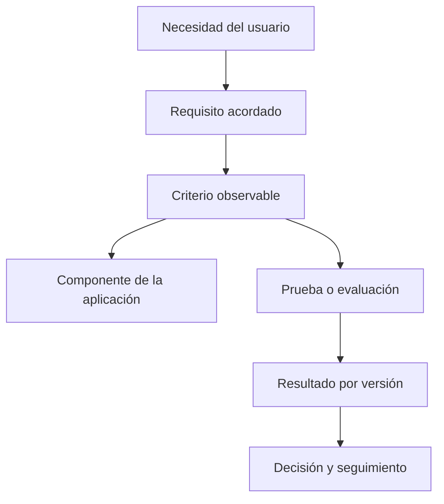

# 46 — Verificación y validación de requisitos: comprobar el producto y confirmar su utilidad

En el [capítulo 44](44-modelos-de-calidad-del-software.md) aprendimos a definir las propiedades de calidad importantes para un producto. En el [capítulo 45](45-metricas-e-indicadores-de-calidad.md) estudiamos cómo recopilar e interpretar evidencias técnicas. Ahora aparece una pregunta que no se resuelve sumando pruebas ni calculando un porcentaje:

> **¿Cómo sabemos que construimos el producto conforme a lo especificado y, además, que lo especificado responde a las necesidades reales de las personas que lo utilizarán?**

Una aplicación puede pasar todas sus pruebas automatizadas y seguir resolviendo el problema equivocado. También puede gustar en una demostración, pero contener errores de autorización, inconsistencias de datos o defectos en los casos límite.

Este capítulo diferencia **verificación**, **validación**, **pruebas** y **aceptación**. Usaremos PetMatch Community como caso de estudio, con sus clases JUnit, MockMvc, MySQL, reportes PDF/Excel y escenarios de interacción. Separamos lo que **existe en el código**, lo que **comprueban sus pruebas**, y lo que **todavía debe observar o decidir una persona autorizada**.

El material sigue el recorrido del libro: **problema → concepto → mecanismo → código real → decisión → alternativa → error frecuente → transferencia**. Podrás aplicar el método a una biblioteca, inventario, sistema de reservas u otro proyecto propio; no necesitas reproducir el dominio de mascotas.

Al finalizar podrás:

- explicar la diferencia entre verificación, validación del producto y validación de requisitos;
- transformar necesidades y reglas de negocio en criterios observables;
- diseñar una matriz de trazabilidad requisito → criterio → prueba → resultado;
- escoger entre revisión, prueba unitaria, integración, HTTP, navegador y evaluación de uso;
- preparar datos de frontera, casos negativos y transiciones de estado;
- interpretar las pruebas de PetMatch sin atribuirles alcances que no tienen;
- identificar cómo influyen el entorno, las transacciones y la concurrencia en las conclusiones;
- preparar una sesión de validación o aceptación sin inventar participantes ni aprobaciones;
- registrar hallazgos, retests, regresiones y decisiones vinculadas a una versión.

---

## 1. El problema: una aplicación puede estar bien implementada y ser la aplicación equivocada

Imagina una plataforma para prestar equipos de laboratorio. El equipo técnico implementa un botón «Reservar», comprueba que guarda el registro y muestra una confirmación.

Pero las personas usuarias necesitan **solicitar autorización antes de retirar el equipo**. La función «Reservar» nunca pregunta quién aprueba ni cuándo se permite retirar el recurso.

El código podría estar correcto respecto de su diseño actual y, aun así, el producto no resolvería el proceso real.

Ahora imagina el caso contrario: el equipo entendió perfectamente el proceso de aprobación, pero la aplicación permite retirar el mismo equipo a dos personas simultáneamente. La necesidad era correcta; el mecanismo implementado no la satisface.

### Dos preguntas complementarias

| Pregunta | Enfoque principal | Ejemplo |
|---|---|---|
| ¿El producto cumple sus requisitos y especificaciones? | **Verificación** | El sistema rechaza una reserva incompatible. |
| ¿El producto satisface el uso previsto y las necesidades de sus interesados? | **Validación** | La persona responsable puede gestionar una reserva de principio a fin. |

La distinción suele enseñarse así:

```text
Verification → Are we building the product right?
Validation   → Are we building the right product?
```

Estas frases son ayudas para recordar, **no sustituyen las definiciones ni los criterios**.

Una misma actividad puede aportar evidencia a ambos propósitos si se diseña adecuadamente. La diferencia central no es «máquina contra persona» o «unit test contra demo», sino **qué pregunta se está contestando y contra qué referencia se evalúa**.

---

## 2. ¿Qué entendemos por verificación?

La **verificación** consiste en obtener evidencia objetiva de que un producto de trabajo, componente o sistema satisface los requisitos especificados que se le aplican.

En una aplicación Java puede involucrar:

- revisión del diseño;
- inspección de código;
- análisis de contratos y configuraciones;
- ejecución de pruebas unitarias;
- pruebas de integración;
- comprobación de respuestas HTTP;
- inspección de archivos generados;
- medición de rendimiento frente a criterios definidos.

**Ejemplo concreto:**

> Requisito especificado: solamente cuentas administradoras activas pueden modificar roles.

Verificarlo exige comprobar que una cuenta normal no puede acceder a la operación y que una cuenta previamente administradora, pero degradada, tampoco conserva el permiso.

No es suficiente que el botón de administración esté oculto. También es importante observar que el estado persistido **no cambió** después de una petición rechazada.

### La verificación no ocurre únicamente al final

Puedes verificar requisitos y diseños durante la construcción:

```text
Requisito revisado
        ↓
Diseño inspeccionado
        ↓
Regla de Service probada
        ↓
HTTP y base integrados
        ↓
Regresión repetida tras un cambio
```

**🧠 Idea mental:** verificar no significa simplemente «ejecutar JUnit». Significa buscar evidencia pertinente de cumplimiento frente a un criterio especificado.

---

## 3. ¿Qué entendemos por validación?

La **validación** busca evidencia de que el producto satisface las necesidades del uso previsto, en el contexto para el que fue diseñado.

Imagina que PetMatch implementa correctamente una solicitud de ayuda, pero las personas no entienden la diferencia entre «Solicitudes abiertas» y «Mis solicitudes». El software puede cumplir rutas y reglas internas, mientras que el recorrido real sigue causando confusión.

La validación plantea preguntas como:

- ¿La persona encuentra la funcionalidad que necesita?
- ¿El proceso representa su trabajo real?
- ¿Comprende las condiciones y los mensajes?
- ¿Puede completar la tarea con la información disponible?
- ¿El resultado es útil para tomar una decisión?
- ¿Las restricciones del producto son aceptables para su contexto?

### Validación de requisitos y validación del producto

Conviene diferenciar dos momentos relacionados:

**Validar requisitos:** confirmar con las personas interesadas que las necesidades están correctamente entendidas, que no faltan condiciones importantes y que las reglas propuestas representan el problema.

**Validar el producto:** evaluar si el producto implementado satisface ese uso previsto dentro de condiciones apropiadas.

Por ejemplo:

```text
Necesidad expresada:
  "Quiero saber qué solicitudes siguen pendientes."

Pregunta de validación de requisitos:
  ¿"Pendiente" significa OPEN, PENDING, IN_PROGRESS o alguna combinación?

Pregunta de verificación:
  ¿El filtro implementado devuelve el conjunto definido?

Pregunta de validación del producto:
  ¿La persona puede localizar, interpretar y utilizar ese reporte?
```

**⚠️ Error frecuente:** esperar hasta el final del proyecto para preguntar al usuario qué significaba un término ambiguo. Corregir un requisito mal entendido puede costar más que revisar su interpretación al principio.

---

## 4. Pruebas, verificación, validación y aceptación no son sinónimos

Una **prueba** es una técnica para obtener evidencia. Puede emplearse durante actividades de verificación o validación. No toda verificación exige ejecutar software y no toda validación consiste en una reunión informal.

La **aceptación** es una decisión de una persona u organización con autoridad para determinar si el producto, una entrega o un conjunto de criterios resulta aceptable dentro del alcance acordado.

| Término | Qué responde | Ejemplo |
|---|---|---|
| Revisión de requisitos | ¿Son claros, completos y consistentes? | Acordar qué significa «solicitud pendiente». |
| Prueba técnica | ¿Qué hace el sistema en un escenario concreto? | JUnit comprueba una transición de estado. |
| Verificación | ¿Se satisface un requisito especificado? | HTTP rechaza cambios de rol no autorizados. |
| Validación | ¿Sirve para el uso previsto? | Una persona utiliza el reporte para tomar una decisión. |
| Aceptación | ¿La parte autorizada aprueba el resultado bajo los criterios acordados? | Decisión documentada con observaciones y condiciones. |

**Una sesión de validación no implica aprobación automática.** La persona puede encontrar dificultades, aceptar con cambios o concluir que la solución no cumple su necesidad.

**Tampoco todas las validaciones requieren una firma formal.** Eso depende del proyecto y del acuerdo con sus interesados. Lo que sí necesitamos es distinguir la decisión real de una plantilla todavía sin utilizar.

---

## 5. Antes de probar, necesitamos requisitos que se puedan comprender

Una prueba no repara un requisito ambiguo. Observa esta frase:

> «Los usuarios podrán consultar fácilmente sus solicitudes».

¿Qué significa «fácilmente»? ¿Se refiere a tiempo, cantidad de pasos, claridad de etiquetas, acceso móvil o posibilidad de utilizar teclado?

Para poder verificar y validar necesitamos contexto y condiciones.

### Transformar una frase en criterios

**Necesidad:** una persona quiere consultar sus propias solicitudes.

**Regla funcional:** una cuenta autenticada puede consultar las solicitudes que le pertenecen, pero no debe recibir datos privados de otras cuentas.

**Criterio técnico:** al solicitar un recurso ajeno no visible, la operación no entrega su contenido.

**Criterio de uso:** la persona puede localizar «Mis solicitudes», reconocer el estado de una solicitud y volver a la navegación principal.

Los dos últimos criterios requieren **evidencias diferentes**. El primero puede comprobarse mediante integración; el segundo necesita evaluar la interacción real.

### Qué debe contener un criterio verificable

Una formulación útil suele incluir:

1. **Contexto:** actor, datos y condición inicial.
2. **Acción:** qué intenta realizar.
3. **Resultado esperado:** qué debe observarse.
4. **Restricciones:** qué no debe suceder.
5. **Método:** cómo se comprobará.

**🧠 Regla práctica:** evita criterios como «ser moderno», «tener buena seguridad» o «funcionar correctamente» si no se han traducido a comportamientos observables.

---

## 6. El vocabulario de Given–When–Then ayuda a describir escenarios

Una forma sencilla de especificar un comportamiento es separar situación inicial, acción y resultado.

```text
Given → condición inicial
When  → acción o evento
Then  → comportamiento esperado
```

### Ejemplo didáctico: permisos

```text
Given a regular user and an existing admin account
When the regular user requests a role change
Then the request is denied and the stored role remains unchanged
```

Este ejemplo está escrito en inglés porque representa un artefacto técnico de especificación. **No es una prueba automatizada nueva** ni modifica el código de PetMatch.

### Ejemplo didáctico: filtro temporal

```text
Given records before, during, and after the selected day
When the admin filters from 2030-01-10 to 2030-01-10
Then records from that day are included and the next day is excluded
```

El valor de esta estructura no depende de instalar Cucumber u otra biblioteca. Se puede utilizar como guía de revisión, como descripción de un caso JUnit o como criterio de una sesión de demostración.

**⚠️ Error frecuente:** escribir un escenario con un resultado no comprobable, como `Then the user is happy`. La satisfacción requiere una evaluación definida y no se deduce automáticamente de una respuesta HTTP.

---

## 7. La trazabilidad conecta necesidades, criterios, código y evidencias

La trazabilidad ayuda a no perder la relación entre lo que se necesita y lo que se implementó.



### Matriz didáctica basada en PetMatch

Las claves siguientes son **identificadores de ejemplo para enseñar trazabilidad**, no una numeración institucional oficial ni un nuevo archivo de requisitos aprobado.

| Clave didáctica | Necesidad o regla | Criterio | Evidencia técnica del repositorio |
|---|---|---|---|
| EX-01 | Proteger datos de otra cuenta | No se permite consultar o modificar una mascota ajena | `secondUserCannotReadUpdateOrDeleteAnotherUsersPet` |
| EX-02 | Mantener control administrativo | Se impide degradar al último administrador activo | `lastAdminCannotBeDemoted` |
| EX-03 | Consultar periodos completos | El último día está incluido y el siguiente excluido | `dateBoundsIncludeWholeLastDayAndExcludeNextMidnight` |
| EX-04 | Mostrar totales correctos | El total refleja 26 coincidencias aunque haya 20 por página | `totalsAreNotLimitedToPage` |
| EX-05 | Descargar un reporte útil | El PDF incluye filas filtradas fuera de la primera página | `pdfExportsFilteredRowsBeyondFirstPage` |
| EX-06 | Preservar estados concurrentes | Aceptar y cancelar no dejan una combinación incompatible | `simultaneousAcceptanceAndCancellationLeaveConsistentRequestAndApplicationStates` |

**🔎 Archivos reales:**

- [RestApiIntegrationTests.java](../../src/test/java/com/petmatch/community/integration/RestApiIntegrationTests.java).
- [AdminIntegrationTests.java](../../src/test/java/com/petmatch/community/integration/AdminIntegrationTests.java).
- [ReportIntegrationTests.java](../../src/test/java/com/petmatch/community/integration/ReportIntegrationTests.java).
- [ReportExportIntegrationTests.java](../../src/test/java/com/petmatch/community/integration/ReportExportIntegrationTests.java).
- [SupportWorkflowConcurrencyTests.java](../../src/test/java/com/petmatch/community/integration/SupportWorkflowConcurrencyTests.java).

**Atención:** la existencia de un test enlazado muestra que el repositorio **contiene una comprobación diseñada para ese criterio**. Su resultado efectivo se determina al ejecutarlo en una versión y ambiente identificados.

### ¿Qué ocurre si el requisito cambia?

Si una persona responsable decide que el reporte debe incluir también otra condición, hay que revisar el criterio, la consulta, la prueba y la documentación relacionada. **Una prueba que sigue verde puede estar verificando un requisito antiguo.**

---

## 8. Seleccionar el método de comprobación según la pregunta

No existe una única herramienta para todos los requisitos.

| Necesidad | Método apropiado | Límite |
|---|---|---|
| Comprobar una regla de Service | Test unitario con dobles controlados | No ejercita MySQL ni HTTP |
| Verificar una consulta de Criteria API | Integración con JPA y DB de pruebas | No representa todos los volúmenes de producción |
| Comprobar una respuesta REST | MockMvc con seguridad y serialización | No equivale a usar un navegador real |
| Confirmar contenido de PDF/XLSX | Abrir los bytes con PDFBox/POI | No garantiza calidad visual ni lectura humana |
| Comprobar dos escrituras simultáneas | Test concurrente con transacciones reales | No explora todas las intercalaciones |
| Inspeccionar una configuración | Revisión y comprobación estática | No demuestra toda la conducta en ejecución |
| Verificar interacción visual y teclado | Navegador automatizado y revisión manual | No sustituye la evaluación con usuarios |
| Confirmar el uso previsto | Sesión con personas representativas y criterios | Su validez depende del contexto y la muestra |

Un mismo requisito puede necesitar **más de un método**. Por ejemplo, una exportación se puede verificar mediante tests de bytes y además validar su utilidad cuando una persona intenta analizar los datos con su herramienta habitual.

**🔁 Relación con el libro:** revisa [31 — Pruebas unitarias](../06-calidad-y-recorrido/31-pruebas-unitarias.md) y [32 — Pruebas de integración](../06-calidad-y-recorrido/32-pruebas-de-integracion.md) para profundizar en las fronteras técnicas.

---

## 9. Un caso real de verificación: ownership y flujo de negocio

PetMatch ofrece una prueba que integra Services, repositorios y una base de datos de pruebas:

[**MvpFlowIntegrationTests.completeMvpFlowKeepsOwnershipVisibilityAndStatusesConsistent()**](../../src/test/java/com/petmatch/community/integration/MvpFlowIntegrationTests.java).

La prueba crea cuentas distintas, registra una mascota, publica una solicitud y comprueba reglas durante el recorrido.

**Código real — una regla negativa:**

```java
assertThrows(
    PetNotFoundException.class,
    () -> petService.findOwnedPet(pet.getId(), applicantBAuth)
);
```

El caso muestra que otra persona no puede obtener una mascota como si fuera propia mediante el Service.

**Código real — comprobación de aceptación:**

```java
assertEquals(SupportRequestStatus.IN_PROGRESS, inProgress.getStatus());
assertEquals(SupportApplicationStatus.ACCEPTED, accepted.getStatus());
assertEquals(SupportApplicationStatus.REJECTED, rejected.getStatus());
```

La prueba también comprueba que la cuenta propietaria no se postule a su propia solicitud, que no existan postulaciones duplicadas para el mismo usuario y que el flujo pueda terminar en `COMPLETED`.

### ¿Qué integra de verdad?

```text
Services reales
     ↓
Repositories reales
     ↓
JPA / Hibernate
     ↓
Base de datos de pruebas
```

La prueba construye objetos `Authentication` para invocar Services. **No realiza un inicio de sesión mediante el navegador ni ejecuta una sesión completa de usuario final.**

Por eso es evidencia valiosa de **verificación del comportamiento integrado**, pero no demuestra que alguien pueda encontrar los botones ni comprender todos los mensajes.

### Pregunta de comprensión

¿Por qué una prueba de Service que utiliza Mockito podría no descubrir un problema de restricciones SQL que sí aparece al ejecutar un flujo con Repository real?

---

## 10. Un caso real de verificación: seguridad REST y resultados negativos

La clase [RestApiIntegrationTests.java](../../src/test/java/com/petmatch/community/integration/RestApiIntegrationTests.java) utiliza MockMvc para comprobar rutas REST, autenticación, validación y persistencia.

Entre sus pruebas están:

```text
authenticatedUserCanCreatePetThroughApiWithoutCsrfToken
invalidApiRequestReturnsProblemDetail
ownerCanReadUpdateAndDeletePetThroughRest
secondUserCannotReadUpdateOrDeleteAnotherUsersPet
malformedJsonIsRejectedAndMissingPetHasNotFoundProblem
```

### ¿Por qué importan los casos negativos?

Imagina que solamente probamos:

```text
Cuenta propietaria → GET /api/pets/{id} → 200 OK
```

La operación podría funcionar para su dueño y seguir filtrando información de otras personas.

La clase también comprueba que una cuenta diferente recibe una respuesta que **no entrega el recurso ajeno**, incluso si conoce su identificador.

**Código real — fragmento de la prueba de validación:**

```java
.andExpect(status().isBadRequest())
.andExpect(jsonPath("$.title").value("Validation failed"))
.andExpect(jsonPath("$.errors.name").exists())
.andExpect(jsonPath("$.errors.age").exists());
```

Aquí se observa un contrato HTTP y JSON, no solamente el lanzamiento de una excepción Java.

### La diferencia entre comportamiento y contrato

Un cliente de la API necesita respuestas interpretables:

- código HTTP pertinente;
- estructura JSON coherente;
- validaciones reconocibles;
- ausencia de exposición de datos ajenos.

**Verificar un Service no sustituye verificar la respuesta de la interfaz pública que utiliza otro sistema.**

---

## 11. Un caso real de verificación: reportes y datos de frontera

Las fechas son una fuente frecuente de defectos porque el formulario recibe días completos y la base almacena fecha y hora.

**Requisito didáctico:** al filtrar desde el 10 hasta el 10 de enero, deben aparecer los registros de ese día completo, no los del día anterior ni el siguiente.

[ReportIntegrationTests.java](../../src/test/java/com/petmatch/community/integration/ReportIntegrationTests.java) prepara, entre otras fechas:

```text
2030-01-09T23:59:59
2030-01-10T00:00:00
2030-01-10T23:59:59
2030-01-11T00:00:00
```

**Código real — fragmento del caso de límite:**

```java
var f = new SupportRequestReportFilter();
f.setFromDate(LocalDate.of(2030, 1, 10));
f.setToDate(LocalDate.of(2030, 1, 10));

var r = service.search(f, 0);

assertEquals(2, r.rows().getTotalElements());
assertEquals("Sol", r.rows().getContent().get(1).petName());
```

Esta prueba aporta evidencia de **análisis de valores límite**: los valores de medianoche son relevantes porque separan registros que deben incluirse de otros que deben excluirse.

### Otra frontera: paginación

La misma clase contiene `totalsAreNotLimitedToPage()`. Con 26 coincidencias comprueba:

```text
Primera página → 20 filas
Segunda página → 6 filas
Total filtrado  → 26
```

**Antes de ejecutar:** si la tabla muestra 20 filas y el resumen informa 26, ¿se trata necesariamente de una inconsistencia? Razona la diferencia entre tamaño de página y población filtrada.

---

## 12. Equivalencia, límites y transiciones: tres técnicas útiles

Las técnicas de diseño de pruebas ayudan a elegir datos significativos y no solamente ejemplos arbitrarios.

### 12.1 Particiones de equivalencia

Agrupa entradas que deberían recibir el mismo tratamiento.

**Ejemplo: rol solicitado**

```text
Valid roles:
  USER
  ADMIN

Invalid values:
  SUPERUSER
  missing role
```

El código de PetMatch usa un enum `Role`. No hace falta probar infinitas cadenas aleatorias, pero sí verificar que las entradas no admitidas no cambian privilegios.

### 12.2 Análisis de valores límite

Busca condiciones cercanas a un extremo:

```text
Before selected day
First instant of selected day
Last representable time during selected day
First instant of following day
```

El Repository de reportes utiliza un intervalo cuyo fin es **exclusivo** para representar correctamente el último día.

### 12.3 Transiciones de estado

En una solicitud:

```text
OPEN
   ↓
IN_PROGRESS
   ↓
COMPLETED
```

También puede existir una cancelación permitida desde el estado correspondiente. La autorización y las condiciones del Service deciden qué transiciones son válidas.

No es suficiente probar que cada estado existe como enum: hay que comprobar **qué operación permite pasar entre ellos y qué operaciones se rechazan**.

### Tabla conceptual de diseño

| Estado inicial | Acción | Resultado esperado | Tipo de caso |
|---|---|---|---|
| `OPEN` | Aceptar postulación válida | `IN_PROGRESS` | Positivo |
| `OPEN` | Cancelar según regla | `CANCELLED` | Positivo |
| `COMPLETED` | Volver a aceptar | Rechazo | Negativo |
| `OPEN` | Aceptar y cancelar simultáneamente | Una decisión coherente | Concurrencia |

La tabla es una **selección didáctica**, no una especificación exhaustiva de todas las transiciones y actores de PetMatch. Para comprobar las reglas exactas debes revisar [SupportRequestService](../../src/main/java/com/petmatch/community/service/SupportRequestService.java) y [SupportApplicationService](../../src/main/java/com/petmatch/community/service/SupportApplicationService.java).

---

## 13. Una prueba concurrente responde una pregunta diferente

Los tests secuenciales pueden comprobar:

```text
Accept → state becomes IN_PROGRESS
Cancel → state becomes CANCELLED
```

Pero eso no garantiza el resultado cuando dos operaciones compiten por la misma solicitud.

La clase [SupportWorkflowConcurrencyTests.java](../../src/test/java/com/petmatch/community/integration/SupportWorkflowConcurrencyTests.java) inicia dos tareas paralelas con una barrera y comprueba el estado persistido.

**Código real — aserción central:**

```java
boolean acceptedSuccessfully = accepted.get(25, TimeUnit.SECONDS);
boolean cancelledSuccessfully = cancelled.get(25, TimeUnit.SECONDS);

assertNotEquals(acceptedSuccessfully, cancelledSuccessfully);
```

Después revisa la solicitud y su postulación:

```java
if (acceptedSuccessfully) {
    assertEquals(SupportRequestStatus.IN_PROGRESS, request.getStatus());
    assertEquals(SupportApplicationStatus.ACCEPTED, application.getStatus());
} else {
    assertEquals(SupportRequestStatus.CANCELLED, request.getStatus());
    assertEquals(SupportApplicationStatus.REJECTED, application.getStatus());
}
```

### ¿Qué demuestra el test si pasa?

Que **en la ejecución observada** las operaciones competidoras produjeron una sola decisión efectiva y estados compatibles con la regla definida.

### ¿Qué no demuestra?

Que todas las posibles intercalaciones de hilos, tiempos, bloqueos y cargas están libres de defectos. La concurrencia exige repetir, observar y analizar riesgos particulares.

Otro ejemplo es [RoleConcurrencyTests.simultaneousSelfDemotionsLeaveOneActiveAdmin()](../../src/test/java/com/petmatch/community/integration/RoleConcurrencyTests.java), que protege la regla de conservar una cuenta administradora activa.

**⚠️ Error frecuente:** ejecutar únicamente dos llamadas consecutivas y presentarlas como una prueba de concurrencia.

---

## 14. Un archivo descargado también requiere verificación de contenido

Una respuesta HTTP `200 OK` no demuestra que un PDF pueda abrirse o que un archivo XLSX contenga las filas esperadas.

Por eso [ReportExportIntegrationTests.java](../../src/test/java/com/petmatch/community/integration/ReportExportIntegrationTests.java) utiliza **PDFBox** y **Apache POI** para inspeccionar el archivo generado.

### PDF: contenido filtrado

**Código real — fragmento:**

```java
var bytes = result.getResponse().getContentAsByteArray();
assertEquals("%PDF", new String(bytes, 0, 4, StandardCharsets.US_ASCII));

try (var document = Loader.loadPDF(bytes)) {
    var text = new PDFTextStripper().getText(document);
    assertTrue(text.contains("Filtered total: 25"));
    assertTrue(text.contains("Pet walk 24"));
    assertFalse(text.contains("Pet walk 25"));
    assertTrue(text.contains("WALK: 25"));
}
```

Estas aserciones comprueban que:

- se generó un documento PDF reconocible;
- el archivo puede abrirse mediante la biblioteca;
- la población filtrada no quedó limitada a las primeras 20 filas;
- no aparece una solicitud excluida por el filtro;
- el resumen refleja el total esperado.

### Excel: estructura y tipos

La misma clase abre los bytes con `WorkbookFactory` y comprueba hojas, número de filas, valores y formato de fecha.

**Código real — fragmento:**

```java
assertEquals(27, details.getPhysicalNumberOfRows());
assertEquals("Pet walk 25", details.getRow(26).getCell(1).getStringCellValue());
```

### ¿Dónde empieza la validación?

Una persona que necesita analizar reportes todavía debe evaluar si los nombres de columnas, el orden de datos, el tamaño de texto o la organización de las hojas responden a su trabajo real.

**Verificar que el XLSX es válido no equivale a validar que es útil para todas las personas que lo descargarán.**

Consulta el [capítulo 42](42-exportacion-reportes-pdf-excel-strategy.md) para el diseño de las estrategias de exportación.

---

## 15. Seguridad de los datos de prueba: verificar sin dañar otra base

Las pruebas de integración de PetMatch requieren MySQL y un perfil de tests separado.

La configuración de [application-test.yaml](../../src/test/resources/application-test.yaml) utiliza:

```yaml
spring:
  datasource:
    url: ${TEST_DB_URL}
    username: ${TEST_DB_USERNAME}
    password: ${TEST_DB_PASSWORD}
  jpa:
    hibernate:
      ddl-auto: update
```

### ¿Por qué importa?

`ddl-auto: update` puede modificar el esquema de la base a la que apunte la conexión. Por eso **no debes ejecutar la suite contra datos reales ni contra una base cuyo contenido necesites conservar**.

El repositorio añade una comprobación temprana mediante [TestDatabaseSafety.java](../../src/test/java/com/petmatch/community/TestDatabaseSafety.java).

**Código real — regla principal:**

```java
String url = context.getEnvironment()
        .getRequiredProperty("spring.datasource.url");

if (!url.matches("jdbc:mysql://[^/]+/[A-Za-z0-9_]+_test([?].*)?")) {
    throw new IllegalStateException(
        "TEST_DB_URL must identify a dedicated MySQL schema ending in _test"
    );
}
```

Este control verifica el **patrón de nombre de esquema**, no la identidad del servidor ni quién utiliza esa base. Un esquema llamado `anything_test` puede contener información importante.

**Por tanto, un sufijo `_test` no es por sí solo una garantía de aislamiento.** La persona que configura el ambiente también debe comprobar el host, las credenciales, los permisos y la ausencia de datos que deban conservarse.

### Ejecutar la verificación

Después de preparar una **base MySQL exclusivamente de pruebas**:

```bash
./mvnw clean verify
```

El comando es el de la configuración del proyecto y ejecuta las fases de Maven necesarias para pruebas y reporte JaCoCo.

No debemos afirmar en este capítulo que acabamos de ejecutar la suite: **escribimos documentación sobre el código y los mecanismos existentes**, no un nuevo informe de resultados.

---

## 16. Verificación estática, HTTP y navegador: evidencias complementarias

En el [capítulo 43](43-usabilidad-navegacion-y-accesibilidad.md) estudiamos navegación, formularios, errores y accesibilidad. Para estas necesidades hay distintas fronteras de comprobación.

### 16.1 Comprobación estática

[tools/check-accessibility.py](../../tools/check-accessibility.py) analiza las asociaciones textuales entre mensajes `th:errors` e identificadores de error en cuatro plantillas.

**Puede aportar evidencia de:** presencia del patrón esperado en esos archivos.

**No puede demostrar:** comportamiento completo del navegador, anunciación de lector de pantalla o conformidad integral WCAG 2.2.

### 16.2 Respuesta HTTP y plantilla

[WebRegressionTests.java](../../src/test/java/com/petmatch/community/integration/WebRegressionTests.java) verifica, entre otros casos, que un formulario con valores inválidos genera errores asociados y atributos de validación.

**Puede aportar evidencia de:** comportamiento de Spring MVC y del HTML renderizado en el escenario probado.

**No puede demostrar:** que la persona encuentre el control mediante teclado o comprenda el mensaje.

### 16.3 Navegador automatizado

El repositorio incluye [tools/browser-smoke.py](../../tools/browser-smoke.py), un recorrido Playwright con cuentas y base sintéticas.

El script cubre acciones de registro, flujos de solicitud, administración, temas, enlaces de descarga y algunas comprobaciones de navegación.

**Límite de CI actual:** [`.github/workflows/ci.yml`](../../.github/workflows/ci.yml) ejecuta:

```bash
python3 -m py_compile tools/browser-smoke.py
```

Esto comprueba **sintaxis Python**, no ejecuta el navegador ni valida esos recorridos. Para afirmar que el smoke test pasó, sería necesario ejecutar Playwright y conservar la evidencia de esa ejecución.

### 16.4 Evaluación con personas

La comprensión del formulario, la claridad del recorrido y la facilidad de uso requieren observar o consultar personas representativas bajo condiciones definidas.

**Conclusión correcta:** las cuatro actividades se complementan, pero ninguna equivale automáticamente a las demás.

---

## 17. Preparar la validación de requisitos antes de construir toda la interfaz

La validación empieza incluso antes de que exista una versión completa.

Imagina que una persona interesada solicita:

> «Necesito revisar las solicitudes pendientes».

Antes de implementar, pregunta:

1. ¿Quién debe revisarlas?
2. ¿Qué significa exactamente *pendiente*?
3. ¿Incluye solicitudes `OPEN` y `IN_PROGRESS`?
4. ¿Debe ver solicitudes de todas las personas o solo las propias?
5. ¿Qué información necesita para tomar una decisión?
6. ¿Qué debe ocurrir después de la revisión?

Estas preguntas buscan detectar **ambigüedad y omisiones**, no convencer a la persona de aceptar una solución ya implementada.

### Una técnica sencilla: ejemplos concretos

Prepara tres solicitudes ficticias:

| Solicitud | Estado | Propietario |
|---|---|---|
| A | `OPEN` | Ana |
| B | `IN_PROGRESS` | Bruno |
| C | `COMPLETED` | Ana |

Pregunta cuáles deberían aparecer bajo el concepto «pendientes» y por qué.

Si dos personas interesadas responden de forma distinta, **todavía falta acordar el requisito**. Es más útil resolver esa diferencia aquí que escribir pruebas sobre una interpretación arbitraria.

**🧠 Idea mental:** una prueba técnica puede demostrar que el programa implementa perfectamente una regla **mal definida**. Validar el requisito ayuda a evitar ese problema.

---

## 18. Preparar una sesión de validación del producto

Una sesión útil no consiste en mostrar diapositivas o preguntar solamente «¿le gustó?». Debe observar tareas relevantes para el uso previsto.

### Qué definir antes

| Elemento | Pregunta |
|---|---|
| Perfil de participante | ¿La persona representa un uso real? |
| Versión | ¿Qué commit o despliegue se evaluará? |
| Ambiente | ¿Qué navegador, dispositivo, datos y permisos se utilizarán? |
| Tarea | ¿Qué resultado debe alcanzar la persona? |
| Condición inicial | ¿Qué información tiene y qué está preparado? |
| Criterio observable | ¿Cuándo consideramos completada la tarea? |
| Registro | ¿Cómo documentaremos dificultades y observaciones? |
| Decisión | ¿Quién revisará los hallazgos y definirá próximos pasos? |

### Ejemplo de recorrido para PetMatch

**Escenario:** una persona quiere conseguir apoyo para pasear a su mascota.

**Tareas:**

1. Registrarse e iniciar sesión.
2. Registrar una mascota.
3. Crear una solicitud de tipo `WALK`.
4. Verificar que encuentra su solicitud.
5. Comprender qué significa su estado.
6. Revisar una postulación recibida.
7. Confirmar que comprende el resultado después de aceptarla.

Observa si la persona puede completar el recorrido, dónde duda, qué información busca y cuáles mensajes requieren explicación.

**No le dictes cada clic** si el criterio es autonomía. Las ayudas dadas durante la sesión deben registrarse porque cambian la interpretación del resultado.

### ¿Puede una prueba automatizada apoyar esta sesión?

Sí. Puede preparar datos de ejemplo, estabilizar el entorno y detectar regresiones antes de la sesión. Pero no debe presentarse como si hubiera observado la comprensión de una persona.

---

## 19. Tres recorridos de validación posibles en PetMatch

No todos los participantes necesitan ejecutar todas las funcionalidades. Elige tareas correspondientes a su función.

### Recorrido A — Propietario de mascota

**Objetivo:** registrar mascota, solicitar ayuda y administrar la solicitud.

**Evidencia de uso:** la persona comprende los campos, encuentra su solicitud y distingue sus estados.

**Riesgo técnico asociado:** que una cuenta diferente pueda modificar datos ajenos.

### Recorrido B — Persona que ofrece apoyo

**Objetivo:** encontrar una solicitud abierta, postularse y comprender si fue aceptada.

**Evidencia de uso:** la persona sabe a qué solicitud se postuló y qué significa el resultado.

**Riesgo técnico asociado:** postulaciones duplicadas, auto-postulación o transiciones incompatibles.

### Recorrido C — Cuenta administradora

**Objetivo:** aplicar filtros a un reporte, interpretar el total, cambiar la agrupación y descargar resultados.

**Evidencia de uso:** la persona encuentra los criterios, distingue 20 filas visibles de un total mayor y utiliza los archivos obtenidos.

**Riesgo técnico asociado:** filtrado incorrecto, exportaciones incompletas o acceso no autorizado.

### Cuándo considerar que un recorrido fue exitoso

Define antes de observar:

- resultado esperado;
- ayuda permitida o no permitida;
- tiempo de referencia, solo si el proyecto lo necesita;
- errores aceptables o bloqueantes;
- forma de registrar dudas y correcciones.

No transformes automáticamente «la persona hizo clic» en «la persona entendió el proceso».

---

## 20. Un acta de validación no es una plantilla completada de antemano

El repositorio contiene un documento histórico llamado **Acta de validación de requisitos — plantilla sin aprobación**, bajo la carpeta antigua `docs/08-aplicacion-cronograma/`.

Ese documento declara expresamente **PENDIENTE DE VALIDACIÓN HUMANA**. No registra una reunión celebrada ni firmas de aceptación.

Es importante reconocer esta diferencia:

```text
Plantilla disponible
        ≠
Sesión ejecutada
        ≠
Necesidad validada
        ≠
Entrega aceptada
```

### Qué debe registrarse cuando la sesión sí ocurre

| Campo | Qué documentar |
|---|---|
| Versión del producto | Commit o despliegue |
| Fecha y entorno | Cuándo y dónde se evaluó |
| Participantes y funciones | Personas reales y responsabilidades, con protección de datos personales |
| Requisitos o tareas | Qué se pretendía validar |
| Observaciones | Qué sucedió realmente |
| Cambios solicitados | Necesidades nuevas o ajustes |
| Decisión | Acepta, acepta con condiciones, no acepta o continúa en evaluación |
| Seguimiento | Acción, responsable y fecha acordada |
| Evidencia | Registro verificable, según la política del proyecto |

Si no se ha realizado la sesión, esos campos deben permanecer **pendientes**. Nunca deben completarse con nombres, comentarios, resultados o firmas ficticias.

### El estado de PetMatch en este capítulo

**Disponible:** código, casos automatizados y materiales para preparar la evaluación.

**Sin evidencia de aprobación humana aportada por el repositorio revisado:** una decisión formal de aceptación de la aplicación.

Esto no descalifica las comprobaciones técnicas. Simplemente reconoce que **responden otra pregunta**.

---

## 21. Resultados técnicos y decisiones de aceptación pueden diferir

Imagina que el test de exportación Excel comprueba correctamente la estructura XLSX, las fechas y el total.

Durante la validación, la persona administradora explica que necesita una columna adicional para clasificar los datos. El archivo es técnicamente válido, pero resulta insuficiente para su proceso de trabajo.

**Qué ocurrió:**

- La **verificación** del contrato actual puede ser satisfactoria.
- La **validación** detectó una necesidad adicional.
- La **aceptación** puede quedar condicionada a acordar y resolver ese requisito.

También podría ocurrir lo contrario: una persona considera visualmente satisfactoria una pantalla, pero una prueba descubre que otra cuenta puede consultar datos privados. Una impresión favorable de uso **no elimina una vulnerabilidad**.

### Cómo registrar la diferencia sin ocultarla

```text
Technical verification: Meets the tested contract
Intended-use validation: Additional need identified
Acceptance decision: Pending stakeholder review
Action: Clarify requirement and update acceptance criteria
```

Este es un **ejemplo de registro**, no el estado oficial de una reunión real sobre PetMatch.

**⚠️ Error frecuente:** convertir automáticamente una captura bonita, una CI verde o un comentario favorable en la afirmación «el cliente aprobó el sistema».

---

## 22. De un hallazgo a una corrección comprobada

La verificación y validación pueden producir hallazgos diferentes: defectos técnicos, requisitos ambiguos o necesidades nuevas.

Una secuencia de mejora útil sería:

```text
Hallazgo
   ↓
Clasificar: defecto, necesidad o cambio
   ↓
Describir impacto y pasos para reproducir
   ↓
Acordar resultado esperado
   ↓
Implementar la corrección
   ↓
Repetir el caso afectado
   ↓
Ejecutar regresiones pertinentes
   ↓
Obtener nueva evaluación si cambió el uso previsto
```

### Repetición y regresión no son lo mismo

**Retest:** repetir el escenario que falló para comprobar la corrección.

**Prueba de regresión:** comprobar que un cambio no rompió comportamientos que antes funcionaban.

Ejemplo:

- Cambiamos cómo se actualiza el estado de una solicitud.
- Repetimos el test que reproducía el estado incorrecto.
- También ejecutamos pruebas de aceptación de postulaciones, cancelación, visibilidad y flujo completo.

Ambas actividades aportan evidencias complementarias.

### Distinguir tipos de hallazgos

| Hallazgo | Qué corresponde hacer |
|---|---|
| La API devuelve datos ajenos | Corregir defecto de autorización y añadir prueba negativa |
| El filtro excluye el último día | Corregir lógica y repetir caso de frontera |
| Un usuario no comprende el nombre de una opción | Revisar lenguaje y observar nuevamente el recorrido |
| Se solicita una función no acordada | Evaluar y decidir cambio de alcance |
| La exportación tarda más de lo admisible | Precisar presupuesto, medir y estudiar causas |

No todas las observaciones requieren agregar una clase o un patrón. **Primero identifica la causa y la necesidad real.**

---

## 23. Qué evidencia puede conservarse en GitHub Actions

El proyecto tiene [`.github/workflows/ci.yml`](../../.github/workflows/ci.yml), que configura Java 21, MySQL de pruebas y la ejecución Maven:

```bash
./mvnw -B -ntp clean verify
```

La CI también comprueba asociaciones de errores de formulario mediante un script estático y verifica la sintaxis Python del smoke test.

Los artefactos configurados incluyen:

```text
target/surefire-reports/
target/site/jacoco/
target/report-query-performance.json
```

### ¿Qué demuestra un workflow aprobado?

Que los pasos configurados se completaron satisfactoriamente en **esa ejecución y ese commit**, según los resultados publicados.

No debemos atribuirle:

- una evaluación humana;
- una prueba visual completa;
- conformidad WCAG 2.2 AA;
- ausencia total de defectos;
- aceptación formal del producto;
- ejecución del recorrido Playwright completo, porque la CI descrita solo comprueba su sintaxis.

### Identificación mínima de la evidencia

Conserva:

```text
Commit
Workflow run
Environment
Executed checks
Results
Relevant artifacts
Unexecuted checks
```

El [capítulo 45](45-metricas-e-indicadores-de-calidad.md) explica cómo leer conteos Surefire, cobertura JaCoCo y mediciones sin mezclar ejecuciones distintas.

**No copies un número histórico de pruebas aprobadas como si describiera automáticamente una revisión posterior.**

---

## 24. Cómo evitar conclusiones exageradas

Una conclusión técnica debe corresponder exactamente al alcance de la evidencia.

| Evidencia disponible | Conclusión válida | Conclusión exagerada |
|---|---|---|
| `contextLoads()` pasa | El contexto arranca en ese entorno de pruebas | Toda la aplicación funciona |
| Test de ownership pasa | Ese intento de acceso ajeno se rechaza | No existe ninguna vulnerabilidad |
| Test de fecha límite pasa | Ese intervalo y datos de frontera se comportan como se espera | Todos los filtros son perfectos |
| Test PDF abre archivo y comprueba texto | El archivo contiene los datos verificados | Todos los PDF son visualmente accesibles |
| JaCoCo registra cobertura | Una porción de código instrumentado se ejecutó | Todo ese código es correcto |
| Script estático verifica etiquetas | Los patrones revisados aparecen en esas plantillas | Se cumple íntegramente WCAG AA |
| Una persona completa una tarea | Esa tarea fue completada en las condiciones observadas | Todos los usuarios completarán todos los flujos |
| Existe una plantilla de aceptación | Se preparó un instrumento | El cliente aceptó la entrega |

**🧠 Regla editorial del libro:** distinguir **implementado**, **comprobado en una ejecución identificada**, **pendiente de validar** y **alternativa propuesta**.

Este cuidado es especialmente importante cuando el repositorio conserva materiales de versiones anteriores: sus resultados son históricos y no pueden presentarse como estado actual sin repetición.

---

## 25. Diseñar una matriz de V&V proporcionada al proyecto

No necesitas un documento enorme. Comienza con los requisitos más importantes del negocio y un conjunto de evidencias que respondan las preguntas correctas.

### Plantilla de trabajo

| Campo | Pregunta |
|---|---|
| Requisito | ¿Qué necesidad o regla existe? |
| Criterio | ¿Qué resultado debe observarse? |
| Tipo | ¿Verificación, validación o ambos propósitos? |
| Método | ¿Revisión, test, demostración, medición o sesión? |
| Fuente | ¿Dónde se conserva la evidencia? |
| Versión | ¿Qué commit o despliegue se evaluó? |
| Resultado | ¿Qué se observó realmente? |
| Estado | ¿Comprobado, fallido, pendiente o bloqueado? |
| Decisión | ¿Qué se hará con el resultado? |

### Ejemplo de matriz, sin inventar ejecuciones

| Requisito didáctico | Actividad | Fuente disponible | Estado que puedes afirmar hoy |
|---|---|---|---|
| Impedir accesos a mascotas ajenas | Test REST de usuario diferente | Clase de integración en repositorio | Caso implementado; ejecución por verificar para la revisión |
| Preservar un administrador activo | Test concurrente y regla de Service | Clase de concurrencia y Service | Caso implementado; ejecución por verificar para la revisión |
| Mostrar correctamente fechas y totales | Test de integración de reportes | Clase de reportes | Casos implementados; ejecución por verificar para la revisión |
| Facilitar la consulta por una persona | Tarea de uso con un representante | Guía que el equipo debe preparar y ejecutar | **Pendiente de validación humana** |
| Confirmar la aceptación de la entrega | Revisión por parte autorizada | Registro de decisión por elaborar | **Pendiente de decisión real** |

En un informe de una ejecución concreta, reemplaza «ejecución por verificar» por el **resultado efectivamente observado**, su fecha, su commit y sus evidencias correspondientes.

---

## 26. 🧪 Laboratorio guiado: verifica un criterio y prepara otro para validación

Esta práctica no requiere agregar una funcionalidad nueva. Trabajaremos con los mecanismos existentes.

### Parte A — Selecciona el requisito

Elige uno:

- impedir el acceso a una mascota ajena;
- conservar el último administrador activo;
- incluir el último día en un reporte;
- mantener el total más allá de una página;
- generar un archivo exportado válido.

Escribe la condición inicial, la acción y el resultado esperado.

### Parte B — Ubica la implementación

Sigue el recorrido:

```text
HTTP o entrada del caso de uso
       ↓
Controller
       ↓
Service
       ↓
Repository
       ↓
Base de datos, si aplica
```

No todas las pruebas pasan por todas las capas. Identifica **cuáles sí** intervienen en el criterio seleccionado.

### Parte C — Localiza la prueba correspondiente

Busca el test enlazado en la matriz de la sección 7. Lee el fixture y sus aserciones.

Responde:

1. ¿Qué entradas prepara?
2. ¿Qué comportamiento ejecuta?
3. ¿Qué aserción comprueba el resultado?
4. ¿Qué capa es real y cuál se sustituye?
5. ¿Qué riesgo no cubre el test?

### Parte D — Prepara el entorno de forma segura

Utiliza una base MySQL **desechable y aislada**, nunca datos productivos. Configura las variables de prueba y ejecuta:

```bash
./mvnw clean verify
```

No sigas si no puedes confirmar la identidad y el aislamiento de la base. La presencia de `_test` en el nombre es una protección adicional, no una autorización para usar cualquier esquema.

### Parte E — Registra la verificación

Conserva:

```text
Repository revision:
Requirement:
Acceptance criterion:
Test method:
Test environment:
Observed result:
Evidence location:
Unverified risks:
```

Completa los campos con datos **reales de tu ejecución**. Si no ejecutaste la suite, indícalo.

### Parte F — Prepara una actividad de validación

Escoge un recorrido de usuario relacionado. Por ejemplo, interpretar el total de un reporte filtrado.

Define:

- perfil de participante;
- tarea;
- resultado esperado;
- condiciones iniciales;
- ayuda permitida;
- observaciones a registrar;
- quién tiene autoridad para decidir cambios o aceptación.

**No rellenes observaciones ni resultados antes de la sesión.**

### Parte G — Compara ambas evidencias

Explica qué podrías afirmar después de un test exitoso y qué información adicional necesitarías para afirmar que el recorrido satisface su uso previsto.

**Entrega de aprendizaje:** una matriz breve con un criterio técnicamente verificable, una evidencia real o pendiente expresamente identificada y un escenario de validación preparado. No se requiere un PDF ni una firma ficticia.

---

## 27. 🔁 Llévalo a tu proyecto

No copies `Pet`, `SupportRequest` ni las reglas administrativas de PetMatch. Selecciona un escenario de tu aplicación que realmente importe a sus usuarios.

### Paso 1 — Identifica una necesidad

Ejemplo de otro dominio:

> «Una persona necesita devolver un libro prestado y comprobar que vuelve a estar disponible».

### Paso 2 — Valida la interpretación del requisito

Pregunta qué sucede si el libro está reservado por otra persona, si el préstamo está vencido o si la devolución se registra dos veces.

No inventes una respuesta del cliente: documenta las decisiones que aún deben consultarse.

### Paso 3 — Formula dos criterios técnicos

Uno positivo y uno negativo. Evita limitarte al escenario exitoso.

### Paso 4 — Escoge niveles de prueba

Decide qué reglas probarás en el Service, cuáles requieren base de datos y cuáles necesitan HTTP.

### Paso 5 — Diseña datos de frontera

Incluye estados y valores cercanos a las condiciones donde cambia el comportamiento.

### Paso 6 — Define un recorrido de uso

Describe una tarea que una persona representativa pueda realizar sin instrucciones paso a paso.

### Paso 7 — Prepara trazabilidad

Relaciona necesidad, criterio, implementación, test, evidencia y estado.

### Paso 8 — Registra resultados sin inventarlos

Utiliza categorías como:

```text
Verified
Failed
Blocked
Not executed
Human validation pending
Acceptance decision pending
```

En un artefacto técnico las claves y estados pueden estar en inglés; la explicación de su significado se puede redactar en español.

### Paso 9 — Decide qué hacer con los hallazgos

Si el test falla, prepara corrección y regresión. Si la validación revela una necesidad nueva, acuerda el requisito antes de cambiar el código.

El objetivo no es producir documentos por cantidad, sino **demostrar que sabes qué pregunta responde cada evidencia**.

---

## 28. ⚠️ Errores frecuentes

### Error A — «La suite pasó, así que el cliente aceptó el sistema»

**Corrección:** la suite proporciona evidencia técnica; la aceptación requiere una decisión real de la parte autorizada, cuando ese proceso aplica.

### Error B — «Validación significa ejecutar pruebas y verificación significa revisar documentos»

**Corrección:** ambas pueden utilizar pruebas, revisiones, análisis o demostraciones. Cambia el **propósito de la evaluación**, no una lista rígida de herramientas.

### Error C — «La validación solo se hace al finalizar»

**Corrección:** valida la interpretación de requisitos desde el inicio y vuelve a evaluar el producto cuando sea adecuado.

### Error D — «Un caso positivo demuestra toda la regla»

**Corrección:** incluye actores no autorizados, entradas inválidas, valores límite y estados no permitidos.

### Error E — «El HTTP 403 demuestra que los datos no cambiaron»

**Corrección:** cuando corresponda, complementa la respuesta HTTP con una comprobación del estado persistido.

### Error F — «Una prueba de Service simula un login real»

**Corrección:** si construye manualmente `Authentication`, no recorre el formulario ni la sesión web.

### Error G — «Dos llamadas consecutivas demuestran concurrencia»

**Corrección:** utiliza transacciones y ejecución competidora cuando el riesgo involucra carreras.

### Error H — «Una descarga con extensión XLSX es válida»

**Corrección:** abre el archivo y comprueba contenido, tipos y estructura.

### Error I — «La presencia de Playwright garantiza que CI lo ejecutó»

**Corrección:** revisa los pasos reales del workflow y distingue `py_compile` del navegador en ejecución.

### Error J — «Una plantilla de acta prueba que se realizó la reunión»

**Corrección:** documenta únicamente participantes, observaciones, decisiones y aprobaciones reales.

### Error K — «El resultado histórico describe la rama actual»

**Corrección:** cada evidencia pertenece a un commit, ambiente y momento.

### Error L — «Todo hallazgo exige una función adicional»

**Corrección:** puede tratarse de una regla mal entendida, un defecto, un problema de lenguaje o una necesidad todavía por acordar. Corrige la causa con una solución proporcionada.

---

## 29. 🧪 Comprueba que entendiste

Responde sin copiar las definiciones:

1. ¿Qué pregunta responde principalmente la verificación?
2. ¿Qué pregunta responde principalmente la validación?
3. ¿Por qué el hecho de usar JUnit no identifica por sí solo el propósito de una actividad?
4. ¿En qué se diferencia validar un requisito de validar el producto?
5. ¿Qué relación existe entre validación y aceptación?
6. ¿Por qué un requisito ambiguo puede producir un sistema técnicamente correcto, pero inútil?
7. ¿Qué representan Given, When y Then?
8. ¿Por qué la trazabilidad debe relacionar requisito, criterio y evidencia?
9. ¿Qué ocurre con una prueba cuando el requisito cambia?
10. ¿Qué comprueba realmente `completeMvpFlowKeepsOwnershipVisibilityAndStatusesConsistent`?
11. ¿Por qué ese test no equivale a un recorrido de navegador?
12. ¿Qué valor aporta probar un usuario diferente en la API?
13. ¿Qué datos hacen relevante una prueba de límite de fechas?
14. ¿Por qué el total filtrado puede ser mayor que las filas de una página?
15. ¿En qué se diferencia un test concurrente de dos operaciones secuenciales?
16. ¿Qué evidencia específica aporta abrir un PDF mediante PDFBox?
17. ¿Por qué un archivo válido puede seguir siendo inadecuado para la necesidad del usuario?
18. ¿Por qué el sufijo `_test` no demuestra por sí solo aislamiento de una base?
19. ¿Qué comprueba el script estático de formularios?
20. ¿Qué no comprueba `python3 -m py_compile tools/browser-smoke.py`?
21. ¿Qué debe contener un registro de sesión de validación?
22. ¿Qué diferencia hay entre *retest* y regresión?
23. ¿Por qué una CI verde no equivale a certificación WCAG?
24. ¿Qué significa que una evidencia pertenezca a una versión?
25. ¿Cómo prepararías la validación de una necesidad antes de programarla?

### Diagnóstico de un caso

Una aplicación de reservas cumple estas condiciones:

- sus tests de Service pasan;
- el endpoint HTTP devuelve respuestas correctas en los escenarios probados;
- las personas usuarias no comprenden cuándo su reserva queda confirmada;
- la organización todavía no ha decidido si acepta la entrega.

**Explica:**

1. qué parte ya tiene evidencia de verificación;
2. qué necesidad requiere validación;
3. qué requisito podría estar incompleto;
4. cómo formularías un criterio de uso observable;
5. qué tarea propondrías a una persona representativa;
6. qué resultado deberías registrar si todavía no ejecutaste la sesión;
7. por qué no puedes escribir «entrega aprobada»;
8. qué regresiones técnicas repetirías después de modificar el flujo de confirmación.

La respuesta debe separar **hechos observados**, **hipótesis** y **decisiones pendientes**.

---

## ✅ Qué debes recordar

**Verificar** significa reunir evidencia de cumplimiento frente a requisitos o especificaciones. **Validar** significa comprobar la adecuación al uso previsto y a las necesidades reales. **Aceptar** significa tomar una decisión autorizada sobre la entrega o el resultado, de acuerdo con los criterios aplicables.

La misma prueba o demostración puede aportar información a más de una actividad, pero **una evidencia técnica no se convierte automáticamente en aceptación humana**.

PetMatch ofrece ejemplos de autorización, ownership, filtros, archivos y concurrencia que pueden verificarse con JUnit, MockMvc y MySQL. También dispone de componentes de interfaz y un recorrido de navegador propuesto. La documentación histórica, sin embargo, deja la validación humana y la aceptación como **pendientes**, no como actividades celebradas.

El método transferible es:

**necesidad → requisito entendido → criterio → evidencia técnica → evaluación del uso previsto → decisión y seguimiento**.

### Para continuar

- [20 — Formularios y Form DTO](../03-web-mvc/20-formularios-y-form-dto.md).
- [25 — Autorización y ownership](../04-seguridad/25-autorizacion-y-ownership.md).
- [31 — Pruebas unitarias](../06-calidad-y-recorrido/31-pruebas-unitarias.md).
- [32 — Pruebas de integración](../06-calidad-y-recorrido/32-pruebas-de-integracion.md).
- [40 — Administración de roles y auditoría](40-roles-autorizacion-y-auditoria.md).
- [43 — Usabilidad, navegación y accesibilidad](43-usabilidad-navegacion-y-accesibilidad.md).
- [44 — Modelos de calidad del software](44-modelos-de-calidad-del-software.md).
- [45 — Métricas e indicadores de calidad](45-metricas-e-indicadores-de-calidad.md).

El **capítulo 47** abordará la mejora continua: cómo organizar una corrección con PDCA y comprobar que la acción tomada produce el resultado esperado.

### Referencias oficiales y técnicas

- [NASA — Software Engineering Handbook: Requirements Validation](https://swehb.nasa.gov/spaces/SWEHBVD/pages/102695440/SWE-055%2B-%2BRequirements%2BValidation).
- [NASA — Software Engineering Handbook: Verify Implementation](https://swehb.nasa.gov/spaces/7150/pages/16450546/SWE-067%2B-%2BVerify%2BImplementation).
- [NASA — Systems Engineering Handbook: Product Realization](https://www.nasa.gov/reference/5-0-product-realization/).
- [JUnit 5 — User Guide](https://junit.org/junit5/docs/current/user-guide/).
- [Spring Framework — Testing](https://docs.spring.io/spring-framework/reference/testing.html).
- [Apache Maven Surefire — Documentación](https://maven.apache.org/surefire/maven-surefire-plugin/).
- [W3C WAI — Evaluación de accesibilidad web](https://www.w3.org/WAI/test-evaluate/).

Las definiciones se presentan como **explicaciones educativas**. El código y los métodos citados corresponden al repositorio consultado; los escenarios didácticos no son requisitos aprobados ni resultados de ejecución. Este capítulo no inventa sesiones, observaciones, firmas o aceptación institucional.
