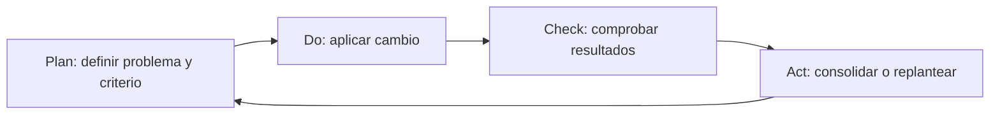

# 47 — Mejora continua con PDCA: de un hallazgo a una corrección comprobable

En el [capítulo 44](44-modelos-de-calidad-del-software.md) estudiamos las características de calidad del producto y su relación con la gestión. En el [capítulo 45](45-metricas-e-indicadores-de-calidad.md) aprendimos a interpretar métricas y evidencias; y en el [capítulo 46](46-verificacion-y-validacion-de-requisitos.md) distinguimos verificar un requisito de validar que una solución satisface una necesidad real.

Ahora podemos cerrar el recorrido con una pregunta práctica:

> **¿Qué hacemos cuando descubrimos un defecto o una oportunidad de mejora, cómo demostramos que el cambio funcionó y cómo evitamos que el problema vuelva a aparecer?**

La respuesta no consiste en escribir «mejorado» después de modificar un archivo. Una mejora necesita un problema identificable, una decisión razonada, una intervención, una comprobación comparable y una acción posterior.

Este capítulo utiliza el ciclo **Plan–Do–Check–Act (PDCA)** para organizar ese trabajo. PetMatch Community aporta dos casos históricos **reales y documentados** relacionados con accesibilidad: asociaciones entre campos y errores, y navegación del foco hacia el contenido principal. También examinaremos cómo aplicar el método a riesgos de autorización, concurrencia, reportes y rendimiento **sin afirmar que se ejecutó un ciclo nuevo cuando no existe esa evidencia**.

El material es **neutral y transferible**. No constituye un informe de cumplimiento institucional ni exige copiar el dominio de mascotas. Puedes aplicar el razonamiento a una biblioteca, un sistema de inventarios, una aplicación de reservas o cualquier otro software.

Al finalizar podrás:

- explicar qué significa la mejora continua y qué resuelve PDCA;
- distinguir defecto, síntoma, causa, corrección, acción correctiva y prevención de recurrencia;
- formular una oportunidad de mejora con criterio y línea base;
- utilizar Plan, Do, Check y Act sin confundir ejecución con efectividad;
- interpretar evidencias históricas de un caso real de PetMatch sin presentarlas como resultados actuales;
- diferenciar una comprobación estática, una prueba de navegador y una evaluación humana;
- elegir pruebas de regresión pertinentes para conservar una mejora;
- registrar una decisión de cierre, seguimiento o nuevo ciclo;
- priorizar riesgos de seguridad, confiabilidad y experiencia de uso;
- preparar un pequeño ejercicio PDCA en tu propio proyecto sin crear funcionalidades artificiales.

---

## 1. ¿Por qué «corregí el código» no significa «mejoré el producto»?

Imagina un formulario donde una persona escribe una edad inválida. La aplicación rechaza el valor, pero el mensaje de error no se relaciona con el campo.

Una persona desarrolladora encuentra ese comportamiento y añade una clase CSS roja. Ahora el mensaje es más llamativo.

**¿Se resolvió realmente el problema?**

No necesariamente. El problema original podía consistir en que el mensaje no tenía una relación programática con el control. Cambiar su color no resuelve esa causa. Además, no sabemos si el resultado se revisó con teclado o tecnologías de apoyo.

Una mejora requiere contestar al menos estas preguntas:

1. ¿Qué comportamiento concreto era incorrecto?
2. ¿Quién o qué podía resultar afectado?
3. ¿Qué evidencia teníamos antes del cambio?
4. ¿Cuál era la causa probable?
5. ¿Qué acción se eligió y por qué?
6. ¿Qué criterio indicaría que funcionó?
7. ¿Cómo se comprobó después?
8. ¿Qué falta validar y qué impedirá una regresión?

**🧠 Idea mental**

```text
Observación
    ↓
Problema delimitado
    ↓
Hipótesis de causa
    ↓
Corrección proporcionada
    ↓
Nueva comprobación
    ↓
Aprendizaje y seguimiento
```

**Antes de continuar:** piensa en un defecto que hayas corregido. ¿Guardaste una prueba o evidencia que mostrara el fallo **antes** y el comportamiento esperado **después**?

---

## 2. ¿Qué es la mejora continua?

La **mejora continua** consiste en revisar y mejorar de manera sostenida productos, servicios o procesos a partir de necesidades, observaciones y resultados.

No exige cambiar código en cada iteración. Algunas mejoras pueden consistir en:

- aclarar un requisito ambiguo;
- agregar una prueba que descubre un fallo repetido;
- eliminar una abstracción innecesaria;
- simplificar un procedimiento de despliegue;
- ajustar un mensaje que las personas no comprenden;
- reducir esperas de una consulta;
- documentar una decisión para evitar interpretaciones distintas;
- adoptar una revisión de seguridad antes de integrar cambios.

**No es una competición por agregar características.**

En un proyecto pequeño, una corrección sencilla con una prueba pertinente puede aportar más valor que introducir una arquitectura compleja.

### Producto y proceso: dos objetivos diferentes

| Objeto de mejora | Ejemplo | Evidencia adecuada |
|---|---|---|
| **Producto** | Un campo comunica correctamente su error | HTML final, prueba y revisión de interacción |
| **Proceso de desarrollo** | Una nueva prueba evita reintroducir el fallo | Suite ejecutada en cambios posteriores |
| **Proceso de revisión** | Los requisitos ambiguos se aclaran antes de programar | Decisiones y criterios acordados |
| **Proceso operativo** | Los reportes se miden de forma reproducible | Registro por commit, datos y entorno |

PDCA puede organizar cualquiera de esos casos. Lo importante es definir **qué se intenta mejorar** y cómo sabremos si tuvo efecto.

---

## 3. PDCA: cuatro decisiones conectadas

PDCA significa:

| Etapa | Pregunta principal | Resultado que conviene conservar |
|---|---|---|
| **Plan — Planificar** | ¿Qué problema resolveremos, por qué y con qué criterio? | Hallazgo, causa probable, línea base, objetivo y plan |
| **Do — Hacer** | ¿Qué cambio aplicaremos y cómo controlaremos su alcance? | Implementación y referencia al cambio |
| **Check — Comprobar** | ¿Qué ocurrió al repetir la observación y las pruebas? | Resultados comparables y límites |
| **Act — Actuar** | ¿Qué incorporamos, corregimos o investigamos después? | Decisión, regresión, responsable y siguiente revisión |

El ciclo es **iterativo**. Si la comprobación no ofrece evidencia suficiente o muestra que el problema continúa, se vuelve a planificar.



### ¿PDCA es una tecnología de Spring?

No. No forma parte de Spring Boot, JPA ni JUnit. Es una herramienta de razonamiento y gestión aplicable a múltiples tipos de trabajo.

En el enfoque por procesos de **ISO 9001:2015**, la guía pública de ISO explica que PDCA puede aplicarse a procesos individuales y a un sistema de gestión en conjunto. Eso **no** significa que escribir cuatro encabezados en un Markdown certifique una organización bajo ISO 9001.

**Referencia oficial:** [ISO — The Process Approach in ISO 9001:2015](https://www.iso.org/iso/iso9001_2015_process_approach.pdf).

---

## 4. No confundas síntoma, causa y solución

Imagina este hallazgo:

> «Al enviar el formulario, el usuario no sabe qué campo debe corregir».

Ese enunciado describe un **síntoma**. Todavía debemos investigar si la causa está en:

- un mensaje demasiado genérico;
- una etiqueta ausente;
- una asociación HTML incorrecta;
- el lugar donde se muestra el error;
- un problema de foco tras recargar;
- un texto difícil de entender;
- una combinación de varios factores.

### Un análisis causal pequeño

```text
Síntoma:
La persona no identifica el campo erróneo.
         ↓
Hipótesis:
El mensaje no está asociado al control.
         ↓
Comprobación:
Inspeccionar HTML y relación aria-describedby.
         ↓
Decisión:
Corregir asociación si la hipótesis se confirma.
```

No necesitamos un diagrama complejo de causa-efecto para cada defecto. Pero sí debemos **distinguir hechos comprobados de hipótesis**.

### Un ejemplo de solución prematura

```text
Síntoma: el reporte se demora.
Solución inmediata: agregar caché.
```

Todavía no sabemos si el costo se encuentra en el `COUNT`, el `GROUP BY`, un índice, el entorno o la generación de archivos. La caché podría añadir complejidad sin resolver la causa.

**⚠️ Error frecuente:** elegir la herramienta antes de comprender el problema.

---

## 5. Caso histórico de PetMatch: dos defectos de interacción documentados

En el repositorio se conserva un registro histórico de mejora bajo la carpeta antigua de materiales de calidad:

[05 — Registro histórico de mejora PDCA](../08-aplicacion-cronograma/calidad/05-mejora-pdca.md).

Ese registro describe dos hallazgos:

| Identificador histórico | Problema observado | Alcance de la intervención |
|---|---|---|
| `PM-A11Y-01` | Mensajes de error sin asociación programática explícita con campos | Formularios Thymeleaf |
| `PM-A11Y-02` | El enlace «Saltar al contenido» desplazaba la página, pero no dejaba el foco sobre `main-content` | Navegación por teclado |

**No son defectos inventados para este capítulo.** El repositorio conserva archivos con resultados antes y después, y una referencia al cambio técnico histórico.

### Una precaución temporal

Las evidencias se recogieron en una intervención del **20 de octubre de 2026**, relacionada con el commit técnico histórico `03bdc5bc3e0705ea38d8136767817b42ef4a57a1`.

Los resultados de esa ejecución describen **aquella versión y entorno**. Las clases y pruebas han seguido evolucionando después.

En este capítulo **no** ejecutamos una nueva evaluación humana ni afirmamos que las mediciones históricas constituyan el estado medido de la rama actual.

**🧠 Idea mental:** una mejora documentada es útil para aprender el método; una cifra histórica no se convierte automáticamente en una cifra actual.

---

## 6. Plan del primer caso: definir exactamente el problema

El primer hallazgo afectaba campos de cuatro formularios:

```text
auth/register.html
pets/form.html
support-requests/form.html
support-applications/form.html
```

El script [tools/check-accessibility.py](../../tools/check-accessibility.py) reconoce mensajes definidos con `th:errors` y busca la asociación esperada entre esos mensajes y sus controles.

### Línea base histórica

**Evidencia archivada — [a11y-before.txt](../08-aplicacion-cronograma/evidencias/a11y-before.txt):**

```text
Campos con errores revisados: 14; sin asociación accesible: 14
```

Este resultado indica que, **en el alcance estático inspeccionado y en la revisión histórica**, los 14 campos revisados carecían del patrón de asociación que buscaba el script.

No demuestra por sí solo cómo se comportaban todas las tecnologías asistivas, ni que hubiera 14 usuarios afectados. Es una **observación técnica delimitada**.

### Formular un criterio antes de modificar

Un criterio apropiado sería:

> Para cada campo revisado con un mensaje `th:errors`, la plantilla debe identificar ese mensaje con un ID y asociarlo al control mediante el atributo correspondiente cuando exista un error.

Una meta definida para ese control técnico:

```text
Checked fields: 14
Missing associations: 0
```

**La meta no es «100 % de accesibilidad».** Solo cubre esas asociaciones en las plantillas revisadas.

### ¿Qué quedó fuera?

- contraste de todas las combinaciones de color;
- recorrido completo de teclado;
- usabilidad con una persona;
- comportamiento en todos los lectores de pantalla;
- totalidad de las páginas de la aplicación.

**Antes de continuar:** ¿por qué no sería correcto presentar «14/14» como un porcentaje de cumplimiento WCAG 2.2 AA?

---

## 7. Do del primer caso: asociar campos y mensajes

La corrección incorporó identificadores de error y atributos condicionales en los formularios.

**Código real actual — [pets/form.html](../../src/main/resources/templates/pets/form.html):**

```html
<label for="name">Nombre</label>

<input id="name"
       type="text"
       th:field="*{name}"
       th:attr="aria-invalid=${#fields.hasErrors('name')},
                aria-describedby=${#fields.hasErrors('name') ? 'name-error' : null}"
       maxlength="100">

<p th:if="${#fields.hasErrors('name')}"
   id="name-error"
   role="alert"
   th:errors="*{name}">
</p>
```

El fragmento conserva los elementos relevantes y omite clases CSS de presentación para facilitar su lectura.

### ¿Qué hace cada pieza?

1. `label` proporciona el nombre del campo.
2. `th:field` vincula el control con el DTO de formulario.
3. `#fields.hasErrors('name')` pregunta si existe un error para ese campo.
4. `aria-invalid` comunica el estado inválido cuando corresponde.
5. `aria-describedby` referencia el ID del mensaje solo cuando hay error.
6. `id="name-error"` identifica el texto explicativo.
7. `th:errors` presenta el mensaje de validación.
8. `role="alert"` aporta semántica para reconocer el mensaje como una alerta.

**No se cambió la regla del dominio para simular una mejora.** La intervención se concentra en **comunicar correctamente un error ya detectado por el servidor**.

### ¿Por qué no bastaba con poner texto rojo?

Porque el color no crea una relación programática entre un input y el mensaje que explica su problema. La solución elegida responde a la causa técnica identificada.

**🔁 Relación con el libro:** consulta [21 — Validación](../03-web-mvc/21-validacion.md) y [43 — Usabilidad y accesibilidad](43-usabilidad-navegacion-y-accesibilidad.md).

---

## 8. Check del primer caso: repetir el mismo criterio

Para que el antes y después tenga sentido, necesitamos **comparar el mismo tipo de comprobación**.

El script histórico admitía consultar archivos de un commit mediante `git show`, sin cambiar el checkout.

**Código real — [tools/check-accessibility.py](../../tools/check-accessibility.py):**

```python
text = (
    subprocess.check_output(
        ['git', 'show', args.revision + ':' + name],
        text=True
    )
    if args.revision
    else pathlib.Path(name).read_text()
)
```

El código mostrado está dividido en varias líneas para explicar la expresión; la versión del archivo usa el mismo comportamiento en una línea.

### Comandos registrados en la evidencia histórica

```bash
python3 tools/check-accessibility.py --revision 4d246a1
python3 tools/check-accessibility.py
```

El primer comando inspeccionaba la referencia histórica anterior. El segundo inspeccionaba los archivos presentes en el checkout de esa ejecución.

### Resultados archivados

<escape>| Momento | Campos revisados | Asociaciones ausentes |
|---|---:|---:|
| Antes | 14 | 14 |
| Después | 14 | 0 |</escape>

- [Evidencia previa](../08-aplicacion-cronograma/evidencias/a11y-before.txt).
- [Evidencia posterior](../08-aplicacion-cronograma/evidencias/a11y-after.txt).

La interpretación válida es:

> En el experimento histórico, la comprobación estática definida pasó de detectar 14 asociaciones ausentes a detectar cero entre los mismos 14 campos inspeccionados.

### ¿Qué limita ese resultado?

El script utiliza patrones de texto sobre plantillas; no representa un motor que ejecuta Thymeleaf ni un lector de pantalla. Puede no detectar estructuras diferentes de las esperadas o problemas de HTML final.

Por eso el siguiente paso no debería ser anunciar una certificación de accesibilidad, sino **complementar con verificación HTTP y evaluación real de interacción**.

---

## 9. Act del primer caso: conservar la mejora sin exagerarla

Después de comprobar el cambio técnico, la decisión de mantenimiento descrita en el registro histórico fue conservar el patrón para nuevos formularios y mantener la revisión de asociaciones.

La verificación estática quedó disponible como script del repositorio y se ejecuta desde la configuración de CI.

**Código real — [ci.yml](../../.github/workflows/ci.yml):**

```yaml
- name: Check form error accessibility associations
  run: python3 tools/check-accessibility.py
```

Esto convierte una corrección puntual en un **control de regresión**: si alguno de los campos inspeccionados deja de conservar la estructura esperada y el script detecta el problema, el paso falla.

### Lo que Act no significa aquí

No significa que la evaluación esté terminada para todos los usuarios. Sigue siendo necesario revisar:

- el HTML renderizado y la asociación efectiva;
- el foco después de errores de formulario;
- tecnologías de apoyo;
- comprensión de mensajes por personas representativas;
- otros formularios que se agreguen al sistema.

La decisión de **Act** puede ser, simultáneamente:

```text
Technical check: Retained as regression control
Human evaluation: Pending
Future review: Required when templates change
```

Un ciclo puede consolidar una mejora técnica y **dejar explícita una nueva actividad de validación**. Eso es más preciso que declarar «problema de accesibilidad definitivamente resuelto».

---

## 10. Segundo caso: cuando el enlace desplaza la página, pero el foco no cambia

La siguiente observación apareció durante la verificación de navegación por teclado.

En las plantillas existe un enlace inicial:

```html
<a href="#main-content" class="skip-link">
    Saltar al contenido
</a>
```

La intención es permitir que quien navega con teclado evite repetir todos los enlaces del menú.

### El problema histórico

El navegador desplazaba la página hacia el destino, pero la comprobación de foco fallaba.

**Evidencia archivada — [browser-focus-before.txt](../08-aplicacion-cronograma/evidencias/browser-focus-before.txt):**

```text
AssertionError
```

El archivo conserva la aserción que comparaba `document.activeElement.id` con `main-content`.

### ¿Por qué importa distinguir desplazamiento y foco?

El desplazamiento visual mueve la vista. El **foco** determina qué elemento está activo para la interacción por teclado.

No son necesariamente el mismo estado.

```text
Scroll position
    ≠
Keyboard focus target
```

Una página puede mostrar visualmente la sección correcta y, aun así, dejar el foco en un elemento distinto del esperado.

**Pregunta:** ¿qué problema podría tener una persona si el navegador muestra el contenido principal, pero al continuar con Tab regresa a controles anteriores?

---

## 11. Plan y Do del segundo caso: un destino que puede recibir foco

El criterio histórico estaba definido de forma observable:

> Después de activar con Enter el enlace «Saltar al contenido», el elemento activo debe ser la región principal identificada como `main-content`.

### Solución presente en las plantillas

**Código real actual — [pets/form.html](../../src/main/resources/templates/pets/form.html):**

```html
<a href="#main-content" class="skip-link">
    Saltar al contenido
</a>

<main id="main-content"
      tabindex="-1"
      class="mx-auto max-w-3xl px-6 py-10">
```

`tabindex="-1"` hace que la región pueda ser destino de foco programático sin entrar como otro paso ordinario en la secuencia de Tab.

No se reemplazaron los elementos nativos por un widget complejo. La mejora fue **pequeña y centrada en el comportamiento observado**.

### CSS relacionado

**Código real — [accessibility.css](../../src/main/resources/static/css/accessibility.css):**

```css
.skip-link {
    position: absolute;
    left: -10000px;
}

.skip-link:focus {
    left: 1rem;
    top: 1rem;
    background: #0f172a;
    color: #fff;
    padding: 1rem;
    z-index: 100;
}
```

El enlace se vuelve visible cuando recibe foco. La regla de foco compartida también ayuda a reconocer el control activo.

**No se necesita añadir una SPA ni un patrón de diseño para resolver este comportamiento.**

---

## 12. Check y Act del segundo caso: probar el foco, no solo la apariencia

La comprobación de navegador se describe en [tools/browser-smoke.py](../../tools/browser-smoke.py).

**Código real — fragmento de la aserción:**

```python
admin.goto(admin.url)
admin.keyboard.press('Tab')
expect(admin.locator('.skip-link')).to_be_focused()
admin.keyboard.press('Enter')

assert admin.evaluate(
    'document.activeElement.id'
) == 'main-content'
```

Este es un ejemplo más fuerte que inspeccionar únicamente si existe la cadena `tabindex="-1"`: **ejecuta una interacción en el navegador y pregunta qué elemento quedó enfocado**.

### Evidencia histórica de la intervención

El registro de mejora documenta la falla previa, el cambio en la plantilla y un recorrido automatizado posterior. Los artefactos de esa época incluyen:

- [Fallo de foco anterior](../08-aplicacion-cronograma/evidencias/browser-focus-before.txt).
- [Registro histórico de recorrido automatizado](../08-aplicacion-cronograma/evidencias/browser-smoke.json).
- [Registro histórico PDCA](../08-aplicacion-cronograma/calidad/05-mejora-pdca.md).

**Precisión importante:** el JSON archivado informa tres recorridos de navegador como `PASS`, y los clasifica explícitamente como **automatizados**, no como validación humana. No constituye por sí solo una medición completa de accesibilidad ni garantiza que la versión actual del script haya pasado.

### La decisión de Act

Conservar el destino enfocable y la comprobación del foco para futuras regresiones es una acción coherente con el hallazgo.

Lo pendiente es observar cómo funciona el recorrido con diferentes configuraciones y tecnologías de apoyo, y evaluar si la experiencia realmente satisface las necesidades del usuario.

---

## 13. Qué es una comprobación comparable

Los casos anteriores revelan una regla fundamental:

> **No podemos afirmar que un cambio produjo una mejora si comparamos cosas diferentes sin explicar las diferencias.**

### Comparación válida

```text
Before:
Same static check
Same four templates
14 missing associations

After:
Same static check
Same four templates
0 missing associations
```

La medida tiene el mismo alcance y significado.

### Comparación inválida

```text
Before:
14 missing error associations

After:
All Java tests passed

Conclusion:
All accessibility problems are solved
```

Las dos evidencias responden preguntas distintas. La suite Java puede ser útil como regresión adicional, pero **no reemplaza el criterio de asociación que originó el problema**.

### ¿Qué hacer si el método cambió?

Si una comprobación se moderniza, documenta:

- qué reglas examinaba antes;
- qué reglas examina ahora;
- si cambió la población inspeccionada;
- si cambió el denominador;
- si siguen siendo comparables los resultados;
- qué nuevas condiciones quedan cubiertas.

La mejora de una herramienta de medición puede aumentar los defectos detectados sin que el producto haya empeorado.

---

## 14. Eficacia de una corrección: cuándo declarar un resultado y cuándo no

En proyectos de software es útil distinguir tres niveles.

| Nivel | Pregunta | Ejemplo |
|---|---|---|
| **Cambio aplicado** | ¿Se modificó la implementación? | El input recibió `aria-describedby`. |
| **Corrección verificada** | ¿El criterio técnico anterior ahora se cumple? | La comprobación estática no detecta asociaciones ausentes. |
| **Eficacia confirmada en el uso** | ¿La necesidad se satisface en el contexto real? | Una persona puede localizar y comprender el error con su tecnología habitual. |

Las tres afirmaciones necesitan evidencias distintas.

### Un ejemplo de cierre proporcional

**Conclusión que sí permite el registro histórico:**

> «La corrección de asociaciones pasó la comprobación estática prevista sobre los 14 campos estudiados».

**Conclusión que todavía requiere evaluación:**

> «Todas las personas usuarias pueden identificar los mensajes sin dificultades».

El capítulo 46 explicó que **verificación técnica**, **validación del uso** y **aceptación** no son sinónimos.

### ¿Cuándo se considera terminado un ciclo?

Depende del criterio definido. Es razonable cerrar un **hallazgo técnico delimitado** cuando pasa su retest y se incorporó la prevención de regresión, dejando otros criterios como pendientes.

No es razonable declarar **conformidad integral WCAG 2.2 AA** únicamente por haber completado ese control.

---

## 15. Otro tipo de riesgo: mejorar una regla de negocio

PDCA no se limita a estilos, navegación o formularios.

Considera el riesgo de que dos operaciones simultáneas acepten y cancelen una misma solicitud y dejen estados contradictorios.

La versión actual de PetMatch contiene mecanismos de transición y un test de concurrencia:

[SupportWorkflowConcurrencyTests.java](../../src/test/java/com/petmatch/community/integration/SupportWorkflowConcurrencyTests.java).

**Código real — criterio de éxito competitivo:**

```java
boolean acceptedSuccessfully = accepted.get(25, TimeUnit.SECONDS);
boolean cancelledSuccessfully = cancelled.get(25, TimeUnit.SECONDS);

assertNotEquals(acceptedSuccessfully, cancelledSuccessfully);
```

Después el test inspecciona los estados persistidos y espera una de dos combinaciones coherentes:

```text
Request: IN_PROGRESS
Application: ACCEPTED
```

o:

```text
Request: CANCELLED
Application: REJECTED
```

### Cómo organizarías un PDCA ante un defecto similar

**Plan:** reproducir un escenario en que operaciones simultáneas generan un estado incompatible.

**Do:** corregir la coordinación de la transición en la capa que mantiene la regla.

**Check:** repetir el caso de carrera y revisar los estados persistidos, además de los tests de flujo normal.

**Act:** mantener el test concurrente y revisar la estrategia cuando cambien las operaciones o el volumen.

**Importante:** este apartado explica **cómo se aplicaría PDCA a una clase de riesgo**. No afirma que exista aquí un expediente PDCA independiente con sus cuatro etapas históricas documentadas. La evidencia disponible demuestra que **hay una prueba y mecanismos actuales**, no todo el proceso de diagnóstico realizado por cada cambio previo.

---

## 16. Una mejora de rendimiento exige otro tipo de evidencia

Imagina que el reporte administrativo comienza a tardar demasiado.

No sería serio declarar:

> «Se agregó un índice, así que el rendimiento mejoró».

Antes de modificar conviene definir:

- qué operación tarda;
- qué filtros utiliza;
- cuántos registros existen;
- qué concurrencia se espera;
- cómo se mide;
- cuál es el resultado de partida;
- cuál sería el criterio de mejora;
- qué otros costos podría introducirse.

### La medición que existe en PetMatch

[ReportQueryPerformanceTests.java](../../src/test/java/com/petmatch/community/integration/ReportQueryPerformanceTests.java) prepara 120 solicitudes sintéticas, realiza cinco calentamientos y toma 25 muestras de `service.search(filter, 0)`.

Produce datos como:

```text
median_ms
p95_ms
fixture_rows
samples
commit
```

No son medidas completas de latencia HTTP ni de producción.

### Un PDCA de rendimiento — ejemplo propuesto, no ejecutado aquí

```text
Plan:
Choose a repeatable report query and define a latency budget.

Do:
Apply one justified query or index change.

Check:
Run the same measurement with comparable fixtures.

Act:
Keep the change if the improvement is supported and no
important regression appears; otherwise investigate again.
```

El código del ejemplo es un guion de trabajo, no una secuencia Java ejecutable.

**⚠️ Error frecuente:** comparar p95 de un runner de CI con una única carga de navegador en un ordenador distinto y concluir que una modificación fue la causa de la diferencia.

Para fórmulas y metodología, revisa [45 — Métricas e indicadores de calidad](45-metricas-e-indicadores-de-calidad.md).

---

## 17. Elegir el alcance de la corrección: pequeño, pero suficiente

Un hallazgo acotado no exige reconstruir la arquitectura.

### Caso A — Asociación de error

**Problema:** ausencia de una relación entre input y mensaje.

**Cambio proporcional:** IDs y atributos adecuados, con prueba.

**Cambio injustificado:** sustituir toda la interfaz por una SPA únicamente para modificar atributos HTML.

### Caso B — Formato PDF y Excel

**Problema:** dos algoritmos de generación independientes se mezclan en una clase.

**Cambio proporcionado:** extraer un contrato común y estrategias concretas cuando la variación real lo justifica.

**Cambio injustificado:** crear una jerarquía Strategy para dos consultas que solo difieren en una columna de `GROUP BY`.

En PetMatch, esta última simplificación es visible en el diseño de reportes estudiado en los capítulos 41 y 42.

### Principios útiles

- **KISS:** preferir la solución más sencilla que resuelva correctamente el problema.
- **DRY:** no duplicar conocimiento o reglas de negocio sin necesidad.
- **SOLID:** distribuir responsabilidades y dependencias donde ayuden a modificar y probar el código.
- **Separación de responsabilidades:** impedir que una corrección mezcle HTTP, dominio, persistencia y presentación sin motivo.

**No son objetivos que deban cumplirse añadiendo más archivos.** Son criterios para justificar decisiones.

---

## 18. Priorizar hallazgos: no todos los problemas pesan lo mismo

Una aplicación puede tener varios hallazgos pendientes. Necesitamos decidir un orden de atención.

| Hallazgo posible | Impacto principal | Evidencia que conviene obtener |
|---|---|---|
| Un usuario cambia roles sin permiso | Riesgo de seguridad crítico | Petición negativa y estado persistido |
| Dos transacciones rompen una invariante | Integridad y confiabilidad | Prueba concurrente |
| Un filtro omite el último día | Exactitud funcional | Datos en límites temporales |
| Un error no se asocia al campo | Interacción y accesibilidad | Comprobación estática, navegador y evaluación |
| Un informe demora demasiado | Eficiencia del desempeño | Mediciones repetibles |
| Un color secundario tiene poco contraste | Perceptibilidad del contenido | Medición de contraste y revisión visual |

La prioridad depende de **severidad, exposición, personas afectadas, frecuencia y contexto**. Una etiqueta visual no reemplaza el análisis.

### ¿Conviene usar una fórmula de prioridad?

Puede utilizarse una matriz de riesgo si el equipo comprende sus categorías y sus límites. Pero no es obligatorio convertir cada problema en un número.

Ejemplo de decisión:

> «Primero impediremos la elevación no autorizada de privilegios porque compromete el control del sistema. Después resolveremos los problemas de interacción que afectan tareas frecuentes».

Es una **priorización razonada**, no un indicador oficial derivado de una norma.

---

## 19. Cómo documentar un hallazgo sin crear burocracia

Un registro mínimo puede ser breve y suficiente.

### Campos recomendados

| Campo | Pregunta que responde |
|---|---|
| ID interno | ¿Cómo identificaremos el hallazgo? |
| Problema | ¿Qué comportamiento incorrecto observamos? |
| Impacto | ¿Por qué importa? |
| Entorno y versión | ¿Dónde y cuándo ocurrió? |
| Pasos para reproducir | ¿Cómo repetir el fallo? |
| Evidencia previa | ¿Qué registramos antes del cambio? |
| Causa confirmada o hipótesis | ¿Qué sabemos y qué falta investigar? |
| Criterio de salida | ¿Qué tendría que cumplirse? |
| Cambio aplicado | ¿Qué modificación se hizo? |
| Evidencia posterior | ¿Qué arrojó el retest? |
| Regresión y seguimiento | ¿Cómo evitaremos repetirlo? |
| Estado y responsable | ¿Quién decide qué queda pendiente? |

### Ejemplo didáctico con un defecto de biblioteca

```text
Finding: LIB-RETURN-01
Issue: The same loan can be returned twice.
Expected: A second return must be rejected.
Evidence before: Pending reproduction.
Cause: Not yet confirmed.
Proposed check: Integration test with repeated return.
Current status: Investigation pending.
```

**Este registro es hipotético.** No atribuye una corrección real a otra aplicación.

El objetivo no es crear un sistema de tickets obligatorio para una práctica pequeña, sino conservar lo necesario para **reproducir, decidir y comprobar**.

---

## 20. Evidencia antes y después: conservar el contexto completo

Un resultado es más confiable cuando sabemos:

1. qué commit se examinó;
2. qué ambiente se utilizó;
3. qué comando o procedimiento se aplicó;
4. qué entradas se prepararon;
5. qué resultado se esperaba;
6. qué ocurrió realmente;
7. dónde se encuentra la evidencia.

### Ejemplo con Git

Comandos para identificar una ejecución local:

```bash
git rev-parse HEAD
git status --short
```

El primer comando identifica la revisión activa. El segundo permite observar cambios sin confirmar.

### Ejemplo con pruebas

En un entorno MySQL **desechable y aislado**, la suite del repositorio puede ejecutarse con:

```bash
./mvnw clean verify
```

Para las pruebas se utilizan:

```text
TEST_DB_URL
TEST_DB_USERNAME
TEST_DB_PASSWORD
```

**No utilices una base con datos reales o que debas conservar.** El perfil de tests configura Hibernate con `ddl-auto: update`; el control por sufijo `_test` es una defensa adicional, pero no identifica por sí solo un servidor seguro.

### Repetir un control estático

```bash
python3 tools/check-accessibility.py
```

Este comando revisa las plantillas actuales según el script actual. **No es una auditoría WCAG**.

### Cómo describir una ejecución no realizada

```text
Command: ./mvnw clean verify
Execution status: Not run for this documentation change
Expected evidence: Surefire and JaCoCo artifacts
```

No presentes como realizado un comando que solo se incluyó para enseñar su uso.

---

## 21. Act no es «cerrar porque el test pasó»

El cuarto paso de PDCA requiere una **decisión**.

### Si el criterio se cumplió

- Mantener la corrección.
- Incorporar una prueba de regresión si aporta valor.
- Revisar si el mismo riesgo existe en otros componentes.
- Actualizar la guía técnica pertinente.
- Registrar pendientes que estén fuera del criterio comprobado.

### Si el criterio no se cumplió

- Conservar la evidencia del fallo.
- Revisar la hipótesis de causa.
- Determinar si el cambio fue incompleto o introdujo otro defecto.
- Preparar un nuevo plan con una hipótesis mejor sustentada.

### Si la evidencia es insuficiente

- No declarar éxito.
- Identificar qué medida o escenario falta.
- Repetir la comprobación con un método adecuado.

### Si la mejora causa regresiones

- Evaluar la reversión o corrección del cambio según el riesgo.
- Conservar una prueba del comportamiento que se rompió.
- Revisar si el alcance de la intervención fue excesivo.

**🧠 Idea mental**

```text
Check result
    ├── Meets the defined criterion → Retain + protect
    ├── Fails the criterion         → Investigate + replan
    ├── Inconclusive                → Improve measurement
    └── Causes regression          → Correct or revert
```

El objetivo de **Act** no es producir un estado verde. Es tomar una **decisión justificada a partir de la evidencia**.

---

## 22. Automatización y revisión humana: controles complementarios

Un flujo de mejora puede combinar pruebas, inspecciones y actividades humanas.

### Qué automatiza PetMatch actualmente

En [GitHub Actions](../../.github/workflows/ci.yml) se configura:

```yaml
- run: ./mvnw -B -ntp clean verify

- name: Check form error accessibility associations
  run: python3 tools/check-accessibility.py

- name: Verify browser smoke script syntax
  run: python3 -m py_compile tools/browser-smoke.py
```

Esto aporta, en una ejecución identificada:

- resultados de la suite de pruebas y reporte de cobertura;
- revisión estática de asociaciones de error;
- comprobación de sintaxis de Python para el smoke script.

**No ejecuta Playwright completo** en ese workflow y no supone una evaluación humana.

### Qué requiere otro tipo de comprobación

- comprensión de formularios por personas representativas;
- lectura de mensajes con tecnologías asistivas;
- contraste en todos los estados de la interfaz;
- ergonomía de las tablas en dispositivos reales;
- aceptación de necesidades nuevas por la parte responsable.

La combinación es más sólida que una única herramienta, siempre que cada resultado se describa de forma proporcional.

---

## 23. Mantener el aprendizaje: qué conservar y qué retirar

Una mejora introduce también responsabilidades de mantenimiento.

### Conservar

- la regla corregida;
- una prueba que detectaría la regresión;
- una descripción breve de la decisión cuando no es evidente;
- un vínculo con el requisito o riesgo que originó el cambio;
- los resultados de la ejecución identificada cuando sean relevantes.

### Revisar periódicamente

- controles que ya no corresponden a la implementación actual;
- pruebas cuyo nombre describe clases eliminadas;
- rutas de evidencia que pueden sobrescribir registros anteriores;
- umbrales de rendimiento definidos para un entorno distinto;
- comprobaciones que solo buscan cadenas de texto.

### Un caso presente en PetMatch

El script [tools/collect-quality-evidence.py](../../tools/collect-quality-evidence.py) todavía utiliza una ruta histórica:

```text
docs/08-aplicacion-cronograma/evidencias/
```

Además conserva referencias de clases de agrupación SQL antiguas.

**No debemos ejecutar ese recopilador sobre la carpeta histórica sin revisar el destino**, porque puede alterar registros que representan ejecuciones anteriores.

Una mejora futura podría separar los registros **inmutables de una ejecución** de la **documentación pedagógica estable**.

Ese ajuste sería otro posible ciclo PDCA: primero identificar el riesgo, después corregir el destino, comprobar que los nuevos artefactos se escriben sin sobrescribir los antiguos y finalmente actualizar el procedimiento.

**No se afirma que ese cambio ya esté implementado.**

---

## 24. Conectar PDCA con los modelos y métricas del bloque

Los capítulos 44–46 proporcionan piezas complementarias.

| Capítulo | Pregunta central | Su papel dentro de PDCA |
|---|---|---|
| **44 — Modelos de calidad** | ¿Qué propiedad importa? | Orienta el problema y la prioridad de Plan |
| **45 — Métricas e indicadores** | ¿Qué medimos y cómo lo interpretamos? | Ayuda a definir línea base y evaluar Check |
| **46 — Verificación y validación** | ¿Cumple el requisito y sirve para su uso previsto? | Define las evidencias de Check y los pendientes de Act |
| **47 — PDCA** | ¿Cómo organizamos el cambio y aprendemos del resultado? | Conecta decisiones y seguimiento en un ciclo |

### Producto, proceso y personas

Un mismo hallazgo puede impulsar acciones en distintos niveles:

```text
Producto:
Fix the missing aria-describedby association.

Proceso de desarrollo:
Keep an automated association check.

Validación del uso:
Observe whether users can understand the error.

Gestión:
Record the result, pending work, and next decision.
```

La mejora se vuelve más sólida cuando no depende solamente de que alguien recuerde «revisar eso» la próxima vez.

### No convierte ISO en una certificación

La guía de ISO sobre el enfoque por procesos explica cómo PDCA puede utilizarse para mejorar la eficacia de procesos. Sin embargo, **utilizar el método no implica certificación ISO 9001**, ni permite declarar por sí solo que el producto satisface el modelo ISO/IEC 25010:2023.

---

## 25. Una práctica breve: ejecutar un PDCA en tu propio proyecto

No copies el hallazgo de PetMatch si tu aplicación tiene problemas diferentes. Selecciona uno **real y reproducible**.

### Paso 1 — Observa

Elige un comportamiento incorrecto o una oportunidad de mejora razonable.

Ejemplos:

- un filtro pierde valores al navegar páginas;
- un usuario puede acceder a un recurso ajeno;
- un mensaje de error no indica qué corregir;
- una acción repetida modifica dos veces un registro;
- una consulta se vuelve lenta bajo un conjunto de datos conocido.

No fabriques un fallo deliberadamente y lo presentes después como un defecto descubierto en producción.

### Paso 2 — Plan

Documenta:

```text
Problem:
Impact:
Environment:
Baseline evidence:
Root cause or hypothesis:
Expected result:
Verification method:
```

Si todavía no confirmaste la causa, escribe **hipótesis**. No confundas el síntoma con su explicación.

### Paso 3 — Do

Realiza el cambio mínimo que responda a la hipótesis. Conserva una referencia de código y evita mezclar refactorizaciones no relacionadas.

### Paso 4 — Check

Repite **el mismo criterio** utilizado antes. Añade pruebas complementarias si el riesgo lo necesita.

Registra el resultado observado, no una conclusión inventada.

### Paso 5 — Act

Decide si:

- la corrección queda incorporada;
- falta otra evaluación;
- se necesita un nuevo ciclo;
- se debe revertir un efecto secundario;
- conviene conservar un control de regresión.

### Paso 6 — Transfiere

Explica por qué el mismo método funcionaría en otro proyecto sin usar clases de PetMatch.

**Entrega sugerida:** un registro breve del problema, evidencia previa, cambio, evidencia posterior y decisión. Si el cambio no se completó, describe su estado real. No se requiere un informe institucional ni un PDF para demostrar el razonamiento.

---

## 26. Ejercicio integrador: elegir entre cuatro escenarios

Lee los siguientes casos **hipotéticos** y decide cómo aplicarías PDCA.

### A. Seguridad

Una cuenta normal consigue modificar el rol de otra.

**Preguntas:** ¿qué evidencia necesitas de la petición y del estado persistido? ¿Qué prueba impediría una regresión?

### B. Datos y concurrencia

Dos operaciones simultáneas generan estados incompatibles.

**Preguntas:** ¿por qué no basta un test secuencial? ¿Cómo defines un resultado correcto sin asumir cuál hilo ganará?

### C. Reportes

Un filtro de fecha excluye registros del último día.

**Preguntas:** ¿cuáles valores de frontera utilizarías? ¿Qué consulta debe comprobarse además del detalle?

### D. Interacción

Una persona no comprende el mensaje de un formulario.

**Preguntas:** ¿qué puede inspeccionar un script? ¿Qué debe observar una persona real? ¿Cómo diferenciarías el cierre técnico de la validación humana?

### Tabla para trabajar

| Caso | Plan: criterio | Do: intervención | Check: evidencia | Act: decisión |
|---|---|---|---|---|
| A | Por definir | Por definir | Por definir | Por definir |
| B | Por definir | Por definir | Por definir | Por definir |
| C | Por definir | Por definir | Por definir | Por definir |
| D | Por definir | Por definir | Por definir | Por definir |

**No todos los casos se resuelven con la misma herramienta.** Selecciona evidencia según el riesgo.

---

## 27. ⚠️ Errores frecuentes

### Error A — Comenzar por la solución

**Incorrecto:** «Agregaré Redis para mejorar la calidad».

**Corrección:** definir qué operación tiene un problema, medirlo y seleccionar una intervención proporcionada.

### Error B — No conservar la línea base

**Incorrecto:** «Antes estaba mal y ahora está bien».

**Corrección:** registrar un escenario y criterio reproducibles antes de modificarlo.

### Error C — Comparar métricas distintas

**Incorrecto:** usar un resultado de cobertura JaCoCo para justificar que se corrigió el foco del teclado.

**Corrección:** repetir el criterio que originó la intervención.

### Error D — Confundir causa con síntoma

**Incorrecto:** concluir que el color es el problema únicamente porque el mensaje de error es difícil de encontrar.

**Corrección:** observar el comportamiento y contrastar hipótesis.

### Error E — Convertir una prueba estática en una certificación de accesibilidad

**Incorrecto:** declarar WCAG AA porque el script informa cero asociaciones ausentes.

**Corrección:** informar qué plantillas y reglas se revisaron y qué permanece pendiente.

### Error F — Llamar «prueba humana» a un smoke test automatizado

**Incorrecto:** considerar una ejecución Playwright como evidencia de comprensión de usuarios.

**Corrección:** registrar por separado automatización, evaluación humana y aceptación.

### Error G — Declarar un PDCA completado sin Check

**Incorrecto:** implementar el cambio y escribir «cerrado» sin repetir el escenario.

**Corrección:** comprobar el resultado y conservar su evidencia.

### Error H — Cerrar el ciclo ocultando pendientes

**Incorrecto:** afirmar «sin problemas» después de superar solo un test.

**Corrección:** distinguir criterio técnico cumplido, riesgos no evaluados y decisiones pendientes.

### Error I — Agregar patrones para demostrar mejora

**Incorrecto:** crear interfaces y estrategias que solo cambian un valor SQL.

**Corrección:** usar KISS y abstraer variaciones reales.

### Error J — Sobrescribir registros antiguos

**Incorrecto:** regenerar un JSON sobre una ejecución previa sin guardar el commit y el contexto.

**Corrección:** mantener la trazabilidad temporal de la evidencia.

### Error K — Usar siempre el mismo umbral

**Incorrecto:** copiar un p95 histórico o una meta de otro proyecto como obligación universal.

**Corrección:** definir criterios según la necesidad, la carga y las condiciones de ejecución.

### Error L — Tratar Act como una firma automática

**Incorrecto:** escribir «cliente aprobó» porque una regresión automatizada pasa.

**Corrección:** la aceptación humana requiere una decisión real de la parte autorizada.

---

## 28. 🧪 Comprueba que entendiste

Responde sin consultar la tabla inicial:

1. ¿Por qué modificar código no demuestra por sí solo una mejora?
2. ¿Qué diferencia existe entre mejora del producto y mejora del proceso?
3. ¿Qué significa cada letra de PDCA?
4. ¿Qué se debe conservar al finalizar Plan?
5. ¿Por qué una hipótesis de causa no debe presentarse como hecho confirmado?
6. ¿Qué diferencia hay entre síntoma y causa?
7. ¿Qué dos problemas históricos de accesibilidad se documentaron en PetMatch?
8. ¿Qué significaban los 14 campos revisados antes de la intervención?
9. ¿Qué cambió en las asociaciones de error durante Do?
10. ¿Qué compara el script `check-accessibility.py`?
11. ¿Por qué es importante usar el mismo criterio antes y después?
12. ¿Qué limitaciones tiene la comprobación estática?
13. ¿Qué diferencia existe entre desplazar la página y cambiar el foco del teclado?
14. ¿Qué efecto tiene `tabindex="-1"` en el `main`?
15. ¿Qué comprueba el fragmento del smoke test relacionado con `document.activeElement`?
16. ¿Por qué los resultados del JSON histórico no describen necesariamente la versión actual?
17. ¿Qué diferencia existe entre corrección técnica y validación del uso previsto?
18. ¿Cómo podrías aplicar PDCA a un defecto de concurrencia?
19. ¿Por qué una mediana mejor no demuestra una mejora si cambió el entorno?
20. ¿Qué decisiones corresponden a Act cuando Check falla?
21. ¿Cuándo es razonable repetir el ciclo?
22. ¿Qué información mínima necesita un registro de hallazgo?
23. ¿Qué aporta GitHub Actions a la prevención de regresiones?
24. ¿Por qué `py_compile` no ejecuta Playwright?
25. ¿Por qué no deben sobrescribirse las evidencias históricas?
26. ¿Cómo evitarías crear funcionalidades o patrones artificiales para justificar PDCA?
27. ¿Qué elemento del proceso seguiría pendiente después de una comprobación técnica satisfactoria si todavía no participaron usuarios reales?
28. ¿Cómo aplicarías la metodología a una aplicación distinta de PetMatch?

### Diagnóstico de cierre

Una aplicación de préstamos presenta estas condiciones:

```text
Observed issue:
The return form displays an error message,
but the user cannot identify its related field.

Available evidence:
One screenshot and a reproducible invalid input.

Proposed change:
Associate the field and message.

Not yet available:
Browser keyboard check and human usability session.
```

**Actividad:**

1. Redacta el problema sin anticipar su causa.
2. Formula una hipótesis técnica.
3. Propón un criterio verificable.
4. Explica qué implementarías.
5. Describe cómo obtendrías la evidencia posterior.
6. Identifica una prueba de regresión útil.
7. Indica qué podrías afirmar después de un Check satisfactorio.
8. Señala qué seguiría pendiente para validar la experiencia real.
9. Decide si cerrarías el hallazgo técnico, abrirías otro o repetirías PDCA.
10. Explica cómo conservarías el aprendizaje para formularios futuros.

No basta con colocar cuatro títulos. Debes demostrar una relación clara entre **problema, intervención, resultado y decisión**.

---

## ✅ Qué debes recordar

PDCA no es una formalidad documental. Es una forma de **razonar con evidencia y mejorar de manera controlada**.

**Plan** delimita el problema y el criterio. **Do** aplica una intervención proporcionada. **Check** compara lo observado con lo esperado. **Act** incorpora el aprendizaje, corrige el rumbo o inicia otro ciclo.

PetMatch conserva un ejemplo histórico real: las asociaciones estáticas de error pasaron de **14 ausentes a cero** en los mismos 14 campos revisados, y un problema de foco del enlace «Saltar al contenido» motivó un cambio en el destino principal. Esas evidencias permiten explicar una mejora **técnica delimitada**. No autorizan declarar conformidad integral de accesibilidad ni aceptación humana.

La enseñanza transferible es:

**problema reproducible → causa investigada → criterio verificable → cambio proporcionado → comprobación comparable → decisión y regresión**.

Con este capítulo termina el bloque de administración, reportes y calidad. La meta no es memorizar PetMatch: es poder **explicar decisiones, comprobar consecuencias y mejorar tu propio proyecto con evidencia honesta**.

### Para repasar el bloque

- [40 — Administración de roles y auditoría](40-roles-autorizacion-y-auditoria.md).
- [41 — Reportes dinámicos con JPA](41-reportes-dinamicos-jpa.md).
- [42 — Exportación PDF/Excel y Strategy](42-exportacion-reportes-pdf-excel-strategy.md).
- [43 — Usabilidad, navegación y accesibilidad](43-usabilidad-navegacion-y-accesibilidad.md).
- [44 — Modelos de calidad del software](44-modelos-de-calidad-del-software.md).
- [45 — Métricas e indicadores de calidad](45-metricas-e-indicadores-de-calidad.md).
- [46 — Verificación y validación de requisitos](46-verificacion-y-validacion-de-requisitos.md).

Si necesitas trabajar con una aplicación diferente, utiliza también [Construye tu propia aplicación con Spring Boot](../construye-tu-propia-aplicacion.md) para trasladar las ideas sin replicar el dominio de PetMatch.

### Referencias oficiales y técnicas

- [ISO — The Process Approach in ISO 9001:2015](https://www.iso.org/iso/iso9001_2015_process_approach.pdf), documento público que explica el uso de PDCA para gestionar y mejorar procesos.
- [ASQ — PDCA Cycle](https://asq.org/quality-resources/pdca-cycle), descripción del ciclo y de su aplicación iterativa.
- [W3C — WCAG 2.2](https://www.w3.org/TR/WCAG22/), criterios para analizar necesidades de accesibilidad.
- [Spring Framework — Testing](https://docs.spring.io/spring-framework/reference/testing.html), recursos de verificación técnica.
- [JUnit — User Guide](https://docs.junit.org/current/user-guide/), mecanismos de pruebas automatizadas.
- [GitHub Actions — Workflow artifacts](https://docs.github.com/en/actions/tutorials/store-and-share-data), conservación y consulta de resultados por ejecución.

Este material distingue **código real**, **evidencias históricas**, **ejemplos didácticos** y **actividades pendientes**. No registra una nueva sesión de usuarios, no certifica el producto y no reemplaza los archivos de evidencia anteriores.
